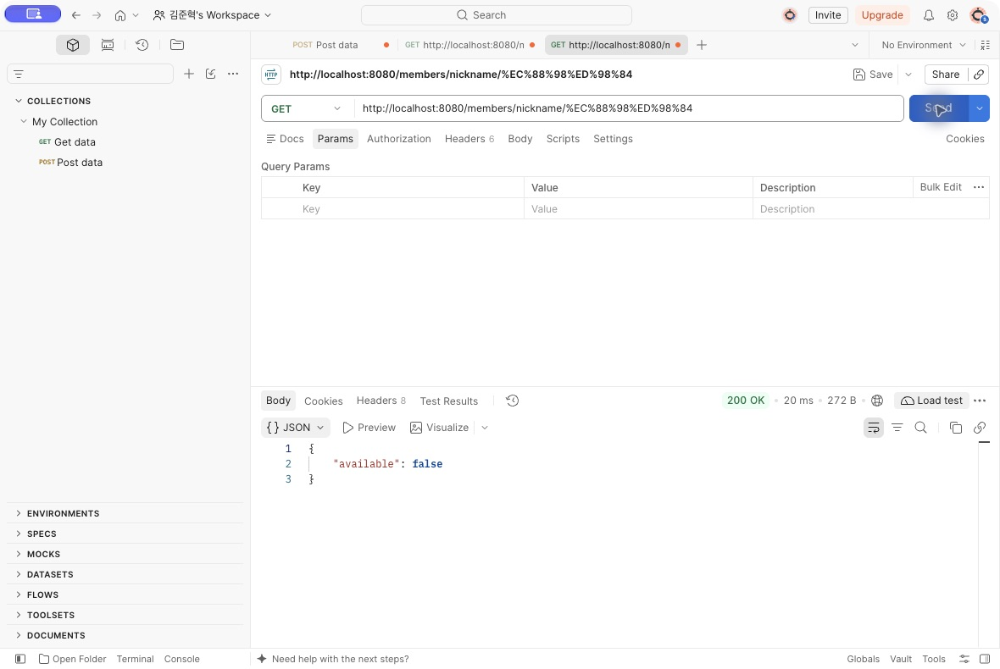
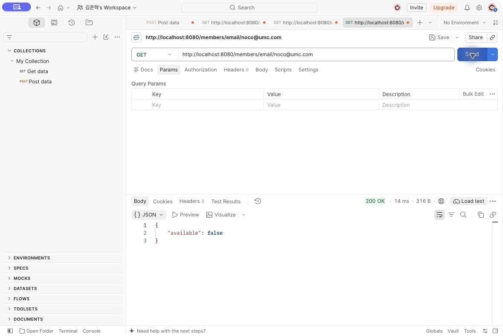
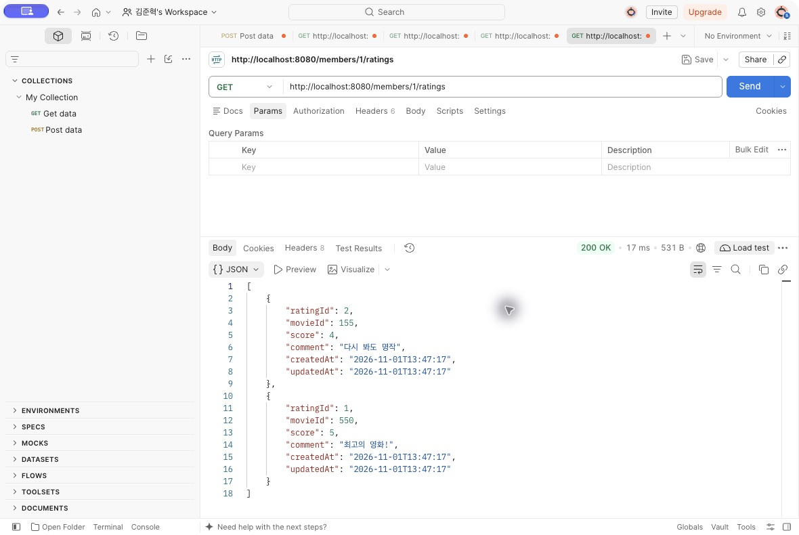
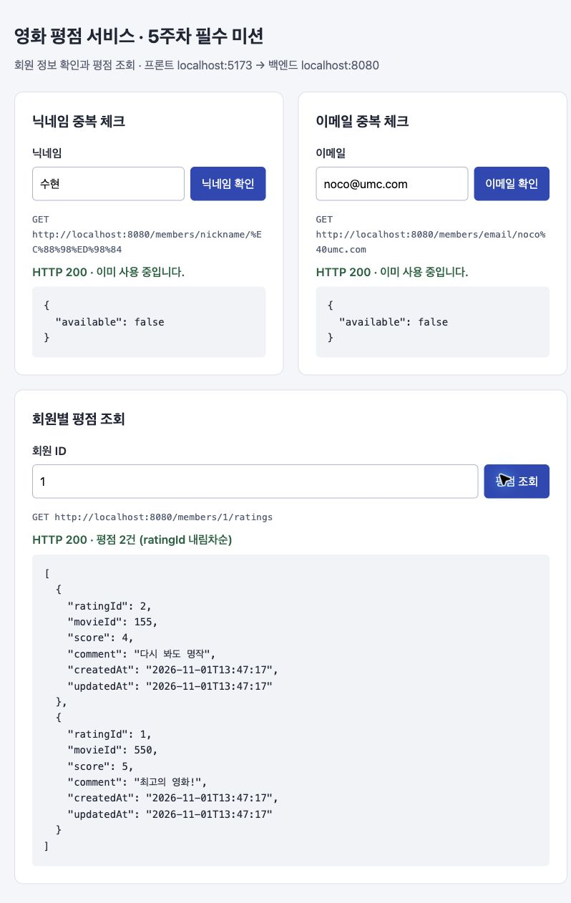
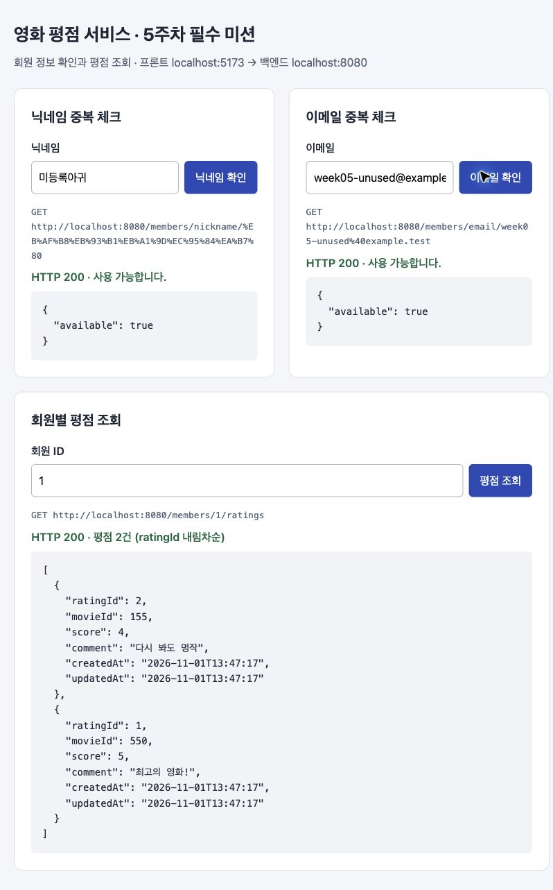
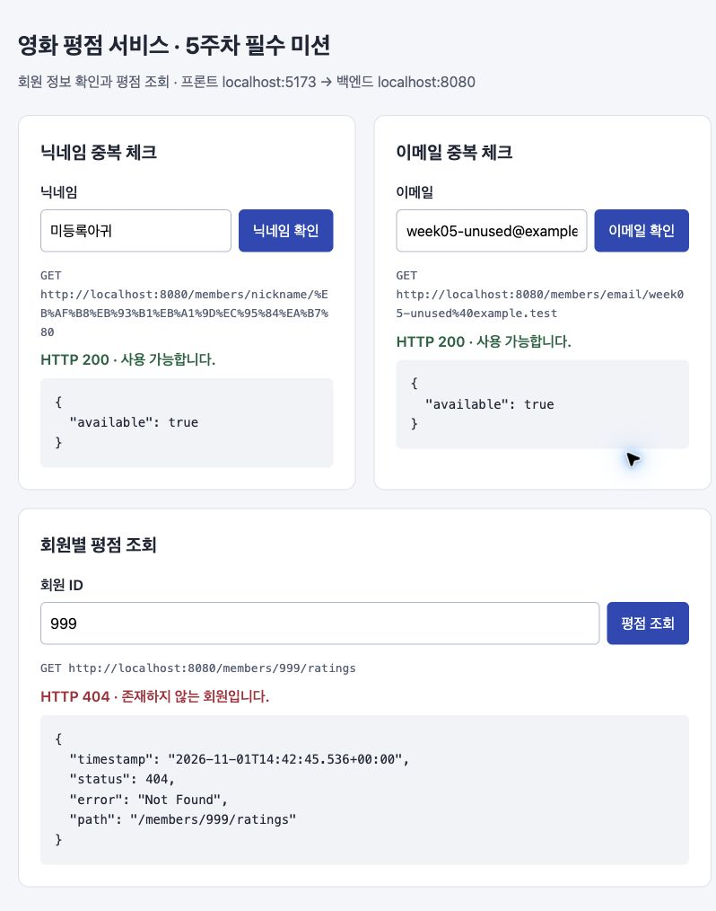
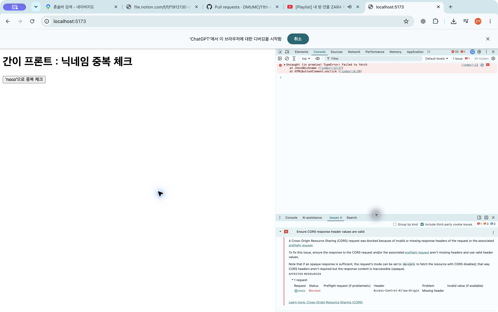

# 5주차 필수 미션 기록 — 영화 평점 서비스

- 작업 브랜치: `week05_Agui_be`
- 구현 스택: Java 21 / Spring Boot 3.5.0 / Spring Data JPA / MySQL
- 검증일: 2026-11-01 (한국 시간)
- 실행 화면: `http://localhost:5173`
- 백엔드: `http://localhost:8080`

## 미션 목표 및 구현 범위

필수 미션은 구현한 API 전체를 실제 웹 또는 앱 화면에서 호출하고 정상 응답을 캡처하는 것이다.
기존 `Agui/mock-frontend`를 직접 만든 웹 화면으로 확장해 닉네임·이메일 중복 체크와 회원별 평점 조회를 모두 연결했다.
선택 미션인 서버 입력 검증, 페이지네이션, CORS 전체 출처 허용 비교는 포함하지 않았다.

## 구현 과정

1. **프로젝트 준비:** 워크북의 Java 21·Spring Boot 3.5.0과 의존성을 설정했다. DB 비밀번호는 실행 환경변수로 관리하고, `ddl-auto: validate`로 매핑을 검증하도록 설정했다. DB 스키마는 사전에 생성한 것을 사용했다.
2. **엔티티와 Repository:** `BaseTimeEntity`로 생성·수정 시각을 공통 관리했다. `Member`, `Rating`을 매핑하고 회원과 영화 조합의 중복 평점을 UNIQUE 제약으로 방지했다. Repository의 쿼리 메서드로 존재 여부와 회원별 평점을 조회했다.
3. **DTO와 API:** 중복 체크는 `available`을 반환하고, 평점 조회는 `RatingResponse` 배열을 반환하도록 작성했다. 존재하지 않는 회원은 404를 응답하도록 처리했다.
4. **CORS 전후 확인:** 간이 프론트에서 CORS 헤더 누락으로 요청이 차단되는 것을 확인했다. `WebConfig`에 `http://localhost:5173`을 허용하고 서버를 재시작한 뒤 정상 JSON 응답을 확인했다.
5. **필수 미션 웹 화면:** 닉네임·이메일·회원 ID 입력창과 요청 버튼을 만들었다. 각 영역에 요청 URL, HTTP 상태, 결과 안내, 실제 JSON을 표시했다. 요청 중 버튼을 비활성화하고 오류 시 이전 결과 대신 오류 응답을 표시했다.
6. **인증:** 실제 MySQL을 사용하는 서버에 대해 Postman CLI 검증을 실행하고, Postman 앱과 웹 화면에서 직접 요청한 결과를 캡처했다. 검증 과정에서 DB 데이터를 추가하거나 변경하지 않았다.

## API 명세와 실제 검증 결과

| 기능 | Method / URL | 검증한 입력 | 실제 응답 |
| --- | --- | --- | --- |
| 닉네임 중복 | `GET /members/nickname/{nickname}` | `수현` | 200, `{"available":false}` |
| 닉네임 사용 가능 | 동일 | `미등록아귀` | 200, `{"available":true}` |
| 이메일 중복 | `GET /members/email/{email}` | `noco@umc.com` | 200, `{"available":false}` |
| 이메일 사용 가능 | 동일 | `week05-unused@example.test` | 200, `{"available":true}` |
| 회원별 평점 | `GET /members/{memberId}/ratings` | `1` | 200, 평점 2건, `ratingId` 2 → 1 |
| 없는 회원 | 동일 | `999` | 404, 웹에 존재하지 않는 회원 안내 |

평점은 TMDB 영화 ID 155(4점), 550(5점) 순서로 반환되었다.
응답 필드는 `ratingId`, `movieId`, `score`, `comment`, `createdAt`, `updatedAt`이며 회원의 비밀번호 등 엔티티의 다른 정보는 반환하지 않는다.
닉네임·이메일 중복 체크와 평점 조회의 정상·404 응답에서 CORS 허용 헤더도 확인했다.

## Postman 인증

각 캡처에 요청 URL, HTTP 200 상태, 실제 응답 JSON이 함께 표시되어 있다.
한글 닉네임 `수현`은 URL에서 `%EC%88%98%ED%98%84`로 인코딩된다.

### 닉네임 중복 체크



### 이메일 중복 체크



### 회원별 평점 조회



## 실제 웹 화면 인증

정적 결과를 표시한 것이 아니라 웹 화면의 버튼에서 `fetch`로 실제 Spring Boot API를 호출한 결과다.

### API 3개 정상 연결



### 미등록 닉네임·이메일 사용 가능



### 존재하지 않는 회원 오류 처리



## 트러블슈팅

**이슈:** 프론트에서 API 호출 시 `Failed to fetch`가 발생했다.

**문제:** 프론트의 `localhost:5173`과 백엔드의 `localhost:8080`은 포트가 달라 서로 다른 출처다. Chrome Issues 패널에서 요청 상태 `Blocked`, 헤더 `Access-Control-Allow-Origin`, 문제 `Missing header`를 확인했다. 일반적인 `Failed to fetch` 메시지만으로 원인을 단정하지 않고 CORS 상세 진단을 확인했다.

**해결:** `WebConfig`에 허용 출처 `http://localhost:5173`과 허용 메서드를 등록하고 서버를 재시작했다. 이후 동일 출처의 웹 화면에서 JSON을 정상적으로 읽을 수 있었고, 허용 헤더도 Postman으로 검증했다.



설정 후 결과는 위의 웹 API 3개 정상 응답 캡처에 기록했다.

## 검증 자료 및 재실행

- [실행 가능한 Postman 컬렉션](postman/collections/week05/.resources/definition.yaml)
- [실제 Postman CLI 검증 로그](postman/reports/week05-run.txt)
- 결과: **요청 6개, 검증 항목 20개 통과, 실패 0개, 종료 코드 0**
- 컬렉션 형식 검사: 오류 0개, 경고 0개
- 웹 JavaScript 구문 검사 통과
- 기존 백엔드의 Java 21 컴파일 및 테스트 코드 컴파일 통과

백엔드와 MySQL이 실행 중인 상태에서 `Agui/movie` 폴더를 기준으로 실행한다.

```sh
postman collection lint postman/collections/week05
postman collection run postman/collections/week05 --no-report-events --timeout-request 10000
```

웹은 `Agui/mock-frontend` 폴더에서 실행한다.

```sh
npx serve -l 5173
```

컬렉션의 기대값은 워크북 시드 데이터 기준이다. 시드 데이터를 변경하면 검증 기대값도 확인해야 한다.
평점이 없는 기존 회원의 빈 배열 표시와 통신 실패 안내는 구현했으나, 이번 실제 서버 검증은 위 표의 6개 사례를 대상으로 했다.

## 핵심 코드

아래는 이번 실습에서 작성한 실제 코드다. 전체 웹 코드는 [index.html](../mock-frontend/index.html)에 있다.


### BaseTimeEntity

[소스 파일](src/main/java/com/umc/movie/entity/BaseTimeEntity.java)

```java
package com.umc.movie.entity;

import jakarta.persistence.Column;
import jakarta.persistence.MappedSuperclass;
import lombok.Getter;
import org.hibernate.annotations.CreationTimestamp;
import org.hibernate.annotations.UpdateTimestamp;

import java.time.LocalDateTime;

@Getter
@MappedSuperclass
public abstract class BaseTimeEntity {

    @CreationTimestamp
    @Column(name = "created_at", nullable = false, updatable = false)
    private LocalDateTime createdAt;

    @UpdateTimestamp
    @Column(name = "updated_at", nullable = false)
    private LocalDateTime updatedAt;
}
```


### Member

[소스 파일](src/main/java/com/umc/movie/entity/Member.java)

```java
package com.umc.movie.entity;

import jakarta.persistence.Column;
import jakarta.persistence.Entity;
import jakarta.persistence.GeneratedValue;
import jakarta.persistence.GenerationType;
import jakarta.persistence.Id;
import jakarta.persistence.Table;
import lombok.AccessLevel;
import lombok.Getter;
import lombok.NoArgsConstructor;

@Entity
@Table(name = "member")
@Getter
@NoArgsConstructor(access = AccessLevel.PROTECTED)
public class Member extends BaseTimeEntity {

    @Id
    @GeneratedValue(strategy = GenerationType.IDENTITY)
    @Column(name = "member_id")
    private Long memberId;

    @Column(nullable = false, unique = true, length = 254)
    private String email;

    @Column(nullable = false, length = 60)
    private String password;

    @Column(nullable = false, unique = true, length = 50)
    private String nickname;

    public Member(String email, String password, String nickname) {
        this.email = email;
        this.password = password;
        this.nickname = nickname;
    }
}
```


### Rating

[소스 파일](src/main/java/com/umc/movie/entity/Rating.java)

```java
package com.umc.movie.entity;

import jakarta.persistence.Column;
import jakarta.persistence.Entity;
import jakarta.persistence.FetchType;
import jakarta.persistence.GeneratedValue;
import jakarta.persistence.GenerationType;
import jakarta.persistence.Id;
import jakarta.persistence.JoinColumn;
import jakarta.persistence.ManyToOne;
import jakarta.persistence.Table;
import jakarta.persistence.UniqueConstraint;
import lombok.AccessLevel;
import lombok.Getter;
import lombok.NoArgsConstructor;

@Entity
@Table(name = "rating", uniqueConstraints = @UniqueConstraint(columnNames = {"member_id", "movie_id"}))
@Getter
@NoArgsConstructor(access = AccessLevel.PROTECTED)
public class Rating extends BaseTimeEntity {

    @Id
    @GeneratedValue(strategy = GenerationType.IDENTITY)
    @Column(name = "rating_id")
    private Long ratingId;

    @ManyToOne(fetch = FetchType.LAZY)
    @JoinColumn(name = "member_id", nullable = false)
    private Member member;

    @Column(name = "movie_id", nullable = false)
    private Long movieId;

    @Column(nullable = false, columnDefinition = "TINYINT")
    private Integer score;

    @Column(columnDefinition = "TEXT")
    private String comment;
}
```


### MemberRepository

[소스 파일](src/main/java/com/umc/movie/repository/MemberRepository.java)

```java
package com.umc.movie.repository;

import com.umc.movie.entity.Member;
import org.springframework.data.jpa.repository.JpaRepository;

public interface MemberRepository extends JpaRepository<Member, Long> {
    boolean existsByNickname(String nickname);
    boolean existsByEmail(String email);
}
```


### RatingRepository

[소스 파일](src/main/java/com/umc/movie/repository/RatingRepository.java)

```java
package com.umc.movie.repository;

import com.umc.movie.entity.Rating;
import org.springframework.data.jpa.repository.JpaRepository;

import java.util.List;

public interface RatingRepository extends JpaRepository<Rating, Long> {
    List<Rating> findByMember_MemberIdOrderByRatingIdDesc(Long memberId);
}
```


### NicknameCheckResponse

[소스 파일](src/main/java/com/umc/movie/dto/NicknameCheckResponse.java)

```java
package com.umc.movie.dto;

public record NicknameCheckResponse(boolean available) {}
```


### EmailCheckResponse

[소스 파일](src/main/java/com/umc/movie/dto/EmailCheckResponse.java)

```java
package com.umc.movie.dto;

public record EmailCheckResponse(boolean available) {}
```


### RatingResponse

[소스 파일](src/main/java/com/umc/movie/dto/RatingResponse.java)

```java
package com.umc.movie.dto;

import com.umc.movie.entity.Rating;

import java.time.LocalDateTime;

public record RatingResponse(
        Long ratingId,
        Long movieId,
        Integer score,
        String comment,
        LocalDateTime createdAt,
        LocalDateTime updatedAt
) {
    public static RatingResponse from(Rating rating) {
        return new RatingResponse(
                rating.getRatingId(),
                rating.getMovieId(),
                rating.getScore(),
                rating.getComment(),
                rating.getCreatedAt(),
                rating.getUpdatedAt()
        );
    }
}
```


### MemberService

[소스 파일](src/main/java/com/umc/movie/service/MemberService.java)

```java
package com.umc.movie.service;

import com.umc.movie.dto.EmailCheckResponse;
import com.umc.movie.dto.NicknameCheckResponse;
import com.umc.movie.repository.MemberRepository;
import lombok.RequiredArgsConstructor;
import org.springframework.stereotype.Service;
import org.springframework.transaction.annotation.Transactional;

@Service
@RequiredArgsConstructor
public class MemberService {

    private final MemberRepository memberRepository;

    @Transactional(readOnly = true)
    public NicknameCheckResponse checkNickname(String nickname) {
        boolean exists = memberRepository.existsByNickname(nickname);
        return new NicknameCheckResponse(!exists);
    }

    @Transactional(readOnly = true)
    public EmailCheckResponse checkEmail(String email) {
        boolean exists = memberRepository.existsByEmail(email);
        return new EmailCheckResponse(!exists);
    }
}
```


### MemberController

[소스 파일](src/main/java/com/umc/movie/controller/MemberController.java)

```java
package com.umc.movie.controller;

import com.umc.movie.dto.EmailCheckResponse;
import com.umc.movie.dto.NicknameCheckResponse;
import com.umc.movie.service.MemberService;
import lombok.RequiredArgsConstructor;
import org.springframework.web.bind.annotation.GetMapping;
import org.springframework.web.bind.annotation.PathVariable;
import org.springframework.web.bind.annotation.RequestMapping;
import org.springframework.web.bind.annotation.RestController;

@RestController
@RequiredArgsConstructor
@RequestMapping("/members")
public class MemberController {

    private final MemberService memberService;

    @GetMapping("/nickname/{nickname}")
    public NicknameCheckResponse checkNickname(@PathVariable String nickname) {
        return memberService.checkNickname(nickname);
    }

    @GetMapping("/email/{email}")
    public EmailCheckResponse checkEmail(@PathVariable String email) {
        return memberService.checkEmail(email);
    }
}
```


### RatingService

[소스 파일](src/main/java/com/umc/movie/service/RatingService.java)

```java
package com.umc.movie.service;

import com.umc.movie.dto.RatingResponse;
import com.umc.movie.repository.RatingRepository;
import com.umc.movie.repository.MemberRepository;
import lombok.RequiredArgsConstructor;
import org.springframework.http.HttpStatus;
import org.springframework.stereotype.Service;
import org.springframework.transaction.annotation.Transactional;
import org.springframework.web.server.ResponseStatusException;

import java.util.List;

@Service
@RequiredArgsConstructor
public class RatingService {

    private final RatingRepository ratingRepository;
    private final MemberRepository memberRepository;

    @Transactional(readOnly = true)
    public List<RatingResponse> getRatingsByMember(Long memberId) {
        if (!memberRepository.existsById(memberId)) {
            throw new ResponseStatusException(HttpStatus.NOT_FOUND, "존재하지 않는 유저입니다.");
        }

        return ratingRepository.findByMember_MemberIdOrderByRatingIdDesc(memberId).stream()
                .map(RatingResponse::from)
                .toList();
    }
}
```


### RatingController

[소스 파일](src/main/java/com/umc/movie/controller/RatingController.java)

```java
package com.umc.movie.controller;

import com.umc.movie.dto.RatingResponse;
import com.umc.movie.service.RatingService;
import lombok.RequiredArgsConstructor;
import org.springframework.web.bind.annotation.GetMapping;
import org.springframework.web.bind.annotation.PathVariable;
import org.springframework.web.bind.annotation.RequestMapping;
import org.springframework.web.bind.annotation.RestController;

import java.util.List;

@RestController
@RequiredArgsConstructor
@RequestMapping("/members")
public class RatingController {

    private final RatingService ratingService;

    @GetMapping("/{memberId}/ratings")
    public List<RatingResponse> getMemberRatings(@PathVariable Long memberId) {
        return ratingService.getRatingsByMember(memberId);
    }
}
```


### WebConfig

[소스 파일](src/main/java/com/umc/movie/config/WebConfig.java)

```java
package com.umc.movie.config;

import org.springframework.context.annotation.Configuration;
import org.springframework.web.servlet.config.annotation.CorsRegistry;
import org.springframework.web.servlet.config.annotation.WebMvcConfigurer;

@Configuration
public class WebConfig implements WebMvcConfigurer {

    @Override
    public void addCorsMappings(CorsRegistry registry) {
        registry.addMapping("/**")
                .allowedOrigins("http://localhost:5173")
                .allowedMethods("GET", "POST", "PATCH", "DELETE")
                .allowedHeaders("*");
    }
}
```


## 필수 미션 완료 체크

- [x] Entity, DTO, Controller/Service 등 핵심 코드 작성 및 기록
- [x] 구현한 API 3개를 직접 만든 웹 화면에 모두 연결
- [x] Postman 요청 URL과 응답 JSON 캡처 3장
- [x] 웹 화면의 실제 서버 정상 응답 캡처
- [x] 중복·미등록 입력과 없는 회원의 404 확인
- [x] CORS 설정 전 오류 및 설정 후 성공 기록
- [x] 중간 구현 과정과 트러블슈팅 기록

이 문서와 캡처를 개인 Notion 미션 기록에 옮긴 뒤, 해당 Notion 페이지 URL을 제출한다.
Notion 편집·외부 제출·Git 커밋 및 푸시는 이번 작업에서 수행하지 않았다.
