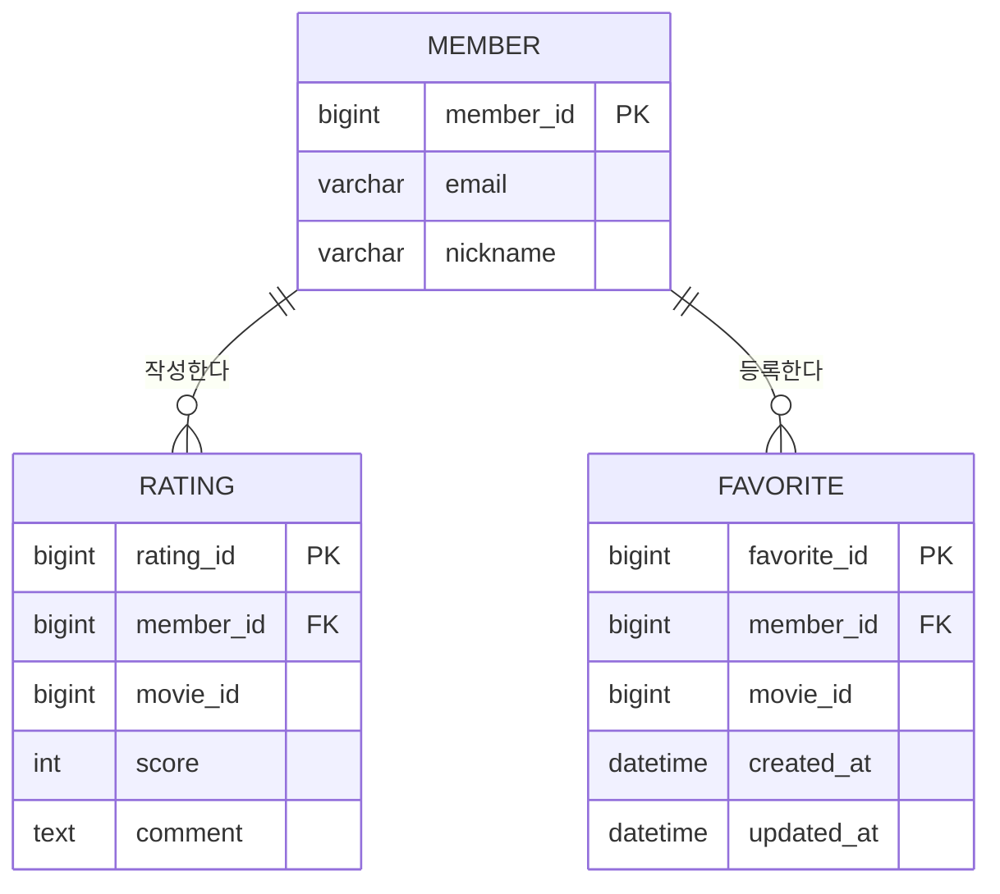
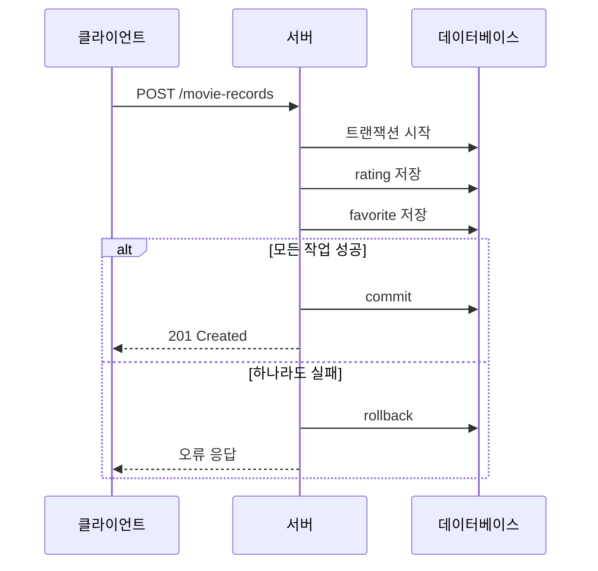

# ❗ 학습 목표

---

1. 즐겨찾기처럼 로그인한 회원의 데이터를 저장하고 조회할 수 있다.
2. 하나의 요청에서 여러 데이터가 함께 바뀔 때 트랜잭션이 필요한 이유를 설명할 수 있다.
3. 트랜잭션 안에서는 모든 작업이 성공하거나, 모두 취소되어야 함을 이해할 수 있다.
4. 데이터베이스의 UNIQUE 제약과 서버의 사전 검사가 각각 왜 필요한지 설명할 수 있다.
5. 토큰에서 꺼낸 회원 정보로 내 즐겨찾기만 다룰 수 있다.

# 📸 잠깐 ! 스터디 인증샷은 찍으셨나요?📸

---

* 스터디리더께서 대표로 매 주차마다 한 장 남겨주시면 좋겠습니다!🙆💗
  (사진을 저장해서 이미지 임베드를 하셔도 좋고, 복사+붙여넣기 해서 넣어주셔도 좋습니다!)

[]()

# ✨ 8주차 주제

---

지난주에는 로그인한 회원을 토큰으로 구분했습니다.

이제 평점을 등록할 때 `memberId`를 요청으로 보내지 않아도, 서버가 토큰에서 “누가 요청했는지” 알아낼 수 있게 되었어요. 이 덕분에 다른 사람의 데이터를 내 것처럼 바꾸는 일을 막을 수 있었습니다.

이번 주에는 영화 서비스에서 자주 쓰이는 **즐겨찾기** 기능을 완성해 봅니다.

사용자는 마음에 드는 영화를 보관하고, 나중에 내 목록에서 다시 찾을 수 있어야 해요. 영화 자체의 정보는 TMDB가 제공하므로, 우리 서버는 TMDB 영화 ID와 회원의 관계만 저장합니다.

그런데 실제 서비스의 요청은 한 테이블만 바꾸고 끝나지 않을 때가 많습니다.

예를 들어 영화를 본 뒤 평점을 남기면서 동시에 즐겨찾기에 넣을 수 있어요. 둘 중 하나만 저장되면 사용자가 의도한 기록과 달라집니다. 이런 상황에서 여러 작업을 하나의 묶음으로 다루는 방법이 **트랜잭션**입니다.

이번 주에는 즐겨찾기 등록/목록 조회/단건 여부 조회/해제를 만들고, 마지막에 평점과 즐겨찾기를 함께 저장하는 작은 “영화 기록” API를 추가합니다.

이 API는 서비스의 기본 기능을 확장하는 학습용 엔드포인트이며, 트랜잭션이 지켜 주는 약속을 코드로 확인하기 위한 장치입니다.

# 📑 8주차 본문 들어가기 전

---

## 1. 8주차에 만들 API 명세

7주차부터 회원은 URL이나 요청 바디가 아니라 `Authorization` 헤더의 토큰으로 식별합니다. 따라서 아래 API 어디에도 `memberId`를 보내지 않습니다.

| API | Method | URL | 요청 | 성공 응답 |
| --- | --- | --- | --- | --- |
| 즐겨찾기 등록 | POST | `/favorites` | Body: `movieId` | 201 Created |
| 내 즐겨찾기 조회 | GET | `/favorites` | Header: `Authorization` | 200 OK |
| 특정 영화 즐겨찾기 여부 조회 | GET | `/favorites/{movieId}` | Header: `Authorization` | 200 OK |
| 즐겨찾기 해제 | DELETE | `/favorites/{movieId}` | Header: `Authorization` | 200 OK |
| 영화 기록 저장 | POST | `/movie-records` | Body: `movieId`, `score`, `comment`, `addToFavorites` | 201 Created |

즐겨찾기 해제에는 `DELETE`를 사용합니다. `favorite`라는 자원을 없애는 요청이기 때문이에요. 7주차의 평점 삭제와 같은 방식이며, 삭제 성공 시에도 공통 응답 형식을 유지하기 위해 상태 코드는 `200`과 `result: null`을 사용합니다.

`POST /movie-records`는 평점과 즐겨찾기를 동시에 저장하는 학습용 API입니다. 프론트 화면에서 반드시 바로 사용할 API라기보다, 한 요청에 여러 저장 작업이 있을 때 트랜잭션을 어떻게 설계하는지 배우기 위한 실습입니다.

`GET /favorites/{movieId}`는 로그인한 회원이 해당 영화를 즐겨찾기했는지 확인합니다. 영화 상세 화면을 열 때 버튼을 채운 상태로 보여 줄지 결정할 때 사용할 수 있어요. 즐겨찾기하지 않았더라도 오류가 아니라 정상 상태이므로 `200 OK`와 `isFavorite: false`를 돌려줍니다.

### 성공 응답의 공통 형태

```json
{
  "isSuccess": true,
  "code": "COMMON201",
  "message": "즐겨찾기를 등록했습니다.",
  "result": {
    "favoriteId": 1,
    "movieId": 550,
    "createdAt": "2026-09-06T21:00:00"
  }
}
```

### 이번 주에 추가되는 실패 코드

| code | 상태 | 언제 |
| --- | --- | --- |
| `FAVORITE404_1` | 404 | 해제하려는 즐겨찾기를 찾을 수 없음 |
| `FAVORITE409_1` | 409 | 이미 같은 영화를 즐겨찾기함 |

`RATING409_1`은 7주차에서 만든 코드 그대로 사용합니다. 영화 기록 저장 중 이미 남긴 평점을 다시 저장하려 할 때도 같은 의미이므로 새로운 코드를 만들 필요가 없습니다.

## 2. 이번 주에 만날 테이블

5주차에 SQL로 만들어 둔 `favorite` 테이블을 이제 엔티티 코드로 연결합니다. `movie_id`는 TMDB가 부여한 숫자 ID입니다. 우리 데이터베이스에 `movie` 테이블은 없으므로 외래 키가 아닙니다.



`favorite`에는 `(member_id, movie_id)` 복합 UNIQUE 제약이 있습니다. 같은 회원이 같은 영화를 두 번 즐겨찾기하는 일을 데이터베이스도 막아 줍니다.

`movie_id`만 UNIQUE라면 한 영화가 서비스 전체에서 한 번만 즐겨찾기될 수 있으니, 반드시 두 값을 한 쌍으로 묶어야 합니다.

## 3. 트랜잭션이 필요한 순간

온라인 쇼핑몰에서 카드 결제와 주문 생성은 함께 성공해야 합니다. 결제만 되고 주문이 없거나, 주문만 생기고 결제가 안 되면 곤란하겠죠. 트랜잭션은 이렇게 **한 덩어리로 움직여야 하는 작업을 묶는 봉투**라고 생각하면 됩니다.

영화 기록 저장도 같습니다. 사용자가 “이 영화에 5점을 주고 즐겨찾기에도 넣기”를 선택했다면, 평점과 즐겨찾기가 모두 저장되어야 합니다. 중간에 하나가 실패했다면 먼저 저장한 것도 되돌려야 해요.



`commit`은 봉투를 최종 제출하는 일이고, `rollback`은 봉투 안의 작업을 처음 상태로 되돌리는 일입니다. 트랜잭션은 오류를 없애 주는 기능이 아닙니다. 오류가 생겼을 때 데이터가 어중간한 상태로 남지 않게 해 주는 기능이에요.

# 🔖 8주차 본문

---

준비가 끝났습니다. 먼저 즐겨찾기 데이터를 표현할 엔티티와 DTO를 만들고, 즐겨찾기 CRUD를 완성해 봅시다. 그다음 지난주 평점 기능과 이번 주 즐겨찾기를 연결해 트랜잭션을 적용합니다.

## 1. 즐겨찾기는 영화 자체가 아니라 회원과 영화의 관계입니다

즐겨찾기는 영화의 속성이 아닙니다. 어떤 회원에게는 좋아하는 영화여도, 다른 회원에게는 아닐 수 있어요. 그래서 `Favorite`에는 `Member`와 `movieId`가 함께 들어갑니다.

영화를 좋아한다고 누르는 행위는 간단해 보여도, 서버 입장에서는 “로그인한 회원이 이 TMDB 영화 ID를 보관한다”는 관계를 저장하는 일입니다. 토큰에서 얻은 회원과 요청 바디의 영화 ID를 합쳐 한 행으로 만드는 거예요.

## 2. [실습 1] Favorite 엔티티와 DTO 만들기

`Favorite`도 `Member`, `Rating`처럼 생성/수정 시각이 필요합니다. 시간 컬럼을 다시 선언하지 말고, 5주차부터 사용한 `BaseTimeEntity`를 상속합니다.

- **🍃 Spring Boot**

  `Favorite` 엔티티와 Repository, 요청/응답 DTO를 만듭니다.

    ```java
    // src/main/java/com/umc/movie/entity/Favorite.java
    package com.umc.movie.entity;
    
    import jakarta.persistence.Column;
    import jakarta.persistence.Entity;
    import jakarta.persistence.FetchType;
    import jakarta.persistence.GeneratedValue;
    import jakarta.persistence.GenerationType;
    import jakarta.persistence.Id;
    import jakarta.persistence.JoinColumn;
    import jakarta.persistence.ManyToOne;
    import jakarta.persistence.Table;
    import jakarta.persistence.UniqueConstraint;
    import lombok.AccessLevel;
    import lombok.Builder;
    import lombok.Getter;
    import lombok.NoArgsConstructor;
    
    @Entity
    @Table(
            name = "favorite",
            uniqueConstraints = @UniqueConstraint(columnNames = {"member_id", "movie_id"})
    )
    @Getter
    @NoArgsConstructor(access = AccessLevel.PROTECTED)
    public class Favorite extends BaseTimeEntity {
    
        @Id
        @GeneratedValue(strategy = GenerationType.IDENTITY)
        @Column(name = "favorite_id")
        private Long favoriteId;
    
        // 즐겨찾기의 주인은 로그인한 회원입니다.
        @ManyToOne(fetch = FetchType.LAZY)
        @JoinColumn(name = "member_id", nullable = false)
        private Member member;
    
        // TMDB의 영화 ID를 그대로 저장합니다. 우리 DB의 외래 키는 아닙니다.
        @Column(name = "movie_id", nullable = false)
        private Long movieId;
    
        @Builder
        public Favorite(Member member, Long movieId) {
            this.member = member;
            this.movieId = movieId;
        }
    }
    ```

    ```java
    // src/main/java/com/umc/movie/repository/FavoriteRepository.java
    package com.umc.movie.repository;
    
    import com.umc.movie.entity.Favorite;
    import org.springframework.data.jpa.repository.JpaRepository;
    
    import java.util.List;
    import java.util.Optional;
    
    public interface FavoriteRepository extends JpaRepository<Favorite, Long> {
    
        List<Favorite> findByMember_MemberIdOrderByFavoriteIdDesc(Long memberId);
    
        Optional<Favorite> findByMember_MemberIdAndMovieId(Long memberId, Long movieId);
    
        boolean existsByMember_MemberIdAndMovieId(Long memberId, Long movieId);
    }
    ```

    ```java
    // src/main/java/com/umc/movie/dto/CreateFavoriteRequest.java
    package com.umc.movie.dto;
    
    import jakarta.validation.constraints.NotNull;
    import jakarta.validation.constraints.Positive;
    
    public record CreateFavoriteRequest(
            @NotNull(message = "영화 ID는 필수입니다.")
            @Positive(message = "영화 ID는 양수여야 합니다.")
            Long movieId
    ) {
    }
    ```

    ```java
    // src/main/java/com/umc/movie/dto/FavoriteResponse.java
    package com.umc.movie.dto;
    
    import com.umc.movie.entity.Favorite;
    
    import java.time.LocalDateTime;
    
    public record FavoriteResponse(
            Long favoriteId,
            Long movieId,
            LocalDateTime createdAt
    ) {
        public static FavoriteResponse from(Favorite favorite) {
            return new FavoriteResponse(
                    favorite.getFavoriteId(),
                    favorite.getMovieId(),
                    favorite.getCreatedAt()
            );
        }
    }
    ```

    ```java
    // src/main/java/com/umc/movie/dto/FavoriteStatusResponse.java
    package com.umc.movie.dto;
    
    public record FavoriteStatusResponse(
            boolean isFavorite
    ) {
    }
    ```

- **🐱 NestJS**

  TypeORM도 추상 클래스의 컬럼 데코레이터를 상속합니다. `BaseTimeEntity`를 그대로 extends 해 주세요.

    ```tsx
    // src/entity/favorite.entity.ts
    import {
      Column,
      Entity,
      JoinColumn,
      ManyToOne,
      PrimaryGeneratedColumn,
      Unique,
    } from 'typeorm';
    import { BaseTimeEntity } from './base-time.entity';
    import { Member } from './member.entity';
    
    @Entity('favorite')
    @Unique('uk_favorite_member_movie', ['member', 'movieId'])
    export class Favorite extends BaseTimeEntity {
      @PrimaryGeneratedColumn({ name: 'favorite_id' })
      favoriteId: number;
    
      // 즐겨찾기의 주인은 로그인한 회원입니다.
      @ManyToOne(() => Member, { nullable: false })
      @JoinColumn({ name: 'member_id' })
      member: Member;
    
      // TMDB의 영화 ID를 그대로 저장합니다. 우리 DB의 외래 키는 아닙니다.
      @Column({ name: 'movie_id' })
      movieId: number;
    }
    ```

    ```tsx
    // src/dto/create-favorite.dto.ts
    import { IsInt, IsNotEmpty, IsPositive } from 'class-validator';
    
    export class CreateFavoriteDto {
      @IsNotEmpty({ message: '영화 ID는 필수입니다.' })
      @IsInt({ message: '영화 ID는 정수여야 합니다.' })
      @IsPositive({ message: '영화 ID는 양수여야 합니다.' })
      movieId: number;
    }
    ```

    ```tsx
    // src/dto/favorite-response.dto.ts
    import { Favorite } from '../entity/favorite.entity';
    
    export class FavoriteResponseDto {
      favoriteId: number;
      movieId: number;
      createdAt: Date;
    
      static from(favorite: Favorite): FavoriteResponseDto {
        return {
          favoriteId: favorite.favoriteId,
          movieId: favorite.movieId,
          createdAt: favorite.createdAt,
        };
      }
    }
    ```

    ```tsx
    // src/dto/favorite-status-response.dto.ts
    export class FavoriteStatusResponseDto {
      isFavorite: boolean;
    
      static from(isFavorite: boolean): FavoriteStatusResponseDto {
        return { isFavorite };
      }
    }
    ```


## 3. [실습 2] 즐겨찾기 등록과 조회 API 만들기 (`POST /favorites`, `GET /favorites`)

등록 전에는 같은 영화를 이미 즐겨찾기했는지 먼저 검사합니다.

사용자에게 `FAVORITE409_1`이라는 명확한 오류를 보여 주기 위해서예요. 그래도 데이터베이스의 UNIQUE 제약은 남겨 둡니다. 서버의 사전 검사는 친절한 오류 메시지를 위한 것이고, DB 제약은 동시 요청까지 포함해 데이터 자체를 지키는 마지막 안전망입니다.

- **🍃 Spring Boot**

    ```java
    // src/main/java/com/umc/movie/service/FavoriteService.java
    package com.umc.movie.service;
    
    import com.umc.movie.dto.CreateFavoriteRequest;
    import com.umc.movie.dto.FavoriteResponse;
    import com.umc.movie.dto.FavoriteStatusResponse;
    import com.umc.movie.entity.Favorite;
    import com.umc.movie.entity.Member;
    import com.umc.movie.exception.ApiException;
    import com.umc.movie.repository.FavoriteRepository;
    import com.umc.movie.repository.MemberRepository;
    import lombok.RequiredArgsConstructor;
    import org.springframework.http.HttpStatus;
    import org.springframework.stereotype.Service;
    import org.springframework.transaction.annotation.Transactional;
    
    import java.util.List;
    
    @Service
    @RequiredArgsConstructor
    public class FavoriteService {
    
        private final FavoriteRepository favoriteRepository;
        private final MemberRepository memberRepository;
    
        @Transactional
        public FavoriteResponse create(Long memberId, CreateFavoriteRequest request) {
            Member member = memberRepository.findById(memberId)
                    .orElseThrow(() -> new ApiException(HttpStatus.NOT_FOUND, "MEMBER404_1",
                            "해당 회원을 찾을 수 없습니다."));
    
            if (favoriteRepository.existsByMember_MemberIdAndMovieId(memberId, request.movieId())) {
                throw new ApiException(HttpStatus.CONFLICT, "FAVORITE409_1",
                        "이미 이 영화를 즐겨찾기하셨습니다.");
            }
    
            Favorite favorite = Favorite.builder()
                    .member(member)
                    .movieId(request.movieId())
                    .build();
    
            return FavoriteResponse.from(favoriteRepository.save(favorite));
        }
    
        @Transactional(readOnly = true)
        public List<FavoriteResponse> getMyFavorites(Long memberId) {
            return favoriteRepository.findByMember_MemberIdOrderByFavoriteIdDesc(memberId).stream()
                    .map(FavoriteResponse::from)
                    .toList();
        }
    
        @Transactional(readOnly = true)
        public FavoriteStatusResponse getStatus(Long memberId, Long movieId) {
            boolean isFavorite = favoriteRepository.existsByMember_MemberIdAndMovieId(memberId, movieId);
            return new FavoriteStatusResponse(isFavorite);
        }
    
        @Transactional
        public void delete(Long memberId, Long movieId) {
            Favorite favorite = favoriteRepository.findByMember_MemberIdAndMovieId(memberId, movieId)
                    .orElseThrow(() -> new ApiException(HttpStatus.NOT_FOUND, "FAVORITE404_1",
                            "즐겨찾기한 영화를 찾을 수 없습니다."));
    
            favoriteRepository.delete(favorite);
        }
    }
    ```

    ```java
    // src/main/java/com/umc/movie/controller/FavoriteController.java
    package com.umc.movie.controller;
    
    import com.umc.movie.dto.ApiResponse;
    import com.umc.movie.dto.CreateFavoriteRequest;
    import com.umc.movie.dto.FavoriteResponse;
    import com.umc.movie.dto.FavoriteStatusResponse;
    import com.umc.movie.interceptor.AuthInterceptor;
    import com.umc.movie.service.FavoriteService;
    import jakarta.validation.Valid;
    import lombok.RequiredArgsConstructor;
    import org.springframework.http.ResponseEntity;
    import org.springframework.web.bind.annotation.DeleteMapping;
    import org.springframework.web.bind.annotation.GetMapping;
    import org.springframework.web.bind.annotation.PathVariable;
    import org.springframework.web.bind.annotation.PostMapping;
    import org.springframework.web.bind.annotation.RequestAttribute;
    import org.springframework.web.bind.annotation.RequestBody;
    import org.springframework.web.bind.annotation.RestController;
    
    import java.util.List;
    
    @RestController
    @RequiredArgsConstructor
    public class FavoriteController {
    
        private final FavoriteService favoriteService;
    
        @PostMapping("/favorites")
        public ResponseEntity<ApiResponse<FavoriteResponse>> create(
                @RequestAttribute(AuthInterceptor.MEMBER_ID) Long memberId,
                @RequestBody @Valid CreateFavoriteRequest request
        ) {
            FavoriteResponse response = favoriteService.create(memberId, request);
            return ResponseEntity.status(201)
                    .body(ApiResponse.created("즐겨찾기를 등록했습니다.", response));
        }
    
        @GetMapping("/favorites")
        public ResponseEntity<ApiResponse<List<FavoriteResponse>>> getMyFavorites(
                @RequestAttribute(AuthInterceptor.MEMBER_ID) Long memberId
        ) {
            List<FavoriteResponse> response = favoriteService.getMyFavorites(memberId);
            return ResponseEntity.ok(ApiResponse.ok("내 즐겨찾기 목록을 조회했습니다.", response));
        }
    
        @GetMapping("/favorites/{movieId}")
        public ResponseEntity<ApiResponse<FavoriteStatusResponse>> getStatus(
                @RequestAttribute(AuthInterceptor.MEMBER_ID) Long memberId,
                @PathVariable Long movieId
        ) {
            FavoriteStatusResponse response = favoriteService.getStatus(memberId, movieId);
            return ResponseEntity.ok(ApiResponse.ok("즐겨찾기 여부를 조회했습니다.", response));
        }
    
        @DeleteMapping("/favorites/{movieId}")
        public ResponseEntity<ApiResponse<Void>> delete(
                @RequestAttribute(AuthInterceptor.MEMBER_ID) Long memberId,
                @PathVariable Long movieId
        ) {
            favoriteService.delete(memberId, movieId);
            return ResponseEntity.ok(ApiResponse.ok("즐겨찾기를 해제했습니다.", null));
        }
    }
    ```

- **🐱 NestJS**

  `Favorite`를 TypeORM에 등록하고, Controller와 Service도 `AppModule`에 등록합니다. 이 프로젝트는 도메인 모듈을 만들지 않고 `AppModule` 하나에서 관리합니다.

    ```tsx
    // src/service/favorite.service.ts
    import { HttpStatus, Injectable } from '@nestjs/common';
    import { InjectRepository } from '@nestjs/typeorm';
    import { Repository } from 'typeorm';
    import { CreateFavoriteDto } from '../dto/create-favorite.dto';
    import { FavoriteResponseDto } from '../dto/favorite-response.dto';
    import { FavoriteStatusResponseDto } from '../dto/favorite-status-response.dto';
    import { Favorite } from '../entity/favorite.entity';
    import { Member } from '../entity/member.entity';
    import { ApiException } from '../exception/api.exception';
    
    @Injectable()
    export class FavoriteService {
      constructor(
        @InjectRepository(Favorite)
        private readonly favoriteRepository: Repository<Favorite>,
        @InjectRepository(Member)
        private readonly memberRepository: Repository<Member>,
      ) {}
    
      async create(memberId: number, dto: CreateFavoriteDto): Promise<FavoriteResponseDto> {
        const member = await this.memberRepository.findOneBy({ memberId });
        if (!member) {
          throw new ApiException(
            HttpStatus.NOT_FOUND,
            'MEMBER404_1',
            '해당 회원을 찾을 수 없습니다.',
          );
        }
    
        const existing = await this.favoriteRepository.findOne({
          where: { member: { memberId }, movieId: dto.movieId },
        });
        if (existing) {
          throw new ApiException(
            HttpStatus.CONFLICT,
            'FAVORITE409_1',
            '이미 이 영화를 즐겨찾기하셨습니다.',
          );
        }
    
        const saved = await this.favoriteRepository.save(
          this.favoriteRepository.create({ member, movieId: dto.movieId }),
        );
        return FavoriteResponseDto.from(saved);
      }
    
      async getMyFavorites(memberId: number): Promise<FavoriteResponseDto[]> {
        const favorites = await this.favoriteRepository.find({
          where: { member: { memberId } },
          order: { favoriteId: 'DESC' },
        });
        return favorites.map(FavoriteResponseDto.from);
      }
    
      async getStatus(
        memberId: number,
        movieId: number,
      ): Promise<FavoriteStatusResponseDto> {
        const isFavorite = await this.favoriteRepository.exists({
          where: { member: { memberId }, movieId },
        });
        return FavoriteStatusResponseDto.from(isFavorite);
      }
    
      async delete(memberId: number, movieId: number): Promise<void> {
        const favorite = await this.favoriteRepository.findOne({
          where: { member: { memberId }, movieId },
        });
        if (!favorite) {
          throw new ApiException(
            HttpStatus.NOT_FOUND,
            'FAVORITE404_1',
            '즐겨찾기한 영화를 찾을 수 없습니다.',
          );
        }
    
        await this.favoriteRepository.remove(favorite);
      }
    }
    ```

    ```tsx
    // src/controller/favorite.controller.ts
    import {
      Body,
      Controller,
      Delete,
      Get,
      HttpCode,
      HttpStatus,
      Param,
      ParseIntPipe,
      Post,
      Req,
      UseGuards,
    } from '@nestjs/common';
    import type { Request } from 'express';
    import { CreateFavoriteDto } from '../dto/create-favorite.dto';
    import { AuthGuard } from '../guard/auth.guard';
    import { FavoriteService } from '../service/favorite.service';
    
    @Controller('favorites')
    @UseGuards(AuthGuard)
    export class FavoriteController {
      constructor(private readonly favoriteService: FavoriteService) {}
    
      @Post()
      @HttpCode(HttpStatus.CREATED)
      async create(@Req() request: Request, @Body() dto: CreateFavoriteDto) {
        const memberId = request['memberId'] as number;
        const result = await this.favoriteService.create(memberId, dto);
    
        return {
          isSuccess: true,
          code: 'COMMON201',
          message: '즐겨찾기를 등록했습니다.',
          result,
        };
      }
    
      @Get()
      @HttpCode(HttpStatus.OK)
      async getMyFavorites(@Req() request: Request) {
        const memberId = request['memberId'] as number;
        const result = await this.favoriteService.getMyFavorites(memberId);
    
        return {
          isSuccess: true,
          code: 'COMMON200',
          message: '내 즐겨찾기 목록을 조회했습니다.',
          result,
        };
      }
    
      @Get(':movieId')
      @HttpCode(HttpStatus.OK)
      async getStatus(
        @Req() request: Request,
        @Param('movieId', ParseIntPipe) movieId: number,
      ) {
        const memberId = request['memberId'] as number;
        const result = await this.favoriteService.getStatus(memberId, movieId);
    
        return {
          isSuccess: true,
          code: 'COMMON200',
          message: '즐겨찾기 여부를 조회했습니다.',
          result,
        };
      }
    
      @Delete(':movieId')
      @HttpCode(HttpStatus.OK)
      async delete(
        @Req() request: Request,
        @Param('movieId', ParseIntPipe) movieId: number,
      ) {
        const memberId = request['memberId'] as number;
        await this.favoriteService.delete(memberId, movieId);
    
        return {
          isSuccess: true,
          code: 'COMMON200',
          message: '즐겨찾기를 해제했습니다.',
          result: null,
        };
      }
    }
    ```

    ```tsx
    // src/app.module.ts
    import { Module } from '@nestjs/common';
    import { ConfigModule, ConfigService } from '@nestjs/config';
    import { JwtModule } from '@nestjs/jwt';
    import { TypeOrmModule } from '@nestjs/typeorm';
    import { AuthController } from './controller/auth.controller';
    import { FavoriteController } from './controller/favorite.controller';
    import { MemberController } from './controller/member.controller';
    import { MovieRecordController } from './controller/movie-record.controller';
    import { RatingController } from './controller/rating.controller';
    import { Favorite } from './entity/favorite.entity';
    import { Member } from './entity/member.entity';
    import { Rating } from './entity/rating.entity';
    import { AuthService } from './service/auth.service';
    import { FavoriteService } from './service/favorite.service';
    import { MemberService } from './service/member.service';
    import { MovieRecordService } from './service/movie-record.service';
    import { RatingService } from './service/rating.service';
    
    @Module({
      imports: [
        ConfigModule.forRoot({ isGlobal: true }),
        TypeOrmModule.forRoot({
          type: 'mysql',
          host: process.env.DB_HOST,
          port: 3306,
          username: process.env.DB_USER,
          password: process.env.DB_PASSWORD,
          database: process.env.DB_NAME,
          autoLoadEntities: true,
          synchronize: false,
        }),
        TypeOrmModule.forFeature([Member, Rating, Favorite]),
        JwtModule.registerAsync({
          global: true,
          inject: [ConfigService],
          useFactory: (configService: ConfigService) => ({
            secret: configService.get<string>('JWT_SECRET'),
            signOptions: {
              expiresIn: Number(configService.get<string>('JWT_ACCESS_EXPIRATION') ?? 3600),
            },
          }),
        }),
      ],
      controllers: [
        AuthController,
        MemberController,
        RatingController,
        FavoriteController,
        MovieRecordController,
      ],
      providers: [
        AuthService,
        MemberService,
        RatingService,
        FavoriteService,
        MovieRecordService,
      ],
    })
    export class AppModule {}
    ```


### Postman으로 확인하기

먼저 7주차 로그인 API로 토큰을 발급받으세요. 아래 세 요청 모두 Headers 탭에 다음 값을 넣습니다.

```
Authorization: Bearer {로그인 응답의 accessToken}
```

1. `POST /favorites`를 호출하고 Body에 아래 JSON을 보냅니다.

    ```json
    {
      "movieId": 550
    }
    ```

2. 같은 요청을 한 번 더 보냅니다. `409`와 `FAVORITE409_1`이 와야 합니다.
3. `GET /favorites`를 호출합니다. 방금 저장한 영화가 배열에 한 개 있어야 합니다.
4. `GET /favorites/550`을 호출합니다. 아래처럼 `isFavorite: true`가 와야 합니다.

    ```json
    {
      "isSuccess": true,
      "code": "COMMON200",
      "message": "즐겨찾기 여부를 조회했습니다.",
      "result": {
        "isFavorite": true
      }
    }
    ```

5. `DELETE /favorites/550`을 호출합니다. `200`, `COMMON200`, `result: null`을 확인합니다.
6. 다시 `GET /favorites/550`을 호출합니다. `isFavorite: false`가 와야 합니다.
7. `GET /favorites`를 호출합니다. 빈 배열 `[]`이 와야 합니다.

빈 즐겨찾기 목록은 오류가 아닙니다. 아직 보관한 영화가 없다는 정상적인 상태이므로 `200 OK`와 빈 배열을 응답합니다.

## 4. [실습 3] 평점과 즐겨찾기를 함께 저장하기 (`POST /movie-records`)

이제 한 요청이 두 테이블을 바꾸는 상황을 만들어 봅시다. `addToFavorites`가 `true`이면 평점과 즐겨찾기를 같이 저장합니다. `false`이면 평점만 저장합니다.

```json
{
  "movieId": 550,
  "score": 5,
  "comment": "오랜 시간이 지나도 좋네요.",
  "addToFavorites": true
}
```

중요한 점은 `RatingService.create()`와 `FavoriteService.create()`를 연달아 부르는 방식으로 끝내지 않는 것입니다. 각각 별도의 트랜잭션으로 동작할 수 있기 때문이에요. 영화 기록이라는 한 가지 사용자 행동을 처리하는 전용 Service에서, 두 저장을 하나의 트랜잭션으로 묶습니다.

- **🍃 Spring Boot**

  Spring에서는 Service 메서드에 `@Transactional`을 붙입니다. 메서드가 정상적으로 끝나면 commit하고, 런타임 예외가 밖으로 나가면 rollback합니다.

    ```java
    // src/main/java/com/umc/movie/dto/CreateMovieRecordRequest.java
    package com.umc.movie.dto;
    
    import jakarta.validation.constraints.Max;
    import jakarta.validation.constraints.Min;
    import jakarta.validation.constraints.NotNull;
    import jakarta.validation.constraints.Positive;
    
    public record CreateMovieRecordRequest(
            @NotNull(message = "영화 ID는 필수입니다.")
            @Positive(message = "영화 ID는 양수여야 합니다.")
            Long movieId,
    
            @NotNull(message = "별점은 필수입니다.")
            @Min(value = 1, message = "별점은 1점 이상이어야 합니다.")
            @Max(value = 5, message = "별점은 5점 이하여야 합니다.")
            Integer score,
    
            String comment,
    
            @NotNull(message = "즐겨찾기 추가 여부는 필수입니다.")
            Boolean addToFavorites
    ) {
    }
    ```

    ```java
    // src/main/java/com/umc/movie/dto/MovieRecordResponse.java
    package com.umc.movie.dto;
    
    public record MovieRecordResponse(
            RatingResponse rating,
            FavoriteResponse favorite
    ) {
    }
    ```

    ```java
    // src/main/java/com/umc/movie/service/MovieRecordService.java
    package com.umc.movie.service;
    
    import com.umc.movie.dto.CreateMovieRecordRequest;
    import com.umc.movie.dto.FavoriteResponse;
    import com.umc.movie.dto.MovieRecordResponse;
    import com.umc.movie.dto.RatingResponse;
    import com.umc.movie.entity.Favorite;
    import com.umc.movie.entity.Member;
    import com.umc.movie.entity.Rating;
    import com.umc.movie.exception.ApiException;
    import com.umc.movie.repository.FavoriteRepository;
    import com.umc.movie.repository.MemberRepository;
    import com.umc.movie.repository.RatingRepository;
    import lombok.RequiredArgsConstructor;
    import org.springframework.http.HttpStatus;
    import org.springframework.stereotype.Service;
    import org.springframework.transaction.annotation.Transactional;
    
    @Service
    @RequiredArgsConstructor
    public class MovieRecordService {
    
        private final MemberRepository memberRepository;
        private final RatingRepository ratingRepository;
        private final FavoriteRepository favoriteRepository;
    
        @Transactional
        public MovieRecordResponse create(Long memberId, CreateMovieRecordRequest request) {
            Member member = memberRepository.findById(memberId)
                    .orElseThrow(() -> new ApiException(HttpStatus.NOT_FOUND, "MEMBER404_1",
                            "해당 회원을 찾을 수 없습니다."));
    
            if (ratingRepository.existsByMember_MemberIdAndMovieId(memberId, request.movieId())) {
                throw new ApiException(HttpStatus.CONFLICT, "RATING409_1",
                        "이미 이 영화에 평점을 남기셨습니다.");
            }
    
            if (request.addToFavorites()
                    && favoriteRepository.existsByMember_MemberIdAndMovieId(memberId, request.movieId())) {
                throw new ApiException(HttpStatus.CONFLICT, "FAVORITE409_1",
                        "이미 이 영화를 즐겨찾기하셨습니다.");
            }
    
            Rating rating = Rating.builder()
                    .member(member)
                    .movieId(request.movieId())
                    .score(request.score())
                    .comment(request.comment())
                    .build();
            Rating savedRating = ratingRepository.save(rating);
    
            FavoriteResponse favoriteResponse = null;
            if (request.addToFavorites()) {
                Favorite favorite = Favorite.builder()
                        .member(member)
                        .movieId(request.movieId())
                        .build();
                Favorite savedFavorite = favoriteRepository.save(favorite);
                favoriteResponse = FavoriteResponse.from(savedFavorite);
            }
    
            return new MovieRecordResponse(
                    RatingResponse.from(savedRating),
                    favoriteResponse
            );
        }
    }
    ```

    ```java
    // src/main/java/com/umc/movie/controller/MovieRecordController.java
    package com.umc.movie.controller;
    
    import com.umc.movie.dto.ApiResponse;
    import com.umc.movie.dto.CreateMovieRecordRequest;
    import com.umc.movie.dto.MovieRecordResponse;
    import com.umc.movie.interceptor.AuthInterceptor;
    import com.umc.movie.service.MovieRecordService;
    import jakarta.validation.Valid;
    import lombok.RequiredArgsConstructor;
    import org.springframework.http.ResponseEntity;
    import org.springframework.web.bind.annotation.PostMapping;
    import org.springframework.web.bind.annotation.RequestAttribute;
    import org.springframework.web.bind.annotation.RequestBody;
    import org.springframework.web.bind.annotation.RestController;
    
    @RestController
    @RequiredArgsConstructor
    public class MovieRecordController {
    
        private final MovieRecordService movieRecordService;
    
        @PostMapping("/movie-records")
        public ResponseEntity<ApiResponse<MovieRecordResponse>> create(
                @RequestAttribute(AuthInterceptor.MEMBER_ID) Long memberId,
                @RequestBody @Valid CreateMovieRecordRequest request
        ) {
            MovieRecordResponse response = movieRecordService.create(memberId, request);
            return ResponseEntity.status(201)
                    .body(ApiResponse.created("영화 기록을 저장했습니다.", response));
        }
    }
    ```

- **🐱 NestJS**

  NestJS에서는 `DataSource.transaction()`의 콜백 안에서 받은 `manager`로만 Repository를 꺼내 사용합니다. 기존에 주입받은 Repository를 콜백 안에서 섞어 쓰면 같은 트랜잭션 연결을 보장할 수 없어요.

    ```tsx
    // src/dto/create-movie-record.dto.ts
    import {
      IsBoolean,
      IsInt,
      IsNotEmpty,
      IsOptional,
      IsPositive,
      Max,
      Min,
    } from 'class-validator';
    
    export class CreateMovieRecordDto {
      @IsNotEmpty({ message: '영화 ID는 필수입니다.' })
      @IsInt({ message: '영화 ID는 정수여야 합니다.' })
      @IsPositive({ message: '영화 ID는 양수여야 합니다.' })
      movieId: number;
    
      @IsNotEmpty({ message: '별점은 필수입니다.' })
      @IsInt({ message: '별점은 정수여야 합니다.' })
      @Min(1, { message: '별점은 1점 이상이어야 합니다.' })
      @Max(5, { message: '별점은 5점 이하여야 합니다.' })
      score: number;
    
      @IsOptional()
      comment?: string;
    
      @IsBoolean({ message: '즐겨찾기 추가 여부는 true 또는 false여야 합니다.' })
      addToFavorites: boolean;
    }
    ```

    ```tsx
    // src/dto/movie-record-response.dto.ts
    import { FavoriteResponseDto } from './favorite-response.dto';
    import { RatingResponseDto } from './rating-response.dto';
    
    export class MovieRecordResponseDto {
      rating: RatingResponseDto;
      favorite: FavoriteResponseDto | null;
    
      static of(
        rating: RatingResponseDto,
        favorite: FavoriteResponseDto | null,
      ): MovieRecordResponseDto {
        return { rating, favorite };
      }
    }
    ```

    ```tsx
    // src/service/movie-record.service.ts
    import { HttpStatus, Injectable } from '@nestjs/common';
    import { DataSource } from 'typeorm';
    import { CreateMovieRecordDto } from '../dto/create-movie-record.dto';
    import { FavoriteResponseDto } from '../dto/favorite-response.dto';
    import { MovieRecordResponseDto } from '../dto/movie-record-response.dto';
    import { RatingResponseDto } from '../dto/rating-response.dto';
    import { Favorite } from '../entity/favorite.entity';
    import { Member } from '../entity/member.entity';
    import { Rating } from '../entity/rating.entity';
    import { ApiException } from '../exception/api.exception';
    
    @Injectable()
    export class MovieRecordService {
      constructor(private readonly dataSource: DataSource) {}
    
      async create(
        memberId: number,
        dto: CreateMovieRecordDto,
      ): Promise<MovieRecordResponseDto> {
        return this.dataSource.transaction(async (manager) => {
          // 이 콜백 안에서는 manager가 만든 Repository만 사용해야 합니다.
          const memberRepository = manager.getRepository(Member);
          const ratingRepository = manager.getRepository(Rating);
          const favoriteRepository = manager.getRepository(Favorite);
    
          const member = await memberRepository.findOneBy({ memberId });
          if (!member) {
            throw new ApiException(
              HttpStatus.NOT_FOUND,
              'MEMBER404_1',
              '해당 회원을 찾을 수 없습니다.',
            );
          }
    
          const existingRating = await ratingRepository.findOne({
            where: { member: { memberId }, movieId: dto.movieId },
          });
          if (existingRating) {
            throw new ApiException(
              HttpStatus.CONFLICT,
              'RATING409_1',
              '이미 이 영화에 평점을 남기셨습니다.',
            );
          }
    
          if (dto.addToFavorites) {
            const existingFavorite = await favoriteRepository.findOne({
              where: { member: { memberId }, movieId: dto.movieId },
            });
            if (existingFavorite) {
              throw new ApiException(
                HttpStatus.CONFLICT,
                'FAVORITE409_1',
                '이미 이 영화를 즐겨찾기하셨습니다.',
              );
            }
          }
    
          const savedRating = await ratingRepository.save(
            ratingRepository.create({
              member,
              movieId: dto.movieId,
              score: dto.score,
              comment: dto.comment ?? null,
            }),
          );
    
          let favoriteResponse: FavoriteResponseDto | null = null;
          if (dto.addToFavorites) {
            const savedFavorite = await favoriteRepository.save(
              favoriteRepository.create({ member, movieId: dto.movieId }),
            );
            favoriteResponse = FavoriteResponseDto.from(savedFavorite);
          }
    
          return MovieRecordResponseDto.of(
            RatingResponseDto.from(savedRating),
            favoriteResponse,
          );
        });
      }
    }
    ```

    ```tsx
    // src/controller/movie-record.controller.ts
    import {
      Body,
      Controller,
      HttpCode,
      HttpStatus,
      Post,
      Req,
      UseGuards,
    } from '@nestjs/common';
    import type { Request } from 'express';
    import { CreateMovieRecordDto } from '../dto/create-movie-record.dto';
    import { AuthGuard } from '../guard/auth.guard';
    import { MovieRecordService } from '../service/movie-record.service';
    
    @Controller('movie-records')
    @UseGuards(AuthGuard)
    export class MovieRecordController {
      constructor(private readonly movieRecordService: MovieRecordService) {}
    
      @Post()
      @HttpCode(HttpStatus.CREATED)
      async create(@Req() request: Request, @Body() dto: CreateMovieRecordDto) {
        const memberId = request['memberId'] as number;
        const result = await this.movieRecordService.create(memberId, dto);
    
        return {
          isSuccess: true,
          code: 'COMMON201',
          message: '영화 기록을 저장했습니다.',
          result,
        };
      }
    }
    ```


### `@Transactional`과 `DataSource.transaction()` 비교

| 구분 | Spring Boot | NestJS |
| --- | --- | --- |
| 시작 방법 | Service 메서드에 `@Transactional` | `dataSource.transaction()` 콜백 실행 |
| 정상 종료 | 메서드가 끝나면 commit | 콜백이 정상적으로 끝나면 commit |
| 오류 발생 | 런타임 예외가 밖으로 나가면 rollback | 콜백에서 예외가 나면 rollback |
| 주의점 | 트랜잭션 메서드를 같은 클래스 내부에서 직접 호출하지 않기 | 콜백 안에서는 `manager.getRepository()`만 사용하기 |

둘 다 “두 저장을 한 묶음으로 처리한다”는 목적은 같습니다. 문법보다 중요한 것은 어느 작업 하나라도 실패했을 때 앞선 저장을 남기지 않겠다는 설계예요.

### Postman으로 트랜잭션 흐름 확인하기

다른 영화 ID를 사용해 아래 요청을 보냅니다.

```
POST /movie-records
Authorization: Bearer {accessToken}
Content-Type: application/json
```

```json
{
  "movieId": 238,
  "score": 5,
  "comment": "다시 보고 싶은 영화입니다.",
  "addToFavorites": true
}
```

성공하면 `result.rating`과 `result.favorite`가 모두 채워져야 합니다.

```json
{
  "isSuccess": true,
  "code": "COMMON201",
  "message": "영화 기록을 저장했습니다.",
  "result": {
    "rating": {
      "ratingId": 3,
      "movieId": 238,
      "score": 5,
      "comment": "다시 보고 싶은 영화입니다."
    },
    "favorite": {
      "favoriteId": 2,
      "movieId": 238,
      "createdAt": "2026-09-06T21:10:00"
    }
  }
}
```

같은 요청을 다시 보내면 이미 등록된 평점 때문에 `RATING409_1`이 나와야 합니다. 데이터베이스에서 `rating`과 `favorite`를 확인할 수 있다면, 실패한 두 번째 요청 때문에 새로운 행이 추가되지 않았는지도 확인해 보세요.

## 5. [실습 4] 실패 상황을 서비스 규칙으로 만들기

즐겨찾기 API에서 아래 상황을 직접 호출해 보세요.

| 상황 | 기대 결과 | 이유 |
| --- | --- | --- |
| 토큰 없이 `POST /favorites` 호출 | 401, `AUTH401_2` | 즐겨찾기는 로그인한 회원의 데이터이기 때문 |
| 같은 `movieId`를 두 번 등록 | 409, `FAVORITE409_1` | 한 회원은 한 영화를 한 번만 즐겨찾기할 수 있음 |
| 즐겨찾기하지 않은 영화의 여부 조회 | 200, `isFavorite: false` | 즐겨찾기하지 않음은 정상 상태임 |
| 존재하지 않는 즐겨찾기 해제 | 404, `FAVORITE404_1` | 없던 관계를 해제할 수 없음 |
| `movieId`에 `0` 전송 | 400 | 영화 ID 입력 규칙을 통과하지 못함 |
| 빈 목록 조회 | 200, `[]` | 데이터가 없는 정상 상태임 |

`401`과 `404`를 혼동하지 마세요. 토큰이 없거나 잘못된 것은 서버가 요청자를 확인할 수 없는 인증 실패입니다. 반면 즐겨찾기를 찾지 못한 것은 요청자는 확인했지만, 요청한 데이터가 없는 상황이에요.

이번 주 코드에는 7주차의 `AuthInterceptor`와 `AuthGuard`를 따로 수정할 필요가 없습니다. 기본 설정이 “모든 경로 보호”이므로 `/favorites`, `/movie-records`는 자동으로 보호됩니다. 오히려 공개 API 예외 목록에 새 경로를 넣지 않았는지 확인하세요.

이제 서비스의 개인화 기능 한 가지가 완성되었습니다. 다음 주에는 Swagger로 API를 문서화하고, 실제 화면과 연결하면서 발견되는 문제를 시나리오로 점검해 봅니다.

# 🎯 핵심 키워드

---

💡 조사해보고 정리해보세요. 공식 홈페이지 Best, 블로그(최신 날짜) Not Bad

- 트랜잭션(Transaction)
- commit / rollback
- 원자성(Atomicity)
- ACID
- UNIQUE 제약 조건
- 낙관적 잠금(Optimistic Locking)

📢 학습 후기

---

1. 트랜잭션이 없을 때 평점만 저장되고 즐겨찾기가 저장되지 않는 상황은 왜 문제가 될까요?
2. 서버의 중복 검사와 DB의 UNIQUE 제약을 둘 다 두는 이유는 무엇일까요?

💡 이번 주에 이해가 가장 잘 된 흐름과, 아직 낯선 개념을 자유롭게 기록해 보세요.

<aside>
💡

</aside>

# ✅ 실습 체크리스트

---

- [ ]  `Favorite` 엔티티가 `BaseTimeEntity`를 상속하고, `member`와 `movieId`를 저장하도록 만들었다.
- [ ]  `POST /favorites`에서 토큰의 회원 ID를 사용하고 요청으로 `memberId`를 받지 않았다.
- [ ]  같은 영화의 즐겨찾기 중복 요청에 `409 FAVORITE409_1`이 오는 것을 확인했다.
- [ ]  `GET /favorites`에서 내 즐겨찾기만 최신 등록 순서로 조회되는 것을 확인했다.
- [ ]  `GET /favorites/{movieId}`에서 등록 전후의 `isFavorite` 값이 각각 `false`, `true`로 바뀌는 것을 확인했다.
- [ ]  `DELETE /favorites/{movieId}`가 `200`과 공통 응답 형식으로 동작하는 것을 확인했다.
- [ ]  평점과 즐겨찾기를 함께 저장하는 코드가 하나의 트랜잭션 안에서 동작하도록 만들었다.

# ☑️ 실습 인증

---

- `POST /favorites` 성공 응답과 같은 요청의 중복 오류 응답을 캡처해 주세요.
- `GET /favorites`의 목록 응답, `GET /favorites/{movieId}`의 여부 응답, `DELETE /favorites/{movieId}`의 해제 응답을 캡처해 주세요.
- `POST /movie-records` 성공 응답에서 `rating`과 `favorite`가 함께 있는 화면을 캡처해 주세요.
- 트랜잭션 코드의 `@Transactional` 또는 `dataSource.transaction()` 부분을 캡처하고, 두 저장을 묶은 이유를 한 문장으로 적어 주세요.

# 🔥 미션

---

💡 Spring Boot와 NestJS 중 한 스택을 선택해 진행하세요. Postman 요청/응답 캡처, 구현 코드 링크, 막힌 점과 해결 과정을 함께 기록합니다.

- **(필수) Standard Mission: 즐겨찾기와 영화 기록 기능 완성하기**

  `Favorite` 엔티티, Repository, Service, Controller를 만들고 아래 API를 완성하세요.

  - `POST /favorites`
  - `GET /favorites`
  - `GET /favorites/{movieId}`
  - `DELETE /favorites/{movieId}`
  - `POST /movie-records`

  `POST /movie-records`는 `addToFavorites: true`일 때 평점과 즐겨찾기를 같은 트랜잭션 안에서 저장해야 합니다.

  **제출물**: 네 즐겨찾기 API의 성공 응답 캡처, 중복 등록 시 `FAVORITE409_1` 응답 캡처, 영화 기록 저장 성공 응답, 핵심 코드 링크

  **확인 포인트**: 요청의 URL/바디/쿼리에 `memberId`가 없고, 토큰에서 회원을 식별하는지 확인하세요. 영화 기록 Service에서 두 저장이 하나의 트랜잭션으로 묶였는지도 확인하세요.

- **(선택) Challenge Mission: 다음 주차를 미리 준비하는 API 문서화**

  9주차에 다룰 Swagger를 미리 적용해, 즐겨찾기와 영화 기록 API의 Method, URL, 요청 예시, 성공/실패 응답을 문서화해 보세요. 인증 API에는 `Authorization: Bearer {token}` 헤더가 필요하다는 점도 표시합니다.

  **제출물**: Swagger UI에서 8주차 API가 보이는 화면, 한 API의 요청과 응답 예시 화면

  **확인 포인트**: 토큰이 필요한 API와 공개 API를 구분해 적었는지, 실패 응답의 `code`와 상태 코드를 함께 적었는지 확인하세요.


# 💪 미션 기록

---

<aside>
🍀 미션 기록의 경우, 아래 미션 기록 토글 속에 작성하시거나, 페이지를 새로 생성하여 해당 페이지에 기록하여도 좋습니다!

하지만, 결과물만 올리는 것이 아닌, **중간 과정 모두 기록하셔야 한다는 점!** 잊지 말아주세요.

</aside>

- **미션 기록**

# 📢 미션 제출 안내 & CodeRabbit 사용법 안내

---

<aside>
👊

미션을 마친 뒤 미션 기록이 포함된 Notion 페이지 URL을 https://umc.ai.kr/ 에 제출해 주세요.

Github에 올리신 코드는 하단의 CodeRabbit을 통해 직접 AI에게 피드백 받으실 수 있습니다!

</aside>

1. 개인 미션 페이지 오른쪽 위의 **공유** 버튼을 눌러 주세요.
2. **링크 복사**를 클릭해 주세요.
3. https://umc.ai.kr/ 에 제출해주세요.

   방법은 ‣ 에 적혀져 있습니다.

- 미션 제출 링크: 링크를 입력해 주시고, 하단의 CodeRabbit 설정으로 직접 AI를 통해 코드 피드백을 받아보세요!

‣

# 🍥 블로그 챌린지 안내

---

<aside>

☘️ 다음 활동들은 **권장 사항**이며 수행 시 챌린저 개인에게 상점이 부여됩니다.

‣

</aside>

> 가이드라인에 제시된 **카테고리 중 1개를 선택해** 블로그를 작성합니다.
본인이 작성한 블로그 URL를 노션 폼에 제출하면, 상점 `+3점` 이 부여됩니다. (주 1회 제출 제한)
>

<aside>

‣

</aside>

>
>
>
> 매주차별 챌린저분들이 작성해주신 블로그는 아래 아카이빙 페이지에서 확인 가능합니다!
>
> ‣
>

---

## 🎁 ⭐️ 지식in 채널에서 **상점 받아가세요!** ⭐️🎁

---

<aside>
💡

워크북을 진행하다 궁금한 점이 생겼다면 너디너리 디스코드 서버의 `지식in 채널`을 활용해보세요!

</aside>

💬 질문 작성 → **상점 1점**

🙋 다른 챌린저의 질문에 답변 → **상점 1점**

> 워크북 수행하면서 궁금한 점도 해결하고, 다른 챌린저와 지식도 나누면서 상점까지 챙겨가세요! <u>주차별 최대 2점까지 상점을 획득할 수 있습니다.</u>
>

!image.png

# ⚡ 트러블 슈팅

---

<aside>
💡 실습하면서 생긴 문제들에 대해서, **이슈 - 문제 - 해결** 순서로 작성해주세요.

</aside>

<aside>
💡 스스로 해결하기 어렵다면? 스터디원들에게 도움을 요청하거나 **너디너리의 지식IN 채널에 질문**해보세요!

</aside>

- ⚡이슈 작성 예시 (이슈가 생기면 아래를 복사해서 No.1, No.2, No3 … 으로 작성해서 트러블 슈팅을 꼭 해보세요!)

  **`이슈`**

  👉 런타임 단계에서 SQLException: Access denied for user 'root'@'localhost' (using password: YES) 이 발생했다

  **`문제`**

  👉 application.yml에 DB 부분에 username, password를 로컬 DB username, password와 일치하지 않았다

  **`해결`**

  👉  로컬 DB 접속할때 쓰는 username, password를 제대로 기입했다

  **`참고레퍼런스`**

  - 링크
- ⚡이슈 No.1

  **`이슈`**

  👉 [트러블이 생긴 상태 작성]

  **`문제`**

  👉 [어떤 이유로 해당 이슈가 일어났는지 작성]

  **`해결`**

  👉  [해결 방법 작성]

  **`참고레퍼런스`**

  - [문제 해결 시 참고한 링크]

# 🤔 참고 자료

- Spring Framework: Transaction Management
- Spring Data JPA: Query Methods
- TypeORM: Transactions
- TypeORM: Relations
- NestJS: Database