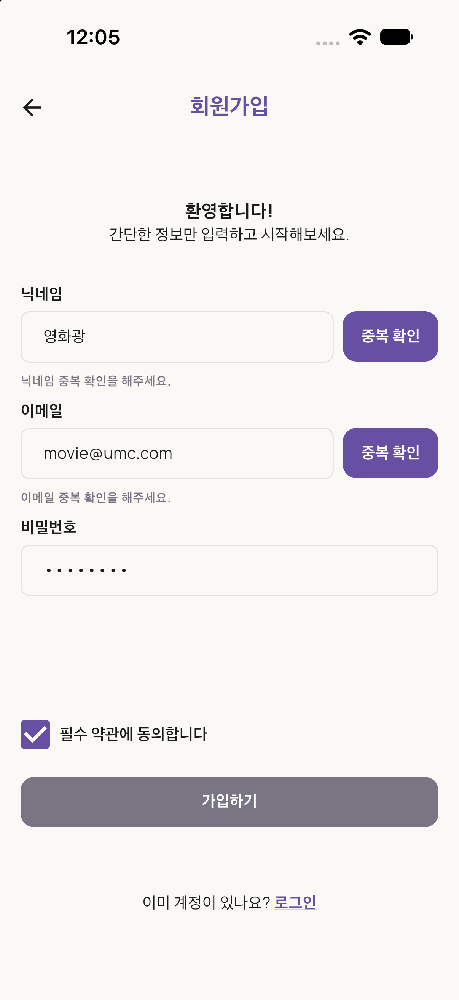
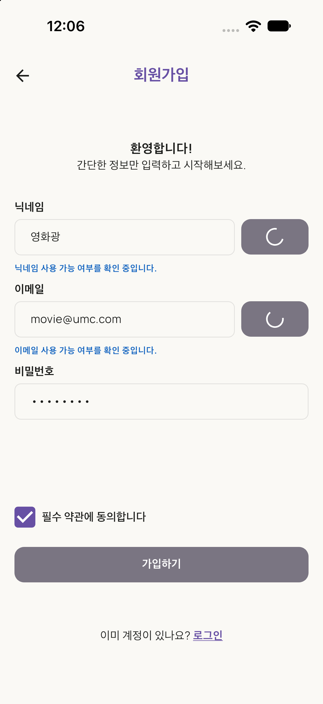
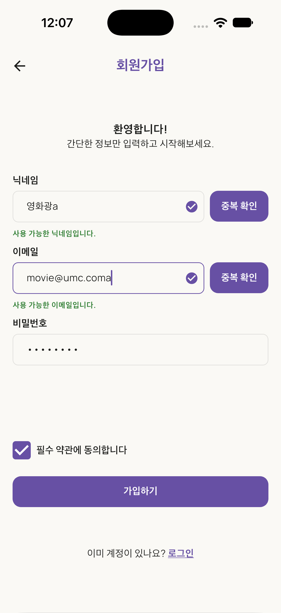
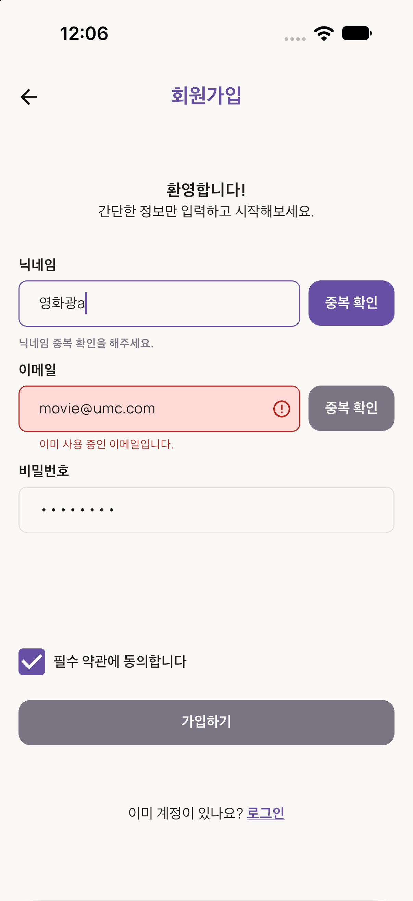
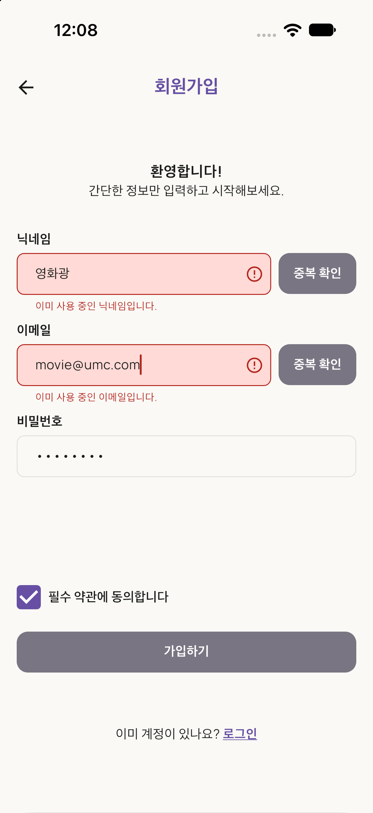
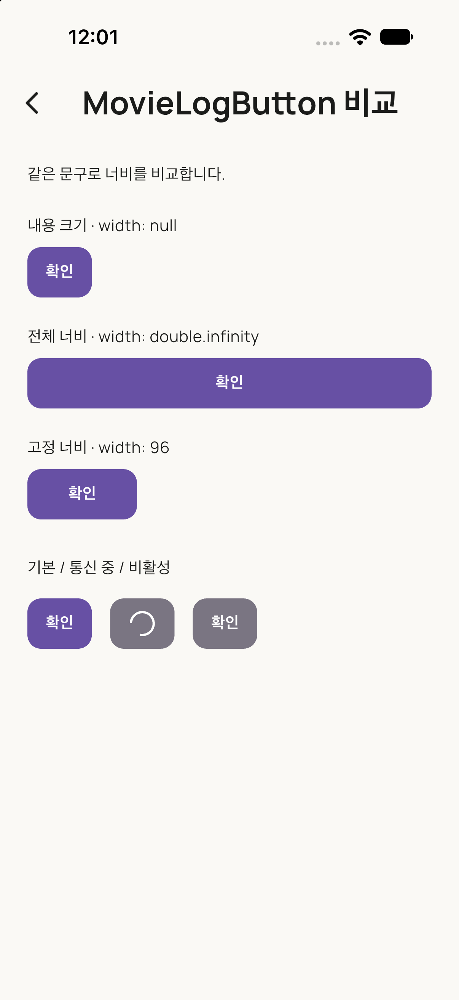
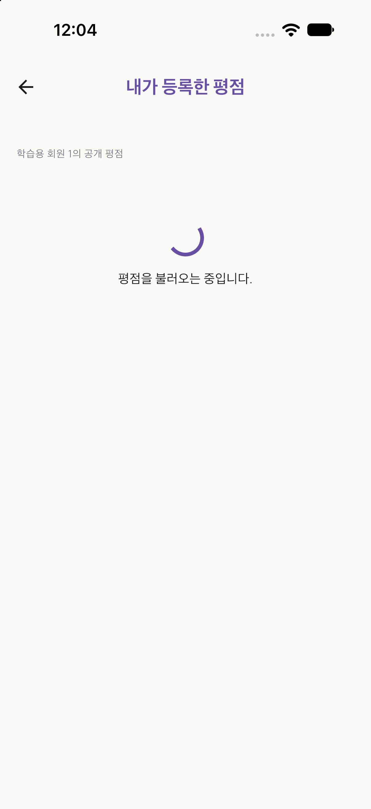
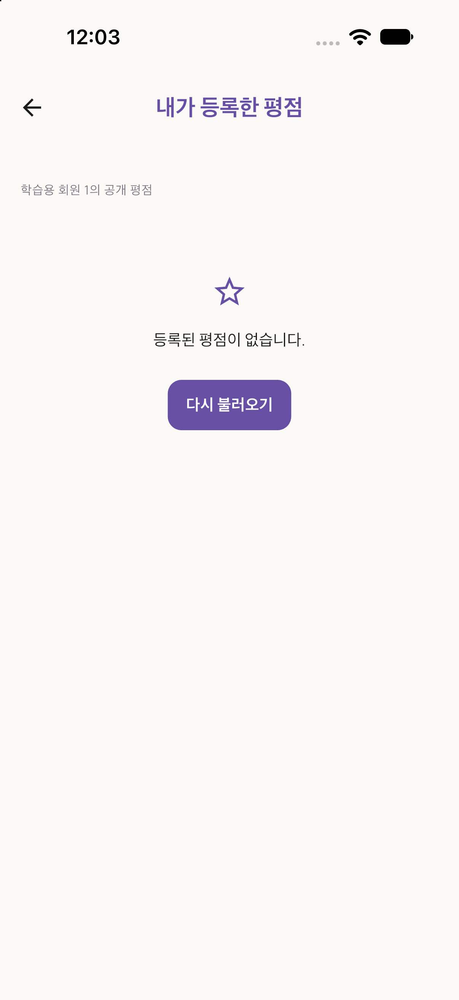
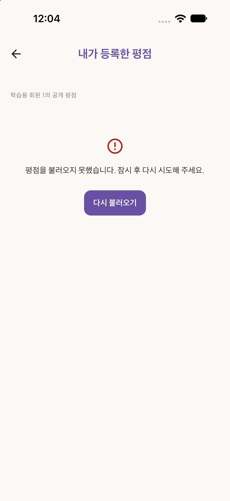
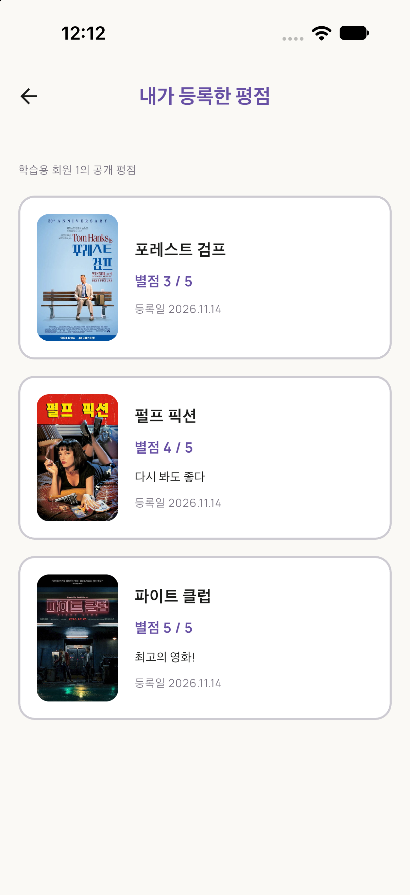

**PR 링크:**

아직 생성하지 않았습니다. 현재 브랜치: `week06_Agui_fe`.
기존 구현 커밋: `ecd4ed9`, `16ea44d`. Required Mission 보완 자료와 개발용 실행 화면도 같은 브랜치에서 관리합니다.

**확인 전/통신 중/가능/중복 화면:**

Device Hub의 iPhone 18 Pro / iOS 27.0에서 2026-11-14 확인했습니다.
아래 회원가입 상태는 일반 앱과 같은 화면·Service·ViewModel을 사용하고,
개발용 응답으로 `available: true/false`와 지연을 재현한 화면입니다.
실제 API 연결 확인은 [Guided Practice A 기록](qa/guided_practice_a.md)에 구분해 남겼습니다.

| 확인 전 | 통신 중 |
| --- | --- |
|  |  |

| 사용 가능 | 중복 |
| --- | --- |
|  |  |

통신 중에는 두 확인 버튼이 회색으로 비활성화되고 인디케이터만 표시됩니다.
두 필드의 확인이 끝나도 약관 미동의 시에는 가입 버튼이 비활성화되는 것을 Device Hub에서 확인했습니다.
약관 토글 직후 저장된 이미지는 상태 전환 중의 화면이어서 제출 캡처에서 제외했습니다.

**입력 변경 시 무효화 화면 또는 영상:**

| 중복 확인 직후 | 닉네임을 다른 값으로 변경한 뒤 |
| --- | --- |
|  |  |

닉네임을 변경하면 닉네임만 확인 전 상태로 돌아가고, 이메일의 중복 결과는 유지됩니다.
이메일도 변경 시 확인 전 상태로 돌아오는 것을 확인했습니다.

**동일 문자열 재입력 시 즉시 에러 화면 또는 영상:**



`영화광a` / `movie@umc.coma`를 확인한 뒤 마지막 `a`를 지워
이전에 중복으로 확인한 `영화광` / `movie@umc.com`으로 돌아오면 즉시 에러가 복원됩니다.
확인 버튼을 다시 누르지 않았고, 개발용 요청 횟수도 각 필드 2회에서 증가하지 않았습니다.

**MovieLogButton 너비 비교 화면(null / double.infinity / 고정값):**



같은 `확인` 문구를 사용했습니다. `null`은 내용 크기, `double.infinity`는 부모의 전체 너비,
고정값 `96`은 지정한 너비로 표시됩니다. 아래에는 기본·통신 중·비활성 상태도 함께 표시했습니다.
이 비교 화면은 별도의 개발용 실행 진입점에만 있으며 일반 앱 메뉴에는 추가하지 않았습니다.

**내가 등록한 평점(memberId 1) Loading/Empty/Error/Success 화면:**

| Loading | Empty |
| --- | --- |
|  |  |

| Error | Success — 실제 API |
| --- | --- |
|  |  |

- Success 캡처는 실제 워크북 GET과 TMDB 조회 결과입니다. 학습용 회원 1의 공개 데이터이며 로그인 사용자 데이터가 아닙니다.
- Loading / Empty / Error는 같은 Service·ViewModel·화면에 개발용 응답을 주입해 재현했습니다. 실제 서버 데이터를 삭제하거나 장애를 유발하지 않았습니다.
- Error의 `다시 불러오기`를 누르면 [정상 목록으로 전환](mission-captures/2026-11-14-required/ratings-retry-success.png)됩니다. 이 평점 배열은 개발용 데이터이며 영화 정보는 TMDB 응답입니다.
- 영화 한 편의 정보 조회만 실패해도 [해당 평점을 유지하고 제목·포스터를 대체 표시](mission-captures/2026-11-14-required/ratings-partial-movie.png)합니다.
- [실제 마이페이지 진입 항목](mission-captures/2026-11-14-required/profile-entry-live.png)에서 목록을 열 수 있고, 목록에는 하단 탭이 보이지 않습니다. 뒤로가면 마이페이지와 하단 탭이 복원됩니다.
- `comment: null`인 포레스트 검프 기록에는 후기 문구를 그리지 않고 점수와 등록일만 표시합니다.

**트러블슈팅:**

1. **버튼 내용 기반 너비**: 공용 버튼에 최소 너비 `102`가 있으면 짧은 라벨도 커집니다. A 구현에서 최소 가로 제약을 제거했고 이번 비교 화면에서 세 너비를 함께 확인했습니다.
2. **확인 결과 무효화**: 필드별 현재 값과 요청 버전을 관리해 수정한 입력을 이전 응답이 덮어쓰지 않도록 했습니다. 마지막 중복값은 별도로 기억합니다.
3. **통신 실패와 중복 구분**: 정상 `available: false`는 중복 문구와 버튼 비활성으로, 개발용 HTTP 500은 실패 문구와 재시도 가능한 버튼으로 구분했습니다. [통신 실패 화면](mission-captures/2026-11-14-required/signup-transport-error.png)
4. **평점과 영화 정보의 부분 실패**: 평점 조회는 성공하고 TMDB 일부만 실패한 경우 전체 목록을 Error로 바꾸지 않고 해당 영화 정보만 대체 표시합니다.
5. **분석 결과**: [앱 범위 flutter analyze 결과](mission-captures/2026-11-14-required/flutter-analyze.txt)는 오류·경고 없이 기존 `week00_dart_practice.dart:25`의 `avoid_print` info 1건입니다. 명령 종료 코드는 1이므로 완전 무결점 통과로 표시하지 않았습니다.

기능 확인을 다시 실행하려면 프로젝트 디렉터리에서 다음 명령을 사용합니다.

```sh
flutter run -t lib/dev/required_mission_main.dart --dart-define-from-file=.env
```

일반 앱은 `flutter run --dart-define-from-file=.env`로 실행합니다.
캡처 원본은 Device Hub의 Screenshot 기능으로 저장했으며 토큰 값은 자료에 포함하지 않았습니다.

**6주차 회고:**

회고 초안입니다. 제출 전 본인의 표현으로 다듬으면 됩니다.

공용 버튼이 화면에서 전달한 상태를 표현하고, ViewModel이 통신과 상태 전환을 담당하도록 구성했다.
서버의 중복 응답과 통신 실패, 목록의 빈 결과와 오류를 서로 다른 상태로 다뤄야 하는 이유를 화면에서 확인했다.
평점 데이터와 영화 정보의 조회를 분리해 영화 정보 일부가 없어도 사용자의 평점 기록은 유지하도록 했다.
개발용 실행 화면을 따로 두니 일반 앱의 동작과 서버 데이터를 바꾸지 않고 각 상태를 반복해서 확인할 수 있었다.
