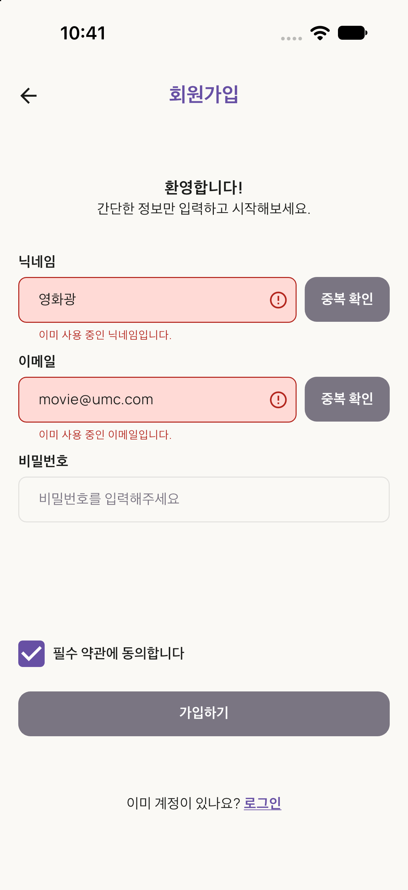
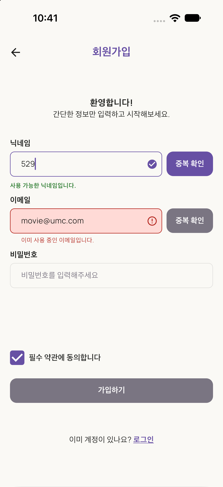
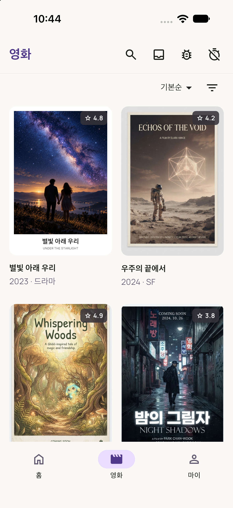
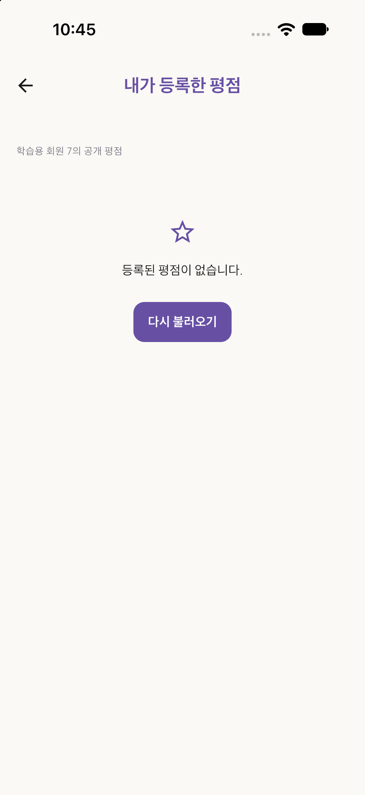

# 7주차 Guided Practice A 기록

## 구현 내용

- MovieLog v6 닉네임·이메일 중복 확인과 회원가입 POST 연결
- 공통 응답과 회원가입 요청·응답 모델, 제출 상태 및 오류 표시 구현
- 가입 결과 memberId를 메모리에 저장하고 내 평점 조회 경로에 전달
- 입력 변경 시 중복 확인 상태 무효화, 요청 중 중복 제출 방지

## 검증 기록

- Device Hub 검증: 일부 완료. 아래 실기기 검증 결과 참조.
- 회원가입 성공 및 memberId 전달 확인. 최종 409, 비밀번호 400 및 제출 중 중복 탭 방지: 미검증.
- 최종 409 화면은 검증 후 캡처 추가 예정.

## Device Hub 확인 (iPhone 18 Pro)

- 기본 닉네임과 이메일의 중복 확인 결과가 각각 이미 사용 중으로 표시되고 가입 버튼이 비활성화됨.
- 닉네임을 변경하면 이전 중복 오류가 사라지고 다시 중복 확인하도록 안내됨.
- 변경한 닉네임 중복 확인에서 사용 가능 결과 확인.
- 최종 409는 미검증. 중복 확인 결과는 회원가입 POST의 최종 409를 검증한 결과가 아님.

### 닉네임·이메일 중복 확인

### 닉네임 변경 후 사용 가능 확인

### 회원가입 성공 및 회원 ID 전달

- 사용자가 회원가입을 완료한 뒤 영화 목록 화면으로 이동한 것을 확인.
- 마이페이지의 내가 등록한 평점 화면에서 학습용 회원 **7**과 빈 목록을 확인.
- 테스트 계정: 닉네임 `mmm`, 이메일 `movie@umc.co` (사용자 제공).

