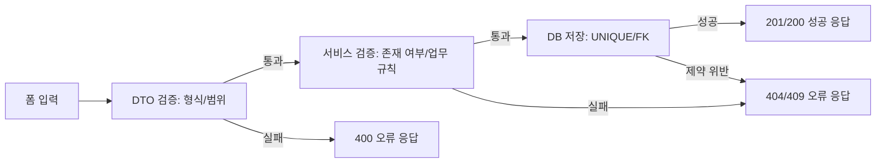
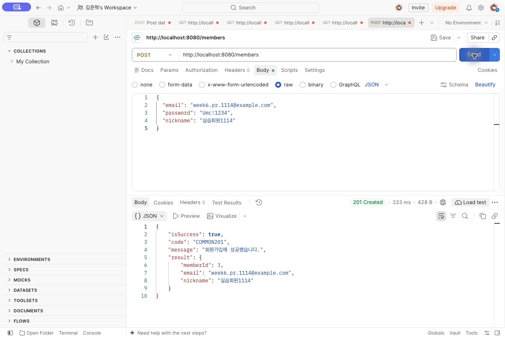
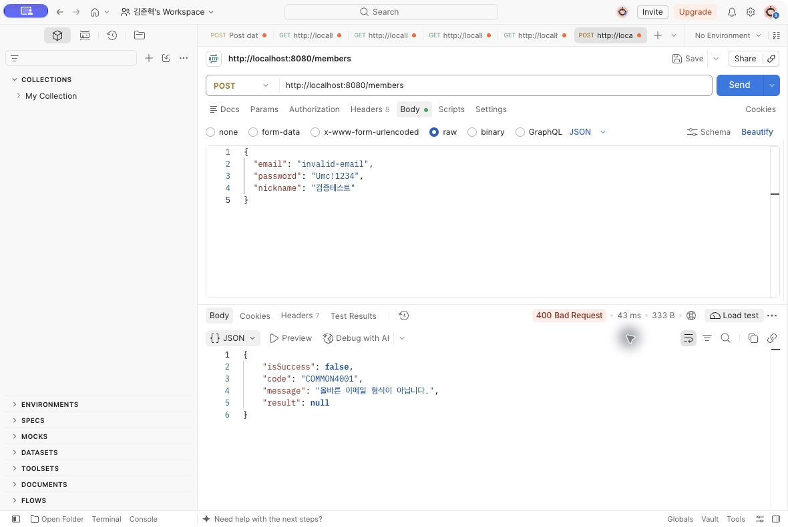
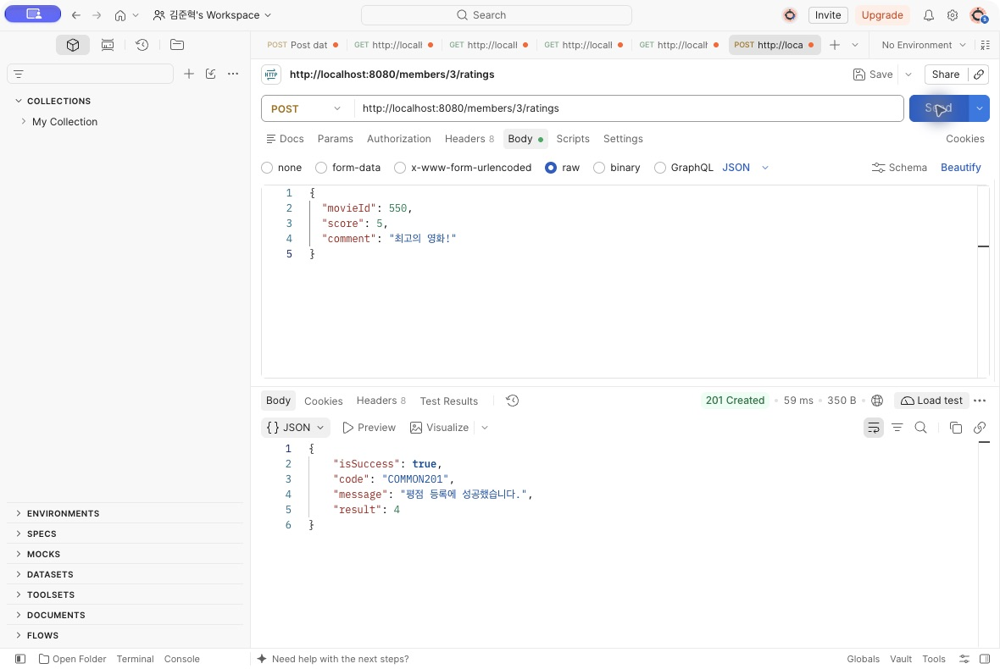

# ❗ 학습 목표

---

- 회원가입 API를 구현할 수 있다.
- 폼 입력값을 DTO에서 검증하고, 검증 실패 이유를 응답으로 돌려줄 수 있다.
- 성공과 실패를 같은 응답 구조로 표현할 수 있다.
- 중복 저장과 존재하지 않는 회원 같은 저장 실패 상황을 확인할 수 있다.

# 📸 잠깐 ! 스터디 인증샷은 찍으셨나요?📸

---

* 스터디리더께서 대표로 매 주차마다 한 장 남겨주시면 좋겠습니다!🙆💗
  (사진을 저장해서 이미지 임베드를 하셔도 좋고, 복사+붙여넣기 해서 넣어주셔도 좋습니다!)

[]()

# ✨ 6주차 주제

---

5주차에는 영화 평점 서비스의 화면이 필요한 데이터를 읽어 오는 경험을 했어요. 닉네임과 이메일 중복 여부를 확인하고, 특정 회원이 남긴 평점을 화면에 보여주면서 프론트와 백엔드가 같은 API 약속을 사용한다는 점을 확인했죠.

하지만 조회만으로는 서비스가 완성되지 않아요. 사용자가 회원가입 폼에 입력한 정보와 영화에 남긴 별점, 후기는 서버를 거쳐 데이터베이스에 안전하게 저장되어야 합니다. 이때 서버는 모든 입력을 그대로 믿지 않고 형식이 맞는지, 이미 존재하는 데이터인지 다시 확인해야 해요.

이번 주차에는 영화 평점 서비스에 회원가입과 평점 쓰기 기능을 더합니다. 저장 요청이 성공했을 때와 실패했을 때를 같은 규칙으로 응답하고, 화면이 오류 이유를 알려줄 수 있도록 API를 설계해 봅시다.

# 📑 6주차 본문 들어가기 전

---

## 1. 이번 주차에 추가할 API

5주차의 조회 API에 이어, 이번 주차에는 아래 쓰기 API를 구현합니다. 아직 로그인 기능 전이므로 평점 API는 memberId를 경로 또는 쿼리로 받아 어느 회원의 요청인지 구분해요. 7주차에는 이 값을 토큰에서 꺼내는 방식으로 바꿉니다.

| 기능 | Method | 경로 | 성공 상태 |
| --- | --- | --- | --- |
| 회원가입 | POST | /members | 201 Created |
| 평점 등록 | POST | /members/{memberId}/ratings | 201 Created |
| 평점 수정 | PATCH | /members/{memberId}/ratings/{ratingId} | 200 OK |
| 평점 삭제 | DELETE | /members/{memberId}/ratings/{ratingId} | 204 No Content |

## 2. 저장 API의 세 가지 문

저장 API는 공연장 입구와 비슷해요. 안내 데스크는 입력표가 올바른지 확인하고, 내부 직원은 실제로 자리가 있는지 확인하며, 마지막 출입구는 데이터베이스 규칙으로 중복 입장을 막습니다. DTO 검증, 서비스 검증, DB 제약 조건이 각각 이 역할을 나눠 맡아요.



DTO 검증을 통과했다고 해서 저장이 보장되지는 않아요. 두 사용자가 거의 동시에 같은 이메일로 가입을 요청하면, 둘 다 중복 체크를 통과해도 DB의 UNIQUE 제약 조건에서 한 요청은 막혀야 합니다. 그래서 서버 검증과 DB 제약을 함께 둡니다.

## 3. 응답 형식을 먼저 약속하기

화면은 매 API마다 서로 다른 JSON 모양을 해석하기보다, 성공과 실패가 같은 틀을 가지면 다루기 쉬워요. 이번 주차부터 아래 형식을 사용합니다. 이후 주차의 API도 이 구조를 유지합니다.

```json
{
  "isSuccess": true,
  "code": "COMMON201",
  "message": "회원가입에 성공했습니다.",
  "result": {
    "memberId": 1,
    "email": "umc@example.com",
    "nickname": "moviefan"
  }
}
```

```json
{
  "isSuccess": false,
  "code": "MEMBER4091",
  "message": "이미 사용 중인 이메일입니다.",
  "result": null
}
```

# 🔖 6주차 본문

---

이제 입력값을 검증하고, 저장에 성공하거나 실패한 이유를 일정한 JSON 구조로 돌려주는 API를 만들어 봅시다. 코드가 조금 길어 보여도 요청 DTO, 서비스, 예외 처리의 역할을 나누면 흐름이 또렷해집니다.

## 1. 입력을 믿지 않는 서버: 검증과 오류 응답

### 1) 회원가입 입력 규칙

- email: 이메일 형식이며 비어 있지 않아야 합니다.
- nickname: 2자 이상 12자 이하여야 합니다.
- password: 영문 대문자, 소문자, 숫자, 특수문자를 모두 포함하고 8자 이상이어야 합니다.

비밀번호는 응답에 절대 포함하지 않습니다. 서버에는 평문 대신 bcrypt 해시만 저장합니다. bcrypt 해시는 항상 60자이므로 member 테이블의 password 컬럼도 60자로 준비되어 있어요.

## 2. [실습 1] 회원가입 API 만들기 (POST /members)

### 1) 🍃 Spring Boot

Spring Boot에서는 요청 DTO에 Bean Validation 애노테이션을 붙이고, Controller 파라미터에 @Valid를 붙여 검증을 시작합니다. Service는 중복 여부를 다시 확인한 뒤 PasswordEncoder로 비밀번호를 해시해 저장합니다.

```java
// src/main/java/com/umc/movie/dto/SignUpRequest.java
package com.umc.movie.dto;

import jakarta.validation.constraints.Email;
import jakarta.validation.constraints.NotBlank;
import jakarta.validation.constraints.Pattern;
import jakarta.validation.constraints.Size;

public record SignUpRequest(
        @NotBlank(message = "이메일을 입력해주세요.")
        @Email(message = "올바른 이메일 형식이 아닙니다.")
        String email,

        @NotBlank(message = "비밀번호를 입력해주세요.")
        @Pattern(
                regexp = "^(?=.*[a-z])(?=.*[A-Z])(?=.*\\d)(?=.*[!@#$%^&*]).{8,}$",
                message = "비밀번호는 대문자/소문자/숫자/특수문자를 포함한 8자 이상이어야 합니다."
        )
        String password,

        @NotBlank(message = "닉네임을 입력해주세요.")
        @Size(min = 2, max = 12, message = "닉네임은 2자 이상 12자 이하로 입력해주세요.")
        String nickname
) {}
```

응답에 쓸 DTO도 함께 만듭니다.

엔티티를 그대로 돌려주면 password까지 나가버리므로 DTO로 옮겨 담습니다.

```java
// src/main/java/com/umc/movie/dto/MemberResponse.java
package com.umc.movie.dto;

public record MemberResponse(
        Long memberId,
        String email,
        String nickname
) {}
```

비밀번호 해시에는 라이브러리가 하나 필요합니다.

build.gradle의 dependencies 블록에 아래 한 줄을 추가해주세요.

spring-boot-starter-security를 넣으면 시큐리티 자동 설정이 켜지면서 지금까지 만든 API가 전부 로그인 페이지로 막히므로, 해시 기능만 있는 가벼운 쪽을 씁니다.

```groovy
// build.gradle 의 dependencies 블록에 추가합니다
implementation 'org.springframework.security:spring-security-crypto'
```

```java
// src/main/java/com/umc/movie/config/PasswordConfig.java
package com.umc.movie.config;

import org.springframework.context.annotation.Bean;
import org.springframework.context.annotation.Configuration;
import org.springframework.security.crypto.bcrypt.BCryptPasswordEncoder;
import org.springframework.security.crypto.password.PasswordEncoder;

@Configuration
public class PasswordConfig {
    @Bean
    public PasswordEncoder passwordEncoder() {
        return new BCryptPasswordEncoder();
    }
}
```

```java
// src/main/java/com/umc/movie/entity/Member.java 의 생성자에 붙입니다
// import lombok.Builder; 도 함께 추가해주세요
@Builder
public Member(String email, String password, String nickname) {
    this.email = email;
    this.password = password;
    this.nickname = nickname;
}
```

```java
// src/main/java/com/umc/movie/controller/MemberController.java
package com.umc.movie.controller;

import com.umc.movie.dto.ApiResponse;
import com.umc.movie.dto.EmailCheckResponse;
import com.umc.movie.dto.MemberResponse;
import com.umc.movie.dto.NicknameCheckResponse;
import com.umc.movie.dto.SignUpRequest;
import com.umc.movie.service.MemberService;
import jakarta.validation.Valid;
import lombok.RequiredArgsConstructor;
import org.springframework.http.ResponseEntity;
import org.springframework.web.bind.annotation.GetMapping;
import org.springframework.web.bind.annotation.PathVariable;
import org.springframework.web.bind.annotation.PostMapping;
import org.springframework.web.bind.annotation.RequestBody;
import org.springframework.web.bind.annotation.RequestMapping;
import org.springframework.web.bind.annotation.RestController;

@RestController
@RequiredArgsConstructor
@RequestMapping("/members")
public class MemberController {
    private final MemberService memberService;

    @GetMapping("/nickname/{nickname}")
    public NicknameCheckResponse checkNickname(@PathVariable String nickname) {
        return memberService.checkNickname(nickname);
    }

    @GetMapping("/email/{email}")
    public EmailCheckResponse checkEmail(@PathVariable String email) {
        return memberService.checkEmail(email);
    }

    @PostMapping
    public ResponseEntity<ApiResponse<MemberResponse>> signUp(
            @Valid @RequestBody SignUpRequest request
    ) {
        MemberResponse response = memberService.signUp(request);
        return ResponseEntity.status(201)
                .body(ApiResponse.created("회원가입에 성공했습니다.", response));
    }
}
```

### 2) 🐱 NestJS

NestJS에서는 class-validator 데코레이터와 전역 ValidationPipe를 함께 사용합니다. Service는 bcrypt.hash로 비밀번호를 해시한 뒤 저장하고, 중복은 ConflictException으로 표현합니다.

```bash
npm install bcrypt class-validator class-transformer
npm install -D @types/bcrypt
```

```tsx
// src/dto/create-member.dto.ts
import { IsEmail, IsNotEmpty, IsString, Matches, MaxLength, MinLength } from 'class-validator';

export class CreateMemberDto {
  @IsEmail({}, { message: '올바른 이메일 형식이 아닙니다.' })
  email: string;

  @IsString()
  @Matches(/^(?=.*[a-z])(?=.*[A-Z])(?=.*\d)(?=.*[!@#$%^&*]).{8,}$/, {
    message: '비밀번호는 대문자/소문자/숫자/특수문자를 포함한 8자 이상이어야 합니다.',
  })
  password: string;

  @IsString()
  @IsNotEmpty({ message: '닉네임을 입력해주세요.' })
  @MinLength(2, { message: '닉네임은 2자 이상이어야 합니다.' })
  @MaxLength(12, { message: '닉네임은 12자 이하여야 합니다.' })
  nickname: string;
}
```

Controller에는 회원가입 메서드를 **추가**합니다.

5주차에 만든 중복 체크 메서드는 지우지 말고 그대로 두세요.

```tsx
// src/controller/member.controller.ts
@Controller("members")
export class MemberController {
  constructor(private readonly memberService: MemberService) {}

  // ... 5주차에 만든 checkNickname, checkEmail은 그대로 둡니다 ...

  @Post()
  @HttpCode(HttpStatus.CREATED)
  async signUp(@Body() dto: CreateMemberDto) {
    const result = await this.memberService.signUp(dto);
    return {
      isSuccess: true,
      code: "COMMON201",
      message: "회원가입에 성공했습니다.",
      result,
    };
  }
}
```

파일 상단 import에 아래를 추가해주세요.

```tsx
import { Body, HttpCode, HttpStatus, Post } from "@nestjs/common";
import { CreateMemberDto } from "../dto/create-member.dto";
```

```tsx
// src/controller/member.controller.ts
import {
  Body,
  Controller,
  Get,
  HttpCode,
  HttpStatus,
  Param,
  Post,
} from "@nestjs/common";
import { CreateMemberDto } from "../dto/create-member.dto";
import { MemberService } from "../service/member.service";

@Controller("members")
export class MemberController {
  constructor(private readonly memberService: MemberService) {}

  @Get("nickname/:nickname")
  checkNickname(@Param("nickname") nickname: string) {
    return this.memberService.checkNickname(nickname);
  }

  @Get("email/:email")
  checkEmail(@Param("email") email: string) {
    return this.memberService.checkEmail(email);
  }

  @Post()
  @HttpCode(HttpStatus.CREATED)
  async signUp(@Body() dto: CreateMemberDto) {
    const result = await this.memberService.signUp(dto);
    return {
      isSuccess: true,
      code: "COMMON201",
      message: "회원가입에 성공했습니다.",
      result,
    };
  }
}
```

### 3) Postman으로 확인하기

```json
POST /members
Content-Type: application/json

{
  "email": "umc@example.com",
  "password": "Umc!1234",
  "nickname": "moviefan"
}
```

정상 요청에서는 201 Created와 회원 정보만 받아야 해요. password 필드가 응답에 섞여 있다면 즉시 DTO를 점검하세요.

### 4) Service에서 회원가입을 처리하기

Controller는 요청을 받고 응답을 돌려주는 창구예요. 실제 회원가입 저장 작업은 Service에서 처리합니다.

Service는 아래 순서로 동작합니다.

1. 이메일과 닉네임이 이미 있는지 확인합니다.
2. 비밀번호를 bcrypt로 해시합니다.
3. Member 엔티티를 저장합니다.
4. 비밀번호를 제외한 응답 DTO를 반환합니다.

Service의 중복 검사를 통과했어도 동시에 같은 이메일로 요청이 들어올 수 있어요. 그래서 DB의 UNIQUE 제약 조건도 마지막 안전망으로 둡니다. DB 제약 위반은 409 Conflict 응답으로 바꿔 주세요.

#### 🍃 Spring Boot

Controller와 마찬가지로 5주차에 만든 MemberService에 이어 씁니다.

PasswordEncoder를 주입받는 줄이 새로 생깁니다.

```java
// src/main/java/com/umc/movie/service/MemberService.java
@Service
@RequiredArgsConstructor
public class MemberService {
    private final MemberRepository memberRepository;
    private final PasswordEncoder passwordEncoder; // 이 줄이 새로 추가됩니다

    // ... 5주차에 만든 checkNickname, checkEmail은 그대로 둡니다 ...

    @Transactional
    public MemberResponse signUp(SignUpRequest request) {
        if (memberRepository.existsByEmail(request.email())) {
            throw new IllegalArgumentException("이미 사용 중인 이메일입니다.");
        }
        if (memberRepository.existsByNickname(request.nickname())) {
            throw new IllegalArgumentException("이미 사용 중인 닉네임입니다.");
        }

        Member member = Member.builder()
                .email(request.email())
                .password(passwordEncoder.encode(request.password()))
                .nickname(request.nickname())
                .build();

        Member savedMember = memberRepository.save(member);
        return new MemberResponse(savedMember.getMemberId(), savedMember.getEmail(), savedMember.getNickname());
    }
}
```

파일 상단에 아래 import가 없다면 추가해주세요.

```java
import com.umc.movie.dto.MemberResponse;
import com.umc.movie.dto.SignUpRequest;
import com.umc.movie.entity.Member;
import org.springframework.security.crypto.password.PasswordEncoder;
```

#### 🐱 NestJS

5주차에 만든 MemberService에 회원가입 메서드를 **추가**합니다.

5주차 메서드와 @InjectRepository(Member)가 붙은 생성자는 그대로 둡니다.

이 데코레이터를 지우면 앱을 켤 때 Nest can't resolve dependencies of the MemberService (?) 에러가 나면서 서버가 뜨지 않습니다.

```tsx
// src/service/member.service.ts 에 아래 메서드를 추가합니다
  async signUp(dto: CreateMemberDto) {
    const existingEmail = await this.memberRepository.findOneBy({ email: dto.email });
    if (existingEmail) {
      throw new ConflictException('이미 사용 중인 이메일입니다.');
    }

    const existingNickname = await this.memberRepository.findOneBy({ nickname: dto.nickname });
    if (existingNickname) {
      throw new ConflictException('이미 사용 중인 닉네임입니다.');
    }

    const savedMember = await this.memberRepository.save(
      this.memberRepository.create({
        email: dto.email,
        password: await bcrypt.hash(dto.password, 10),
        nickname: dto.nickname,
      }),
    );

    return {
      memberId: savedMember.memberId,
      email: savedMember.email,
      nickname: savedMember.nickname,
    };
  }
```

파일 상단 import에 아래를 추가해주세요.

```tsx
import { ConflictException } from "@nestjs/common";
import * as bcrypt from "bcrypt";
import { CreateMemberDto } from "../dto/create-member.dto";
```

## 3. [실습 2] 실패를 같은 형식으로 돌려주기

Controller마다 try-catch를 쓰면 같은 오류를 여러 번 처리하게 됩니다. 전역 예외 처리는 건물의 안내 방송처럼, 어디에서 오류가 생겨도 정해진 문구와 형식으로 알려주는 역할을 해요.

### 1) 🍃 Spring Boot

```java
// src/main/java/com/umc/movie/dto/ApiResponse.java
package com.umc.movie.dto;

public record ApiResponse<T>(boolean isSuccess, String code, String message, T result) {
    public static <T> ApiResponse<T> created(String message, T result) {
        return new ApiResponse<>(true, "COMMON201", message, result);
    }

    public static <T> ApiResponse<T> ok(String message, T result) {
        return new ApiResponse<>(true, "COMMON200", message, result);
    }

    public static ApiResponse<Void> failure(String code, String message) {
        return new ApiResponse<>(false, code, message, null);
    }
}
```

```java
// src/main/java/com/umc/movie/controller/GlobalExceptionHandler.java
package com.umc.movie.controller;

import com.umc.movie.dto.ApiResponse;
import org.springframework.dao.DataIntegrityViolationException;
import org.springframework.http.ResponseEntity;
import org.springframework.web.bind.MethodArgumentNotValidException;
import org.springframework.web.bind.annotation.ExceptionHandler;
import org.springframework.web.bind.annotation.RestControllerAdvice;
import org.springframework.web.server.ResponseStatusException;

@RestControllerAdvice
public class GlobalExceptionHandler {
    @ExceptionHandler(MethodArgumentNotValidException.class)
    public ResponseEntity<ApiResponse<Void>> handleValidation(MethodArgumentNotValidException exception) {
        String message = exception.getBindingResult().getFieldErrors().get(0).getDefaultMessage();
        return ResponseEntity.badRequest().body(ApiResponse.failure("COMMON4001", message));
    }

    @ExceptionHandler(DataIntegrityViolationException.class)
    public ResponseEntity<ApiResponse<Void>> handleDataIntegrity(DataIntegrityViolationException exception) {
        return ResponseEntity.status(409).body(ApiResponse.failure("COMMON4091", "이미 존재하는 데이터입니다."));
    }

    @ExceptionHandler(IllegalArgumentException.class)
    public ResponseEntity<ApiResponse<Void>> handleIllegalArgument(IllegalArgumentException exception) {
        return ResponseEntity.status(409).body(ApiResponse.failure("COMMON4092", exception.getMessage()));
    }
    
    @ExceptionHandler(ResponseStatusException.class)
    public ResponseEntity<ApiResponse<Void>> handleResponseStatus(ResponseStatusException exception) {
        int status = exception.getStatusCode().value();
        return ResponseEntity.status(status)
                .body(ApiResponse.failure("COMMON" + status, exception.getReason()));
    }
}
```

### 2) 🐱 NestJS

```tsx
// src/main.ts
import { ValidationPipe } from '@nestjs/common';
import { NestFactory } from '@nestjs/core';
import { AppModule } from './app.module';
import { HttpExceptionFilter } from './filter/http-exception.filter';

async function bootstrap() {
  const app = await NestFactory.create(AppModule);
  app.enableCors({
    origin: "http://localhost:5173",
    methods: ["GET", "POST", "PATCH", "DELETE"],
  });
  app.useGlobalPipes(new ValidationPipe({ whitelist: true, forbidNonWhitelisted: true, transform: true }));
  app.useGlobalFilters(new HttpExceptionFilter());
  await app.listen(3000);
}
bootstrap();
```

```tsx
// src/filter/http-exception.filter.ts
import { ArgumentsHost, Catch, ExceptionFilter, HttpException } from '@nestjs/common';
import { Response } from 'express';

@Catch(HttpException)
export class HttpExceptionFilter implements ExceptionFilter {
  catch(exception: HttpException, host: ArgumentsHost) {
    const response = host.switchToHttp().getResponse<Response>();
    const status = exception.getStatus();
    const body = exception.getResponse();
    const message = typeof body === 'string' ? body : (body as { message: string | string[] }).message;

    response.status(status).json({
      isSuccess: false,
      code: 'COMMON' + status,
      message: Array.isArray(message) ? message[0] : message,
      result: null,
    });
  }
}
```

ValidationPipe의 whitelist는 DTO에 없는 값을 제거하고, forbidNonWhitelisted는 그런 값이 들어오면 400 오류로 막습니다. 화면에서 보내지 않아야 할 값이 DB로 들어가는 일을 줄여줘요.

## 4. [실습 3] 평점 등록/수정/삭제 API 만들기

### 1) 평점 입력 규칙과 소유자 확인

- movieId: TMDB가 부여한 양의 정수입니다. 우리 DB의 movie 테이블을 참조하지 않습니다.
- score: 1점 이상 5점 이하의 정수이며 필수입니다.
- comment: 선택 입력이며 500자 이하로 제한합니다.
- 한 회원은 같은 영화에 평점을 한 번만 등록할 수 있습니다. 평점을 수정하거나 삭제할 때도 rating에 연결된 memberId와 요청의 memberId가 같은지 확인해야 합니다. 다르면 다른 사람의 데이터를 바꾸려는 요청이므로 403 Forbidden으로 막습니다.

### 2) 🍃 Spring Boot

```java
// src/main/java/com/umc/movie/dto/CreateRatingRequest.java
package com.umc.movie.dto;

import jakarta.validation.constraints.Max;
import jakarta.validation.constraints.Min;
import jakarta.validation.constraints.NotNull;
import jakarta.validation.constraints.Positive;
import jakarta.validation.constraints.Size;

public record CreateRatingRequest(
        @NotNull(message = "영화 ID를 입력해주세요.")
        @Positive(message = "영화 ID는 양수여야 합니다.")
        Long movieId,
        @NotNull(message = "별점을 입력해주세요.")
        @Min(value = 1, message = "별점은 1점 이상이어야 합니다.")
        @Max(value = 5, message = "별점은 5점 이하여야 합니다.")
        Integer score,
        @Size(max = 500, message = "후기는 500자 이하로 입력해주세요.")
        String comment
) {}
```

```java
// src/main/java/com/umc/movie/dto/UpdateRatingRequest.java
package com.umc.movie.dto;

import jakarta.validation.constraints.Max;
import jakarta.validation.constraints.Min;
import jakarta.validation.constraints.NotNull;
import jakarta.validation.constraints.Size;

public record UpdateRatingRequest(
        @NotNull(message = "별점을 입력해주세요.")
        @Min(value = 1, message = "별점은 1점 이상이어야 합니다.")
        @Max(value = 5, message = "별점은 5점 이하여야 합니다.")
        Integer score,
        @Size(max = 500, message = "후기는 500자 이하로 입력해주세요.")
        String comment
) {}
```

```java
// src/main/java/com/umc/movie/entity/Rating.java 에 추가합니다
// import lombok.Builder; 도 함께 추가해주세요
@Builder
public Rating(Member member, Long movieId, Integer score, String comment) {
    this.member = member;
    this.movieId = movieId;
    this.score = score;
    this.comment = comment;
}

public void update(Integer score, String comment) {
    this.score = score;
    this.comment = comment;
}
```

```java
// src/main/java/com/umc/movie/repository/RatingRepository.java 에 추가합니다
// 언더스코어(_)는 "연관된 엔티티를 타고 들어가라"는 표시입니다.
// rating.member.memberId 를 조건으로 삼겠다는 뜻이에요.
boolean existsByMember_MemberIdAndMovieId(Long memberId, Long movieId);
```

```java
// src/main/java/com/umc/movie/service/RatingService.java 에 아래 메서드를 추가합니다
import com.umc.movie.dto.CreateRatingRequest;
import com.umc.movie.dto.UpdateRatingRequest;
import com.umc.movie.entity.Member;
import com.umc.movie.entity.Rating;
import org.springframework.http.HttpStatus;
import org.springframework.transaction.annotation.Transactional;
import org.springframework.web.server.ResponseStatusException;
// ... 5주차에 만든 getRatingsByMember는 그대로 둡니다 ...

@Transactional
public Long create(Long memberId, CreateRatingRequest request) {
    Member member = memberRepository.findById(memberId)
            .orElseThrow(() -> new ResponseStatusException(HttpStatus.NOT_FOUND, "존재하지 않는 유저입니다."));

    // rating 테이블에는 (member_id, movie_id) 복합 UNIQUE 제약이 걸려 있습니다.
    // 그냥 저장해도 DB가 막아주지만, 우리가 정한 메시지로 응답하기 위해 먼저 확인합니다.
    if (ratingRepository.existsByMember_MemberIdAndMovieId(memberId, request.movieId())) {
        throw new IllegalArgumentException("이미 이 영화에 평점을 남기셨습니다.");
    }

    Rating rating = Rating.builder()
            .member(member)
            .movieId(request.movieId())
            .score(request.score())
            .comment(request.comment())
            .build();

    return ratingRepository.save(rating).getRatingId();
}

@Transactional
public void update(Long ratingId, Long memberId, UpdateRatingRequest request) {
    Rating rating = findOwnedRating(ratingId, memberId);

    rating.update(request.score(), request.comment());
    ratingRepository.save(rating);
}

@Transactional
public void delete(Long ratingId, Long memberId) {
    Rating rating = findOwnedRating(ratingId, memberId);

    ratingRepository.delete(rating);
}

/**
 * 평점을 찾고, 그 평점이 요청자의 것인지까지 확인합니다.
 * 수정과 삭제가 똑같은 검사를 하므로 메서드로 묶었습니다.
 * 먼저 찾아보고(없으면 404), 찾았으면 주인을 봅니다(내 것이 아니면 403).
 */
private Rating findOwnedRating(Long ratingId, Long memberId) {
    Rating rating = ratingRepository.findById(ratingId)
            .orElseThrow(() -> new ResponseStatusException(HttpStatus.NOT_FOUND, "존재하지 않는 평점입니다."));

    if (!rating.getMember().getMemberId().equals(memberId)) {
        throw new ResponseStatusException(HttpStatus.FORBIDDEN, "본인이 작성한 평점만 수정하거나 삭제할 수 있습니다.");
    }

    return rating;
}
```

```java
  // src/main/java/com/umc/movie/controller/RatingController.java
  package com.umc.movie.controller;

  import com.umc.movie.dto.ApiResponse;
  import com.umc.movie.dto.CreateRatingRequest;
  import com.umc.movie.dto.RatingResponse;
  import com.umc.movie.dto.UpdateRatingRequest;
  import com.umc.movie.service.RatingService;
  import jakarta.validation.Valid;
  import lombok.RequiredArgsConstructor;
  import org.springframework.http.ResponseEntity;
  import org.springframework.web.bind.annotation.*;

  import java.util.List;

  @RestController
  @RequiredArgsConstructor
  @RequestMapping("/members")
  public class RatingController {
      private final RatingService ratingService;

      @GetMapping("/{memberId}/ratings")
      public List<RatingResponse> getMemberRatings(@PathVariable Long memberId) {
          return ratingService.getRatingsByMember(memberId);
      }

      @PostMapping("/{memberId}/ratings")
      public ResponseEntity<ApiResponse<Long>> create(
              @PathVariable Long memberId,
              @Valid @RequestBody CreateRatingRequest request
      ) {
          Long ratingId = ratingService.create(memberId, request);
          return ResponseEntity.status(201).body(ApiResponse.created("평점 등록에 성공했습니다.", ratingId));
      }

      @PatchMapping("/{memberId}/ratings/{ratingId}")
      public ResponseEntity<ApiResponse<Void>> update(
              @PathVariable Long memberId,
              @PathVariable Long ratingId,
              @Valid @RequestBody UpdateRatingRequest request
      ) {
          ratingService.update(ratingId, memberId, request);
          return ResponseEntity.ok(ApiResponse.ok("평점 수정에 성공했습니다.", null));
      }

      @DeleteMapping("/{memberId}/ratings/{ratingId}")
      public ResponseEntity<Void> delete(@PathVariable Long memberId, @PathVariable Long ratingId) {
          ratingService.delete(ratingId, memberId);
          return ResponseEntity.noContent().build();
      }
  }
```

### 3) 🐱 NestJS

```tsx
// src/dto/create-rating.dto.ts
import { IsInt, IsOptional, Max, MaxLength, Min } from 'class-validator';

export class CreateRatingDto {
  @IsInt({ message: '영화 ID는 정수여야 합니다.' })
  @Min(1, { message: '영화 ID는 양수여야 합니다.' })
  movieId: number;

  @IsInt({ message: '별점은 정수여야 합니다.' })
  @Min(1, { message: '별점은 1점 이상이어야 합니다.' })
  @Max(5, { message: '별점은 5점 이하여야 합니다.' })
  score: number;

  @IsOptional()
  @MaxLength(500, { message: '후기는 500자 이하로 입력해주세요.' })
  comment?: string;
}
```

```tsx
// src/dto/update-rating.dto.ts
import { IsInt, IsOptional, Max, MaxLength, Min } from "class-validator";

export class UpdateRatingDto {
  @IsInt({ message: "별점은 정수여야 합니다." })
  @Min(1, { message: "별점은 1점 이상이어야 합니다." })
  @Max(5, { message: "별점은 5점 이하여야 합니다." })
  score: number;

  @IsOptional()
  @MaxLength(500, { message: "후기는 500자 이하로 입력해주세요." })
  comment?: string;
}
```

```tsx
// src/service/rating.service.ts 에 아래 메서드를 추가합니다
import { ConflictException, ForbiddenException } from "@nestjs/common";
import { CreateRatingDto } from "../dto/create-rating.dto";
import { UpdateRatingDto } from "../dto/update-rating.dto";

// ... 5주차에 만든 getRatingsByMember는 그대로 둡니다 ...

  async create(memberId: number, dto: CreateRatingDto): Promise<number> {
    const member = await this.memberRepository.findOneBy({ memberId });
    if (!member) {
      throw new NotFoundException('존재하지 않는 유저입니다.');
    }

    // rating 테이블에는 (member_id, movie_id) 복합 UNIQUE 제약이 걸려 있습니다.
    // 그냥 저장해도 DB가 막아주지만, 우리가 정한 메시지로 응답하기 위해 먼저 확인합니다.
    const existing = await this.ratingRepository.findOne({
      where: { member: { memberId }, movieId: dto.movieId },
    });
    if (existing) {
      throw new ConflictException('이미 이 영화에 평점을 남기셨습니다.');
    }

    const saved = await this.ratingRepository.save(
      this.ratingRepository.create({
        member,
        movieId: dto.movieId,
        score: dto.score,
        comment: dto.comment ?? null,
      }),
    );

    return saved.ratingId;
  }

  async update(ratingId: number, memberId: number, dto: UpdateRatingDto): Promise<void> {
    const rating = await this.findOwnedRating(ratingId, memberId);

    rating.score = dto.score;
    rating.comment = dto.comment ?? null;

    await this.ratingRepository.save(rating);
  }

  async delete(ratingId: number, memberId: number): Promise<void> {
    const rating = await this.findOwnedRating(ratingId, memberId);

    await this.ratingRepository.remove(rating);
  }

  /**
   * 평점을 찾고, 그 평점이 요청자의 것인지까지 확인합니다.
   * 먼저 찾아보고(없으면 404), 찾았으면 주인을 봅니다(내 것이 아니면 403).
   */
  private async findOwnedRating(ratingId: number, memberId: number): Promise<Rating> {
    const rating = await this.ratingRepository.findOne({
      where: { ratingId },
      relations: { member: true }, // 작성자를 함께 불러와야 소유권을 비교할 수 있습니다
    });

    if (!rating) {
      throw new NotFoundException('존재하지 않는 평점입니다.');
    }

    if (rating.member.memberId !== memberId) {
      throw new ForbiddenException('본인이 작성한 평점만 수정하거나 삭제할 수 있습니다.');
    }

    return rating;
  }
```

```tsx
// src/controller/rating.controller.ts
import {
  Body,
  Controller,
  Delete,
  Get,
  HttpCode,
  HttpStatus,
  Param,
  ParseIntPipe,
  Patch,
  Post,
} from "@nestjs/common";
import { CreateRatingDto } from "../dto/create-rating.dto";
import { UpdateRatingDto } from "../dto/update-rating.dto";
import { RatingService } from "../service/rating.service";

@Controller("members")
export class RatingController {
  constructor(private readonly ratingService: RatingService) {}

  @Get(":memberId/ratings")
  getMemberRatings(@Param("memberId", ParseIntPipe) memberId: number) {
    return this.ratingService.getRatingsByMember(memberId);
  }

  @Post(":memberId/ratings")
  @HttpCode(HttpStatus.CREATED)
  async create(
    @Param("memberId", ParseIntPipe) memberId: number,
    @Body() dto: CreateRatingDto,
  ) {
    const ratingId = await this.ratingService.create(memberId, dto);
    return {
      isSuccess: true,
      code: "COMMON201",
      message: "평점 등록에 성공했습니다.",
      result: ratingId,
    };
  }

  @Patch(":memberId/ratings/:ratingId")
  async update(
    @Param("memberId", ParseIntPipe) memberId: number,
    @Param("ratingId", ParseIntPipe) ratingId: number,
    @Body() dto: UpdateRatingDto,
  ) {
    await this.ratingService.update(ratingId, memberId, dto);
    return {
      isSuccess: true,
      code: "COMMON200",
      message: "평점 수정에 성공했습니다.",
      result: null,
    };
  }

  @Delete(":memberId/ratings/:ratingId")
  @HttpCode(HttpStatus.NO_CONTENT)
  async delete(
    @Param("memberId", ParseIntPipe) memberId: number,
    @Param("ratingId", ParseIntPipe) ratingId: number,
  ) {
    await this.ratingService.delete(ratingId, memberId);
  }
}
```

### 4) 등록, 수정, 삭제와 실패 응답까지 확인하는 순서

1. POST로 새로운 평점을 등록하고 201 Created와 ratingId를 확인합니다.
2. 같은 memberId와 movieId로 한 번 더 등록해 409 Conflict 응답을 확인합니다. 회원가입에서도 이미 사용 중인 이메일 또는 닉네임으로 요청해 409 Conflict를, 잘못된 이메일 형식이나 별점 범위로 요청해 400 Bad Request를 확인합니다.
3. PATCH로 별점과 후기를 수정한 뒤 5주차의 유저별 평점 조회 API로 결과를 확인합니다.
4. DELETE를 호출하고 다시 조회해 목록에서 사라졌는지 확인합니다.

마지막으로 존재하지 않는 ratingId로 수정 또는 삭제해 404 Not Found를, 다른 memberId로 수정 또는 삭제해 403 Forbidden을 확인합니다. 다음 주차부터는 memberId를 요청에서 직접 받지 않고 로그인 토큰에서 현재 회원을 찾아 같은 흐름을 더 안전하게 바꿉니다.

# 🎯 핵심 키워드

---

- Bean Validation과 @Valid
- class-validator와 ValidationPipe
- bcrypt와 salt round
- HTTP 201 Created / 204 No Content / 409 Conflict
- UNIQUE 제약 조건과 동시성
- @RestControllerAdvice / Exception Filter

# 📢 학습 후기

---

- 이번 주차 워크북을 해결해보면서 어땠는지 회고해봅시다.
- 핵심 키워드에 대해 완벽하게 이해했는지? 혹시 이해가 안 되는 부분은 뭐였는지?

<aside>
💡

</aside>

# ✅ 실습 체크리스트

---

- [x]  회원가입 요청에서 이메일/닉네임/비밀번호를 검증했다.
- [x]  비밀번호를 bcrypt 해시로 저장하고 응답 DTO에서 제외했다.
- [x]  평점 등록/수정/삭제 API를 구현하고, 수정과 삭제 전 요청 memberId와 평점 소유자를 비교했다.
- [x]  평점의 score 범위와 comment 길이를 검증했다.
- [x]  성공과 실패 응답이 같은 구조를 사용한다.
- [x]  중복 회원 또는 중복 평점 요청에서 409, 잘못된 입력에서 400, 다른 회원의 평점 요청에서 403, 없는 평점 요청에서 404 오류를 확인했다.

# ☑️ 실습 인증

---

회원가입 성공 응답 1장, 검증 실패 응답 1장, 평점 등록 또는 수정 성공 응답 1장을 캡처해 기록합니다.

### 회원가입 성공 — 201 Created



### 입력 검증 실패 — 400 Bad Request



### 평점 등록 성공 — 201 Created



# 🔥 미션

---

<aside>
💡

**미션 진행 및 인증 가이드**

- **1개 스택 선택:**
    - Spring Boot 또는 NestJS 중 **본인이 학습 중인 1개 스택으로만 구현**하시면 됩니다.
- **트러블슈팅 기록:** 구현 중 에러가 발생했다면 하단 트러블슈팅 란에 해결 과정을 함께 남겨주세요!
</aside>

> 💡 하나의 스택을 선택해 진행하세요. 결과물만 올리기보다 요청값, 응답값, 오류를 해결한 과정을 함께 기록해봅시다.
>
- (필수)

  ## 1. (필수) Standard Mission

  영화 평점 서비스에 회원가입과 평점 등록/수정/삭제 API를 구현하세요.

    - 회원가입: 이메일/닉네임/비밀번호 검증, bcrypt 저장, 201 응답
    - 평점: 등록 POST, 수정 PATCH, 삭제 DELETE 구현
    - 실패: 중복 이메일 또는 닉네임, 잘못된 별점, 중복 평점 중 2가지 이상을 일관된 오류 응답으로 처리하고, 다른 회원의 평점 수정 또는 삭제 요청은 403으로, 존재하지 않는 평점은 404로 처리

  제출물: API 명세, Postman 또는 화면 요청/응답 캡처, 핵심 코드 링크, 트러블 슈팅 1건

  확인 포인트: password가 응답에 없는가? 중복 평점이 DB에 저장되지 않는가? DELETE가 204로 응답하는가?

- (선택)

  ## 2. (선택) Challenge Mission

  회원가입의 이메일과 닉네임 중복 오류를 구분해 각각 다른 code와 message로 응답하세요. 또한 DB UNIQUE 제약 위반이 발생해도 같은 오류 형식으로 변환되도록 전역 예외 처리에 추가하세요.

  제출물: 동시 또는 반복 요청으로 DB 제약 위반을 재현한 캡처와 전역 예외 처리 코드

  확인 포인트: 사전 중복 체크를 통과한 상황에서도 DB 제약 위반이 발생할 수 있다는 점을 설명했는가?


# 💪 미션 기록

---

<aside>
🍀 미션 기록의 경우, 아래 미션 기록 토글 속에 작성하시거나, 페이지를 새로 생성하여 해당 페이지에 기록하여도 좋습니다!

하지만, 결과물만 올리는 것이 아닌, **중간 과정 모두 기록하셔야 한다는 점!** 잊지 말아주세요.

</aside>

- **미션 기록**

## Standard Mission 진행 기록

Spring Boot 3.5.0 / Java 21 / MySQL로 회원가입과 평점 등록·수정·삭제 API를 구현했다.
실습에서 작성한 기능을 필수 미션에 사용했다. 이후 진행한 Challenge Mission 결과는 아래에 별도로 기록했다.

### 1. 구현 과정

1. 5주차의 Member·Rating 엔티티, Repository, 중복 조회·회원별 평점 조회 API를 준비했다.
2. 회원가입 DTO에 이메일 형식, 닉네임 길이, 비밀번호 규칙을 선언하고 Controller에 `@Valid`를 적용했다.
3. Service에서 이메일·닉네임 중복을 검사하고, `BCryptPasswordEncoder`로 비밀번호를 해시한 뒤 회원을 저장했다. 응답에는 `MemberResponse`를 사용했다.
4. `ApiResponse`와 `GlobalExceptionHandler`로 6주차 쓰기 API의 성공·실패 응답을 통일했다. DELETE 성공은 본문 없이 204를 반환한다.
5. 평점 등록 전에 회원 존재 여부와 동일 영화의 평점 중복을 검사하고, 수정·삭제 전에 요청 memberId와 평점 작성자를 비교했다.
6. 로컬 서버를 실행하고 Postman에서 요청·응답을 확인했다. 수정 후 재조회로 변경된 값을 확인하고, 삭제 후 재조회로 빈 목록을 확인했다.

### 2. API 명세

Base URL: `http://localhost:8080`

POST·PATCH의 요청 본문은 `Content-Type: application/json`을 사용한다.
로그인 기능 전이므로 평점 API의 요청자는 경로의 `memberId`로 구분한다.

| 기능 | Method | 경로 | 요청 본문 | 성공 상태 | result |
| --- | --- | --- | --- | --- | --- |
| 회원가입 | POST | `/members` | email, password, nickname | 201 Created | memberId, email, nickname |
| 평점 등록 | POST | `/members/{memberId}/ratings` | movieId, score, comment(선택) | 201 Created | 생성된 ratingId |
| 평점 수정 | PATCH | `/members/{memberId}/ratings/{ratingId}` | score, comment(선택) | 200 OK | null |
| 평점 삭제 | DELETE | `/members/{memberId}/ratings/{ratingId}` | 없음 | 204 No Content | 응답 본문 없음 |

| 입력값 | 검증 규칙 |
| --- | --- |
| email | 필수, 이메일 형식 |
| nickname | 필수, 2~12자 |
| password | 필수, 8자 이상, 영문 대문자·소문자·숫자·`!@#$%^&*` 중 특수문자 포함 |
| movieId | 필수, 양의 정수인 TMDB 영화 ID |
| score | 필수, 1~5점 정수 |
| comment | 선택, 최대 500자 |

회원별 평점 조회는 기존 `GET /members/{memberId}/ratings`를 사용한다.
5주차 GET API의 응답 형식은 유지했다.

#### 회원가입 요청과 응답

```http
POST /members
Content-Type: application/json
```

```json
{
  "email": "week6.pr.1114@example.com",
  "password": "Umc!1234",
  "nickname": "실습회원1114"
}
```

```json
{
  "isSuccess": true,
  "code": "COMMON201",
  "message": "회원가입에 성공했습니다.",
  "result": {
    "memberId": 3,
    "email": "week6.pr.1114@example.com",
    "nickname": "실습회원1114"
  }
}
```

`password`는 요청에서만 받고 응답에는 포함하지 않는다.

#### 평점 등록 요청과 응답

```http
POST /members/3/ratings
Content-Type: application/json
```

```json
{
  "movieId": 550,
  "score": 5,
  "comment": "최고의 영화!"
}
```

```json
{
  "isSuccess": true,
  "code": "COMMON201",
  "message": "평점 등록에 성공했습니다.",
  "result": 4
}
```

#### 평점 수정 요청과 응답

```http
PATCH /members/3/ratings/4
Content-Type: application/json
```

```json
{
  "score": 4,
  "comment": "다시 봐도 명작"
}
```

```json
{
  "isSuccess": true,
  "code": "COMMON200",
  "message": "평점 수정에 성공했습니다.",
  "result": null
}
```

#### 평점 삭제 요청과 응답

```http
DELETE /members/3/ratings/4
```

성공 시 `204 No Content`이며 응답 본문은 비어 있다.

위 회원 ID와 평점 ID는 실제 캡처 시 발급된 값이다. 이후 요청에서는 직접 생성한 ID를 사용한다.
인증 과정에서 평점 4번은 삭제했으며, 삭제 후 조회 결과는 `[]`였다.

#### 실패 응답

예를 들어 `score: 6`으로 평점을 등록하면 400과 아래 응답을 반환한다.

```json
{
  "isSuccess": false,
  "code": "COMMON4001",
  "message": "별점은 5점 이하여야 합니다.",
  "result": null
}
```

| 실패 상황 | HTTP 상태 | code | message |
| --- | --- | --- | --- |
| 이메일·닉네임·비밀번호·평점 입력 규칙 위반 | 400 | COMMON4001 | 해당 필드의 검증 실패 이유 |
| 이메일 중복 | 409 | MEMBER4091 | 이미 사용 중인 이메일입니다. |
| 닉네임 중복 | 409 | MEMBER4092 | 이미 사용 중인 닉네임입니다. |
| 같은 회원·영화의 평점 중복 | 409 | COMMON4092 | 이미 이 영화에 평점을 남기셨습니다. |
| DB 제약 위반 | 409 | COMMON4091 | 이미 존재하는 데이터입니다. |
| 다른 회원의 평점 수정·삭제 | 403 | COMMON403 | 본인이 작성한 평점만 수정하거나 삭제할 수 있습니다. |
| 존재하지 않는 평점 수정·삭제 | 404 | COMMON404 | 존재하지 않는 평점입니다. |
| 평점 등록 시 회원이 없음 | 404 | COMMON404 | 존재하지 않는 유저입니다. |

위 명세는 Challenge Mission 반영 후 기준이다. 아래 Standard Mission 캡처는 반영 전 기록이므로, 당시 이메일 중복 응답에는 `COMMON4092`가 표시된다.
이메일·닉네임의 DB UNIQUE 제약 위반에도 각각 `MEMBER4091`·`MEMBER4092`를 반환하며, 다른 DB 제약 위반은 `COMMON4091`을 반환한다.

### 3. Postman 요청·응답 인증

아래 13장은 실제 로컬 Spring Boot 서버와 MySQL에 연결한 Postman 화면이다.
회원가입 성공 응답에서 password가 제외된 것을 확인했다.
중복 평점 등록은 409로 거절됐고, 수정 후 조회에도 평점은 1개만 반환됐다.
삭제 응답은 204와 빈 본문이며, 이후 조회에서 삭제된 평점이 사라졌다.

| 순서 | 확인한 내용 | 실제 결과 | 캡처 |
| --- | --- | --- | --- |
| 1 | 회원가입 | 201, 비밀번호 없는 회원 정보 | [회원가입 성공](mission-captures/week06/01-signup-201.jpg) |
| 2 | 잘못된 이메일 | 400, COMMON4001 | [이메일 검증 실패](mission-captures/week06/02-validation-400.jpg) |
| 3 | 평점 등록 | 201, ratingId 4 | [평점 등록 성공](mission-captures/week06/03-rating-create-201.jpg) |
| 4 | 같은 이메일로 회원가입 반복 | 409, COMMON4092 | [중복 이메일](mission-captures/week06/04-signup-duplicate-409.jpg) |
| 5 | 같은 회원·영화로 평점 등록 반복 | 409, COMMON4092 | [중복 평점](mission-captures/week06/05-rating-duplicate-409.jpg) |
| 6 | 별점 6점으로 등록 | 400, COMMON4001 | [잘못된 별점](mission-captures/week06/06-rating-validation-400.jpg) |
| 7 | 본인 평점 수정 | 200, COMMON200 | [평점 수정 성공](mission-captures/week06/07-rating-update-200.jpg) |
| 8 | 다른 memberId로 평점 수정 | 403, COMMON403 | [수정 소유권 검증](mission-captures/week06/08-rating-owner-403.jpg) |
| 9 | 수정 후 평점 목록 조회 | 200, 별점 4점·변경된 후기·평점 1개 | [수정 후 조회](mission-captures/week06/09-rating-updated-list-200.jpg) |
| 10 | 다른 memberId로 평점 삭제 | 403, COMMON403 | [삭제 소유권 검증](mission-captures/week06/10-rating-delete-owner-403.jpg) |
| 11 | 본인 평점 삭제 | 204, 빈 본문 | [평점 삭제 성공](mission-captures/week06/11-rating-delete-204.jpg) |
| 12 | 삭제된 평점을 다시 삭제 | 404, COMMON404 | [없는 평점](mission-captures/week06/12-rating-not-found-404.jpg) |
| 13 | 삭제 후 평점 목록 조회 | 200, 빈 배열 | [삭제 후 조회](mission-captures/week06/13-rating-deleted-list-200.jpg) |

### 4. 핵심 코드 링크

구현 커밋: `684166a` — `feat: 6주차 회원가입 및 평점 CRUD 실습 구현`

- 회원가입 요청 검증: [SignUpRequest.java](src/main/java/com/umc/study/dto/SignUpRequest.java)
- 회원가입 API: [MemberController.java](src/main/java/com/umc/study/controller/MemberController.java)
- 중복 확인·해시 생성·회원 저장: [MemberService.java](src/main/java/com/umc/study/service/MemberService.java)
- bcrypt 설정: [PasswordConfig.java](src/main/java/com/umc/study/config/PasswordConfig.java)
- 비밀번호를 제외한 회원 응답: [MemberResponse.java](src/main/java/com/umc/study/dto/MemberResponse.java)
- 평점 등록·수정 입력 검증: [CreateRatingRequest.java](src/main/java/com/umc/study/dto/CreateRatingRequest.java), [UpdateRatingRequest.java](src/main/java/com/umc/study/dto/UpdateRatingRequest.java)
- 평점 쓰기 API와 상태 코드: [RatingController.java](src/main/java/com/umc/study/controller/RatingController.java)
- 평점 중복·소유권 확인과 저장·수정·삭제: [RatingService.java](src/main/java/com/umc/study/service/RatingService.java)
- 회원·영화 복합 UNIQUE 매핑: [Rating.java](src/main/java/com/umc/study/entity/Rating.java)
- 공통 응답: [ApiResponse.java](src/main/java/com/umc/study/dto/ApiResponse.java)
- 전역 예외 처리: [GlobalExceptionHandler.java](src/main/java/com/umc/study/controller/GlobalExceptionHandler.java)

### 5. 트러블슈팅

아래 `⚡이슈 No.1`에 서버 실행 시 발생한 `Schema-validation: missing table [member]`의 원인과 해결 과정을 기록했다.

## Challenge Mission 진행 기록

### 1. 이메일·닉네임 중복 오류 구분

`DuplicateMemberException`에 오류 코드와 메시지를 정의하고, 회원가입 Service의 사전 중복 검사에서 사용했다.
전역 예외 처리에서 HTTP 409와 기존 `ApiResponse` 구조로 변환한다.

| 상황 | HTTP 상태 | code | message |
| --- | --- | --- | --- |
| 이메일 중복 | 409 Conflict | MEMBER4091 | 이미 사용 중인 이메일입니다. |
| 닉네임 중복 | 409 Conflict | MEMBER4092 | 이미 사용 중인 닉네임입니다. |

```json
{
  "isSuccess": false,
  "code": "MEMBER4091",
  "message": "이미 사용 중인 이메일입니다.",
  "result": null
}
```

```json
{
  "isSuccess": false,
  "code": "MEMBER4092",
  "message": "이미 사용 중인 닉네임입니다.",
  "result": null
}
```

- [이메일 중복 Postman 응답](mission-captures/week06-challenge/01-email-conflict-409.jpg)
- [닉네임 중복 Postman 응답](mission-captures/week06-challenge/02-nickname-conflict-409.jpg)

### 2. DB UNIQUE 제약 위반의 전역 예외 처리

`DataIntegrityViolationException`의 원인 예외에서 Hibernate의 `ConstraintViolationException`을 찾고, 위반한 제약 이름을 확인한다.
실제 MySQL에서 반환한 `member.email`과 `member.nickname`에서 키 이름을 구분해, 사전 검사와 같은 회원 오류 코드·메시지로 응답한다.
명시적 UNIQUE 이름인 `uk_member_email`·`uk_member_nickname`도 처리하며, 나머지 DB 제약 위반은 기존 `COMMON4091` 응답을 유지한다.

- [회원 중복 예외 정의](src/main/java/com/umc/study/exception/DuplicateMemberException.java)
- [회원가입 사전 중복 검사](src/main/java/com/umc/study/service/MemberService.java)
- [DB 제약 위반 및 회원 중복 전역 예외 처리](src/main/java/com/umc/study/controller/GlobalExceptionHandler.java)

### 3. 사전 검사를 통과해도 DB 제약 위반이 발생하는 이유

이메일 존재 여부를 조회하는 시점과 INSERT 시점은 서로 다르다.
두 요청이 거의 동시에 들어오면, 아직 어느 요청도 저장하지 않은 상태에서 두 요청 모두 `existsByEmail()`의 false 결과를 받을 수 있다.
닉네임 중복 검사도 같은 상황이 발생한다.

1. 요청 A와 B가 동일 이메일 또는 닉네임으로 회원가입을 요청한다.
2. 두 요청 모두 DB에 중복 값이 없다고 확인하고 사전 검사를 통과한다.
3. 먼저 저장·커밋한 요청은 회원가입에 성공한다.
4. 다른 요청의 INSERT는 DB UNIQUE 제약으로 거절되며, 전역 예외 처리가 이를 409 응답으로 변환한다.

따라서 사전 중복 검사와 DB UNIQUE 제약을 함께 사용한다. `@Transactional`만으로 서로 다른 회원가입 요청의 조회와 저장을 하나의 배타적 작업으로 만들 수는 없다.

### 4. Postman 동시 요청 재현

로컬 Spring Boot 서버와 MySQL 8.0.44에 연결한 Postman에서 실제 요청을 전송했다.
확인용 `GET /members/email/challenge-probe@example.com` 요청의 Scripts → After response에 아래 재현 스크립트를 입력했다.
부모 GET은 스크립트 실행을 시작하는 용도이며, 실제 경쟁 요청은 스크립트의 `POST /members` 16건이다.

재현 스크립트: [concurrent-signup-postman.js](mission-captures/week06-challenge/concurrent-signup-postman.js)

스크립트는 실행마다 다른 tag를 사용하고 다음 두 묶음을 순서대로 실행한다.

1. 같은 이메일·서로 다른 닉네임의 가입 요청 8건을 동시에 전송한다.
2. 서로 다른 이메일·같은 닉네임의 가입 요청 8건을 동시에 전송한다.
3. 각 묶음에서 생성 1건·중복 7건인지 확인하고, 409 응답의 코드·메시지·result 및 성공 응답의 비밀번호 제외 여부를 검사한다.

인증 실행의 tag는 `5330524`였다.

| 재현 조건 | 공유한 값 | 실제 결과 | 중복 응답 code |
| --- | --- | --- | --- |
| 같은 이메일로 동시 가입 8건 | race-email-5330524@example.com | 201 1건 / 409 7건 | MEMBER4091 |
| 같은 닉네임으로 동시 가입 8건 | N5330524 | 201 1건 / 409 7건 | MEMBER4092 |

Postman Test Results는 **19/19 PASSED**였다. 확인용 GET 1개, 각 가입 응답 16개, 묶음별 생성·중복 개수 검증 2개가 통과했다.


### 5. 실제 DB 제약 위반 증빙

동일 실행의 IntelliJ 서버 로그에서 다음 오류를 확인했다.

```text
SQL Error: 1062, SQLState: 23000
Duplicate entry 'race-email-5330524@example.com' for key 'member.email'
Duplicate entry 'N5330524' for key 'member.nickname'
```

이 로그는 사전 중복 검사에서만 거절된 것이 아니라, 실제 INSERT가 MySQL UNIQUE 제약에 의해 거절됐음을 보여준다.
해당 요청들도 Postman에서 500 대신 409와 각각의 회원 중복 오류 코드로 응답했다.


추가로 Java 21 직접 컴파일과 임시 메모리 DB·예외 매핑 검증 20개도 통과했다.
프로젝트에 별도의 테스트 DB 설정이나 테스트 의존성은 추가하지 않았다.

# 📢 미션 제출 안내 & CodeRabbit 사용법 안내

---

<aside>
👊

미션을 마친 뒤 미션 기록이 포함된 Notion 페이지 URL을 https://umc.ai.kr/ 에 제출해 주세요.

Github에 올리신 코드는 하단의 CodeRabbit을 통해 직접 AI에게 피드백 받으실 수 있습니다!

</aside>

1. 개인 미션 페이지 오른쪽 위의 **공유** 버튼을 눌러 주세요.
2. **링크 복사**를 클릭해 주세요.
3. https://umc.ai.kr/ 에 제출해주세요.

   방법은 PE 워크북 피드백 시스템 사용 방법 에 적혀져 있습니다.

- 미션 제출 링크: 링크를 입력해 주시고, 하단의 CodeRabbit 설정으로 직접 AI를 통해 코드 피드백을 받아보세요!

CodeRabbit으로 코드리뷰 받기

# 🍥 블로그 챌린지 안내

---

<aside>

☘️ 다음 활동들은 **권장 사항**이며 수행 시 챌린저 개인에게 상점이 부여됩니다.

블로그 챌린지 가이드라인

</aside>

> 가이드라인에 제시된 **카테고리 중 1개를 선택해** 블로그를 작성합니다.
본인이 작성한 블로그 URL를 노션 폼에 제출하면, 상점 `+3점` 이 부여됩니다. (주 1회 제출 제한)
>

<aside>

**블로그 챌린지 제출 폼**

</aside>

>
>
>
> 매주차별 챌린저분들이 작성해주신 블로그는 아래 아카이빙 페이지에서 확인 가능합니다!
>
> 블로그 챌린지 아카이빙
>

# 🎁 ⭐️ 지식in 채널에서 **상점 받아가세요!** ⭐️🎁

---

<aside>
💡

워크북을 진행하다 궁금한 점이 생겼다면 너디너리 디스코드 서버의 `지식in 채널`을 활용해보세요!

</aside>

💬 질문 작성 → **상점 1점**

🙋 다른 챌린저의 질문에 답변 → **상점 1점**

> 워크북 수행하면서 궁금한 점도 해결하고, 다른 챌린저와 지식도 나누면서 상점까지 챙겨가세요! <u>주차별 최대 2점까지 상점을 획득할 수 있습니다.</u>
>

!image.png

# ⚡ 트러블 슈팅

---

<aside>
💡 실습하면서 생긴 문제들에 대해서, **이슈 - 문제 - 해결** 순서로 작성해주세요.

</aside>

<aside>
💡 스스로 해결하기 어렵다면? 스터디원들에게 도움을 요청하거나 **너디너리의 지식IN 채널에 질문**해보세요!

</aside>

- ⚡이슈 작성 예시 (이슈가 생기면 아래를 복사해서 No.1, No.2, No3 … 으로 작성해서 트러블 슈팅을 꼭 해보세요!)

  **`이슈`**

  👉 런타임 단계에서 SQLException: Access denied for user 'root'@'localhost' (using password: YES) 이 발생했다

  **`문제`**

  👉 application.yml에 DB 부분에 username, password를 로컬 DB username, password와 일치하지 않았다

  **`해결`**

  👉  로컬 DB 접속할때 쓰는 username, password를 제대로 기입했다

  **`참고레퍼런스`**

    - 링크
- ⚡이슈 No.1

  **`이슈`**

  👉 회원·평점 엔티티를 추가한 뒤 서버 실행 중 `Schema-validation: missing table [member]`가 발생하며 JPA EntityManagerFactory 초기화에 실패했다.

  **`문제`**

  👉 `ddl-auto: validate`는 실제 테이블과 엔티티 매핑을 검사할 뿐 테이블을 생성하지 않는다. 연결한 DB에 member 테이블이 준비되지 않아 검증이 실패했다. SQL 파일을 프로젝트에 두는 것만으로 MySQL에 자동 적용되지는 않는다. 함께 출력된 `No JTA platform available`은 실행 실패의 원인이 아니었다.

  **`해결`**

  👉 `DB_URL`이 가리키는 DB와 실제 테이블을 확인하고, 워크북의 회원·평점 테이블을 준비한 뒤 `ddl-auto: validate`를 유지한 상태로 서버를 재실행했다. 이후 MySQL 연결, JPA 초기화, Tomcat 8080 포트 시작이 정상 완료됐다. Postman 회원가입·평점 등록·수정·삭제 요청으로 저장 흐름도 확인했다.

  **`참고레퍼런스`**

    - [5주차 워크북의 테이블 생성 SQL 및 JPA 설정](../movie/workbook.md)
    - [현재 application.yaml](src/main/resources/application.yaml)

# 🤔 참고 자료

- Spring Framework Bean Validation 공식 문서
- NestJS Validation 공식 문서
- class-validator 공식 문서: https://github.com/typestack/class-validator
- Spring Security Password Storage 공식 문서: https://docs.spring.io/spring-security/reference/features/authentication/password-storage.html
- bcrypt npm 공식 문서: https://www.npmjs.com/package/bcrypt

---

Copyright © 2026 UMC 11st Workbook TF All rights reserved.
