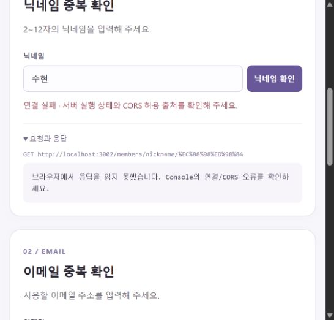
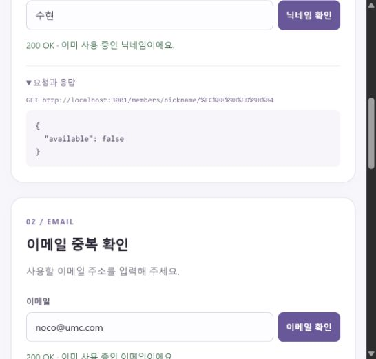
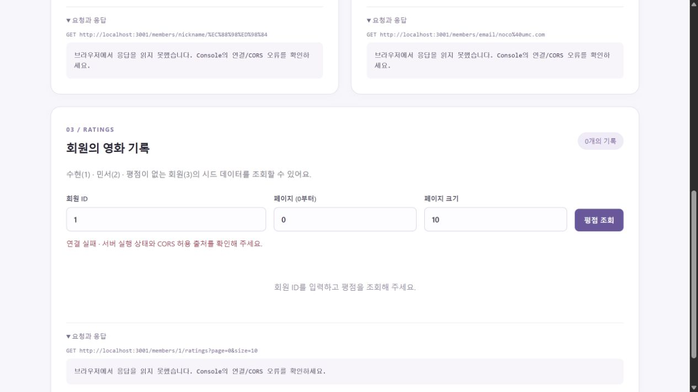
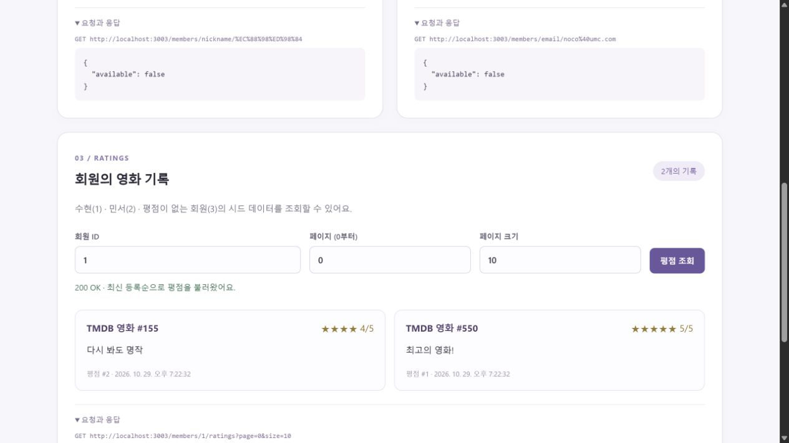

# CORS 허용 범위 비교

동일한 Nest 애플리케이션을 설정만 달리해 별도 포트에서 실행했다.
정상 서버의 기본 설정은 restricted이며 localhost:5173만 허용한다.
disabled/wildcard 서버는 비교 실습용이고 기본 서버를 변경하지 않는다.

| API 포트 | 설정 | 브라우저 출처 | 서버 HTTP | ACAO | 브라우저의 응답 읽기 |
| --- | --- | --- | --- | --- | --- |
| 3001 | restricted | http://localhost:5173 | 200 | http://localhost:5173 | 성공 |
| 3001 | restricted | http://localhost:5174 | 200 | 없음 | 실패 |
| 3002 | disabled | http://localhost:5173 | 200 | 없음 | 실패 |
| 3003 | wildcard | http://localhost:5174 | 200 | * | 성공 |

헤더 실측값: [cors-response-headers.json](evidence/cors-response-headers.json)

## 특정 출처와 전체 출처의 차이

`Access-Control-Allow-Origin: *`는 인증 정보를 포함하지 않는 교차 출처 요청의 응답을 어떤 출처의 브라우저 스크립트라도 읽을 수 있게 한다.
`http://localhost:5173`만 허용하면 동일한 API를 호출하더라도 5174 출처에서는 응답을 읽을 수 없다.
이 실습에서는 서버가 200과 평점 2개를 반환하는 경우에도 브라우저 화면은 CORS 설정에 따라 성공/실패로 달라졌다.
기본 정책은 실제로 사용하는 프론트 출처만 명시해 불필요한 교차 출처 읽기를 허용하지 않는 것이다.
CORS는 인증/인가가 아니므로 Postman, curl, 네이티브 앱의 직접 요청을 차단하는 접근 제어 수단으로 사용하면 안 된다.
쿠키 등 credentials를 허용할 때는 wildcard ACAO를 사용할 수 없으며 별도의 인증/CSRF 설계도 필요하다.
이 프로젝트의 조회 API에는 credentials를 사용하지 않는다. [MDN CORS](https://developer.mozilla.org/en-US/docs/Web/HTTP/Guides/CORS)

## 실제 화면

### CORS 미설정



브라우저의 fetch는 Failed to fetch로 실패했고, Node HTTP 확인에서는 서버가 200을 반환하지만 ACAO가 없음을 확인했다.
Console 수집 결과: [cors-before-console.json](evidence/cors-before-console.json)

### 허용된 출처에서 정상 응답



### 다른 출처 차단



### 전체 출처 허용



## 재현

기본 서버와 프론트:

```powershell
npm run start:prod
npm run frontend
```

비교용 서버와 다른 출처는 각각 별도 터미널에서 실행한다.

```powershell
npm run start:cors-off
npm run start:cors-wildcard
npm run frontend:other
```

localhost:5173/5174 화면의 API 연결 주소를 3001/3002/3003으로 바꾸고 '모두 확인'을 누른다.
브라우저 Console의 오류, 화면 표시, 실제 응답 헤더를 함께 비교한다.
브라우저의 보안 설정을 끄거나 no-cors 모드로 우회하지 않는다.

## 핵심 키워드

- SOP: 브라우저 스크립트의 다른 출처 데이터 접근을 제한하는 기본 정책.
- Origin: scheme + host + port. 포트만 달라도 다른 출처.
- Site: 등록 가능 도메인이 기준이며, 현대 SameSite 쿠키 판단은 scheme도 고려한다.
  서브도메인/포트가 다른 것만으로 다른 site가 되는 것은 아니다. [MDN Site](https://developer.mozilla.org/en-US/docs/Glossary/Site)
- SameSite: 쿠키의 cross-site 전송 조건을 제어하는 속성. CORS 허용 출처와 별개다.
- 복합 UNIQUE: 사용자와 영화 각각의 중복을 금지하는 대신 같은 사용자·같은 영화 조합의 중복만 막는다.
- API 비밀: Git 제외와 배포 앱의 비밀 보관은 다르다. 진짜 비밀 API Key는 클라이언트 번들에 포함하지 않는다.
