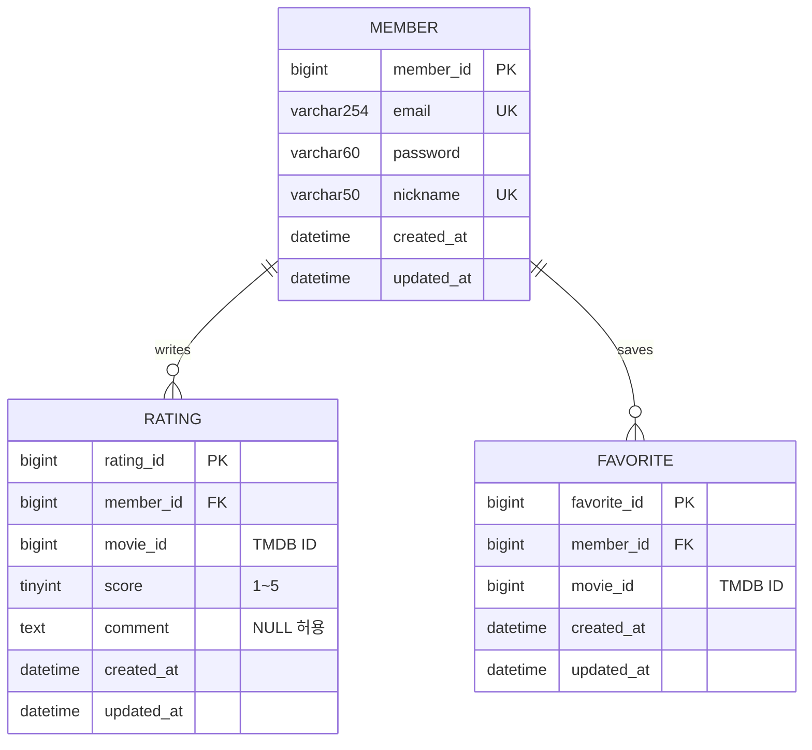

# MovieLog ERD

- Member : Rating = 1:N, Member : Favorite = 1:N.
- Member email/nickname 각각 UNIQUE.
- Rating/Favorite은 각각 (member_id, movie_id) 복합 UNIQUE.
- movie_id는 TMDB ID이며 로컬 영화 테이블이나 FK를 만들지 않는다.
- Favorite은 이번 주차에는 스키마만 작성한다. Entity/API는 8주차 범위다.
- Member/Rating의 시간 컬럼은 BaseTimeEntity에서 상속한다.
- password 시드는 실제 비밀번호가 아닌 더미 문자열이다.
