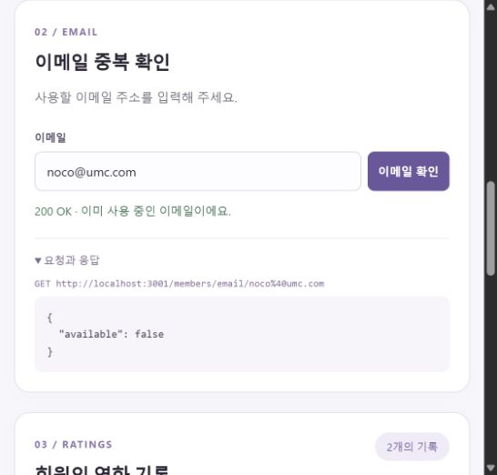
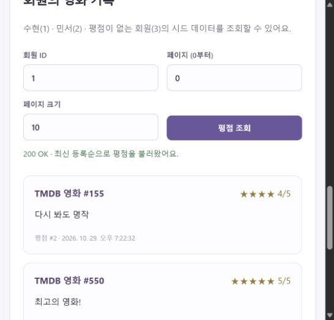
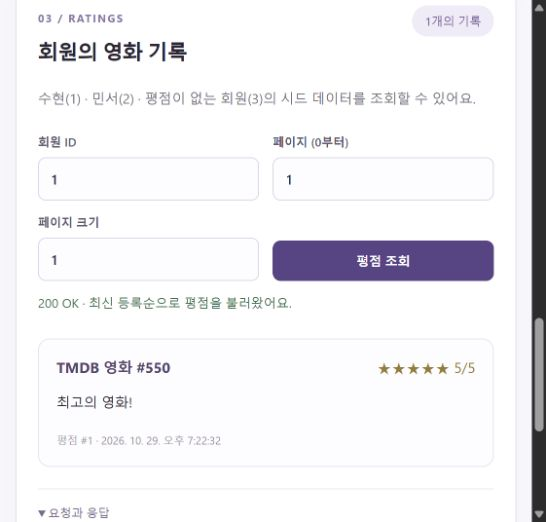

# 5주차 백엔드 미션 기록 · HoGiSim

작성일: 2026-10-29 (한국 시간)
브랜치: `week05_HoGiSim_be`
프로젝트: `HoGiSim/movie`

## 구현 내용

기존 도서 API를 고치지 않고 Nest CLI로 새 프로젝트를 생성했다.
회원/평점 데이터를 MySQL에 저장하고 다음 세 조회 API를 구현했다.

1. GET /members/nickname/{nickname}
2. GET /members/email/{email}
3. GET /members/{memberId}/ratings

선택 미션인 닉네임/이메일 유효성 검증, 평점 페이지네이션,
특정 출처와 전체 출처 CORS 비교도 구현했다.

## 중간 과정

1. 요구사항에서 Member, Rating, Favorite과 1:N 관계를 도출했다.
2. [API 명세](api-spec.md)에 Path/Query와 응답 필드·자료형·오류 상태를 먼저 정리했다.
3. [ERD](erd.md)를 작성하고 movieId는 TMDB 식별자이므로 로컬 영화 FK로 만들지 않았다.
4. Nest CLI로 movie를 새로 생성하고 controller/service/repository/entity/dto 레이어를 구성했다.
   Repository는 별도 클래스를 만들지 않고 TypeORM Repository<Entity>를 Service에 주입했다.
5. 별도 umc_movie DB에 member/rating/favorite 테이블과 회원 3명·평점 3건을 준비했다.
   비밀번호는 실제 값이 아닌 더미 문자열이며 .env는 Git에서 제외했다.
6. BaseTimeEntity를 상속해 생성·수정 시간을 공통화하고,
   Member password는 기본 조회에서 제외하도록 설정했다.
7. DB BIGINT를 엔티티에서는 문자열로 보관하고 DTO에서 안전한 숫자로 변환했다.
   응답에는 평점 6개 필드만 포함하며 회원 엔티티나 비밀번호는 반환하지 않는다.
8. 닉네임·이메일 형식 검증과 회원 존재 여부 검사를 추가했다.
9. 평점은 ratingId 내림차순이며 page/size 조건이 있을 때만 페이지네이션을 적용했다.
10. 웹 화면의 닉네임·이메일 폼과 회원 평점 조회를 모두 실제 API에 연결했다.
11. 브라우저에서 CORS 미설정 실패, 허용 출처 성공,
    다른 출처 차단과 wildcard 성공을 각각 검증하고 캡처했다.
12. 자동 테스트, 실제 MySQL 테스트, Postman Collection 실행 결과를 기록했다.

## 핵심 코드

- [Member](../src/entity/member.entity.ts), [Rating](../src/entity/rating.entity.ts), [BaseTimeEntity](../src/entity/base-time.entity.ts)
- [요청 검증 DTO](../src/dto/member-params.dto.ts), [평점 응답 DTO](../src/dto/rating-response.dto.ts)
- [MemberController](../src/controller/member.controller.ts), [RatingController](../src/controller/rating.controller.ts)
- [MemberService](../src/service/member.service.ts), [RatingService](../src/service/rating.service.ts)
- [CORS 및 ValidationPipe](../src/setup-app.ts), [AppModule 등록](../src/app.module.ts)
- [테이블 SQL](../sql/schema.sql), [시드 SQL](../sql/seed.sql)

## 실행 화면

### 닉네임과 이메일

중복은 available=false, 신규 값은 true이며 둘 다 200이다.
실제 웹 화면에서 API 응답 JSON을 확인했다.

### 회원 평점

수현(1)은 movieId 155, 550 순으로 두 평점을 응답했다.
민서(2)는 한 건, 평점이 없는 회원(3)은 빈 배열이었다.
없는 회원은 404, 잘못된 ID는 400으로 응답했다.

### 페이지네이션

size=1일 때 page=0은 ratingId 2, page=1은 ratingId 1을 반환했다.

### CORS 설정 전후

동일한 웹 화면에서 CORS 미설정 API의 응답은 읽지 못했고,
허용 출처를 설정한 API의 응답은 정상 표시됐다.
동일 애플리케이션을 포트 3001/3002/3003에서 설정만 달리해 비교했다.
브라우저 오류 로그는 Failed to fetch였고,
HTTP 확인에서는 서버의 200 응답과 ACAO 부재를 확인했다.

[다른 출처 차단/wildcard 비교와 설명](cors-comparison.md)

## 검증 결과

| 검증 | 결과 |
| --- | --- |
| npm run build | 성공 |
| npm run lint | 통과 |
| HTTP/DTO/CORS 테스트 | 33개 통과 (Repository 대역) |
| 실제 MySQL 검증 | 16개 통과 |
| Postman Collection(Newman) | 14개 요청·19개 검증 통과 |
| 실제 브라우저 | 세 API, 페이지 이동, CORS 정책 차이 확인 |

- [MySQL 요청·응답](evidence/mysql-api-results.json)
- [Postman Collection 실행 결과](evidence/postman-results.json)
- [CORS 응답 헤더](evidence/cors-response-headers.json)
- [미설정 Console](evidence/cors-before-console.json)
- [불허 출처 Console](evidence/cors-origin-blocked-console.json)

## 학습 내용

API 명세에서 자료형과 상태 코드를 먼저 정하면 화면과 서버의 데이터 계약이 명확해진다.
DTO는 Entity와 API 형식을 분리하고, 비밀번호 같은 내부 데이터를 노출하지 않게 한다.
회원별 평점과 즐겨찾기는 사용자·영화 조합에 UNIQUE를 적용해 같은 사용자의 중복 등록을 막는다.
TMDB 영화 ID는 외부 시스템의 식별자이므로 우리 DB 안에 영화 테이블을 만들 필요가 없다.
CORS는 브라우저의 응답 읽기 허용 정책이며, 네이티브 앱이나 Postman 요청을 막는 인증 수단이 아니다.
Same-Origin은 scheme/host/port를 모두 비교하지만, Same-Site는 등록 가능 도메인과 scheme을 기준으로 판단하는 문맥이 있다.
[MDN CORS](https://developer.mozilla.org/en-US/docs/Web/HTTP/Guides/CORS),
[MDN Site](https://developer.mozilla.org/en-US/docs/Glossary/Site)

## 오류와 해결 과정

### 1. 회원 ID의 원문이 검증 전에 숫자로 변환됨

- 이슈: 1e0, 0x1, 001 요청이 400 대신 회원 1 조회로 처리됐다.
- 문제: 전역 ValidationPipe가 number 타입의 Path 파라미터를 먼저 변환했다.
- 해결: Controller에서는 원문 string을 받아 전용 Pipe에서 양의 정수 형식과 안전 정수 범위를 검증한 뒤 숫자로 변환했다.
- 재검증: 해당 요청은 모두 400이며 HTTP 테스트 33개가 통과했다.

### 2. 브라우저 fetch 실패

- 이슈: 화면에서 Failed to fetch가 발생했지만 HTTP 확인에서는 200이었다.
- 문제: CORS 미설정/불허 Origin에서 ACAO 응답 헤더가 없어 브라우저가 응답 읽기를 차단했다.
- 해결: 기본 서버에 localhost:5173만 허용하는 CORS 정책을 적용했다.
- 재검증: 5173은 성공, 5174는 차단됐고 wildcard 비교 서버에서는 5174도 성공했다.

## 선택 미션 설명

특정 출처만 허용하면 그 출처의 브라우저 화면만 교차 출처 응답을 읽을 수 있다.
모든 출처(*)를 허용하면 인증 정보를 포함하지 않는 요청의 응답을 어느 출처에서도 읽을 수 있다.
따라서 실제 프론트 출처가 정해져 있다면 필요한 출처만 명시하는 정책을 사용한다.
CORS는 서버 접근 자체를 막는 기능이 아니므로 로그인/인가와 별도로 이해해야 한다.

## 제출 전 남은 항목

- [ ] Postman 앱에서 Collection을 Import하고 URL+JSON이 보이는 화면 캡처.
- [ ] GitHub에 이 프로젝트를 커밋·Push하고 PR 링크 기록.
- [ ] 개인 Notion에 과정·캡처·PR 링크 첨부.
- [ ] 실제 개인 학습 후기·스터디 인증샷 추가 후 UMC 제출.

Postman Collection 실행 결과는 Newman으로 검증한 것이며 앱 UI 캡처는 아직 첨부하지 않았다.
Flutter 앱의 회원 폼과 평점 화면에는 이번 API를 추가 연결하지 않았으며,
이번 주차의 필수 실제 화면 연결은 별도로 만든 frontend 웹 화면에서 모두 검증했다.

## PR 설명 초안

### 구현 내용

NestJS 새 프로젝트에 회원·평점 엔티티와 DTO를 구성하고 조회 API 3개를 구현했다.
입력 검증·페이지네이션·CORS 허용 출처 설정을 추가했다.

### 실행 화면

닉네임·이메일 중복 확인, 회원별 평점 조회, CORS 실패/성공 캡처는 README와 본 문서 참고.

### 학습 내용

API 명세와 DTO 계약, 외부 movieId 연결, 브라우저 CORS 정책을 학습했다.

### 오류와 해결 과정

Path ID가 전역 Pipe에서 미리 숫자로 변환되던 문제를 원문 검증으로 해결했다.
브라우저 응답 읽기 실패는 CORS 헤더 설정과 허용 출처 비교로 확인했다.

## Notion에 붙여넣을 짧은 기록

구현: 새 NestJS 프로젝트에서 닉네임/이메일 중복 확인과 회원별 평점 조회 구현.
선택: 형식 검증, page/size 페이지네이션, CORS 출처 범위 비교.
검증: HTTP 33개·MySQL 16개·Postman Collection 14요청/19검증 통과.
화면: 별도 웹 화면에서 API 3개와 CORS 실패/성공 확인.
트러블슈팅: ID 자동 형변환을 원문 검증으로 수정, CORS 응답 읽기 차단 해결.
미완료: Postman 앱 캡처, PR 링크, 개인 후기·인증샷·Notion 제출.
