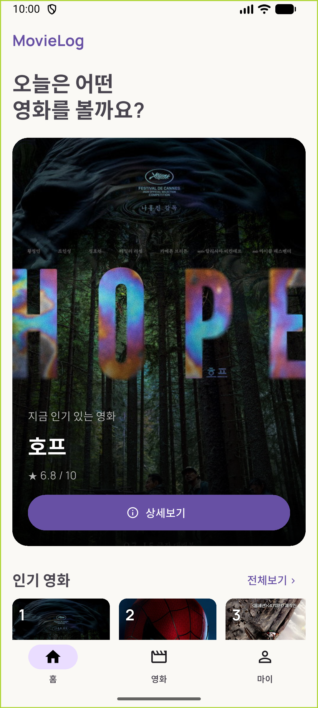
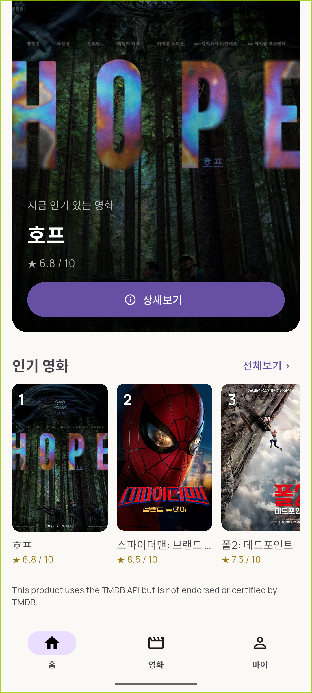
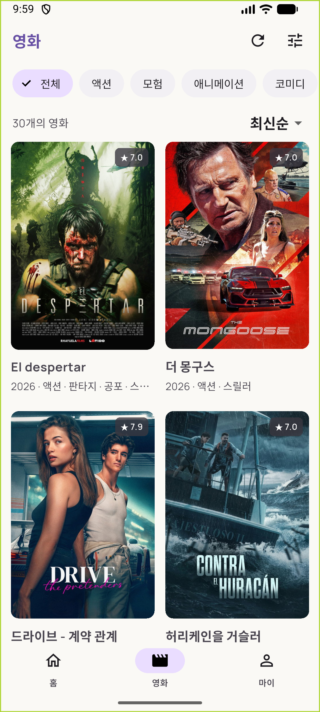
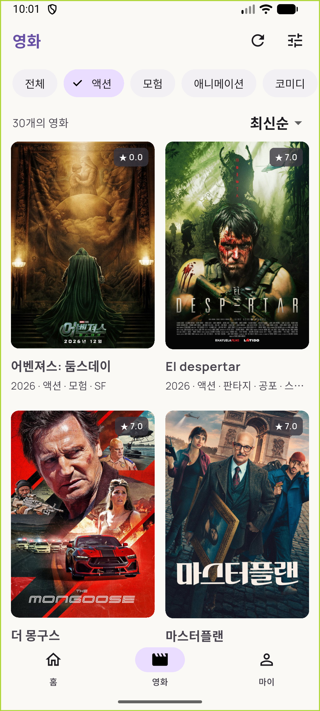
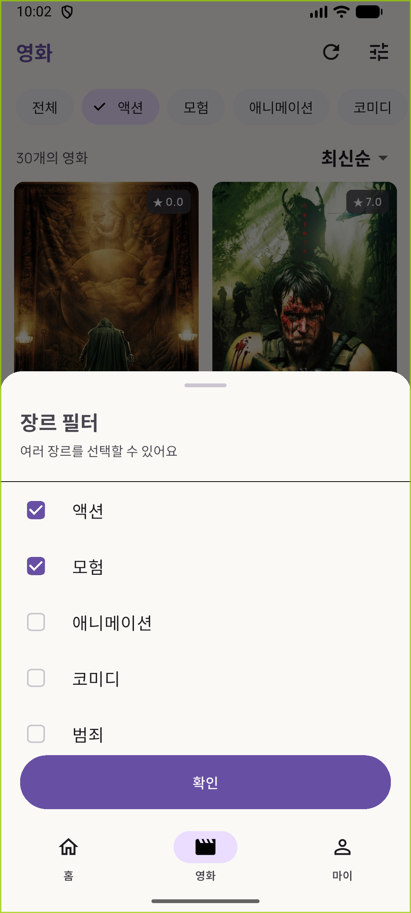
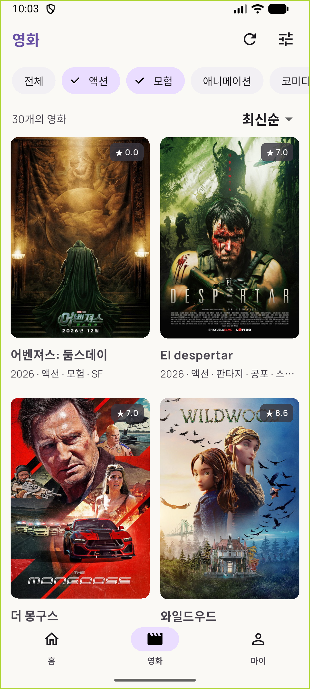
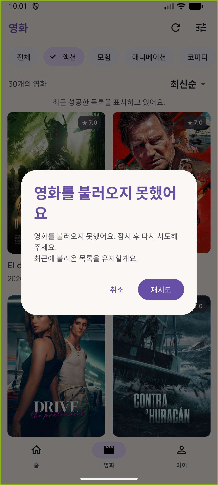
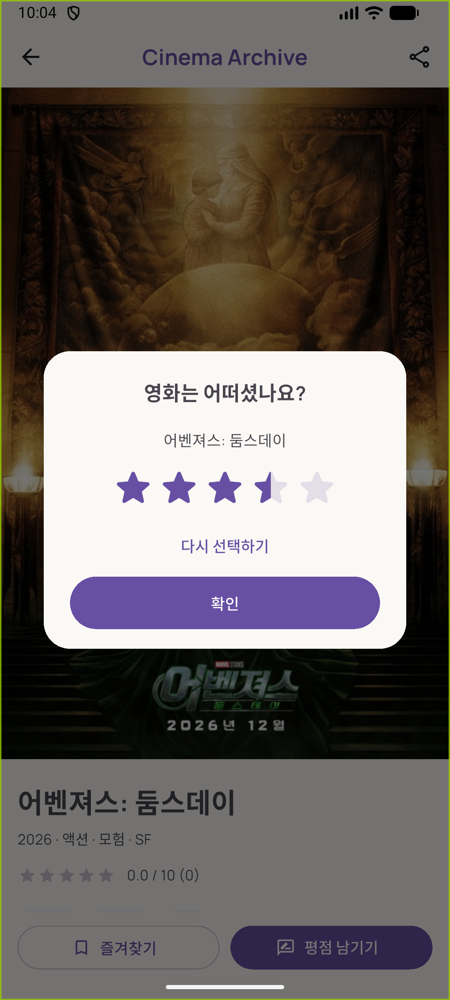

# MovieLog · HoGiSim 5주차

NestJS 도서 API를 작업한 4주차 백엔드와 별도로, 이번 주차는 Flutter MovieLog에 TMDB 영화 데이터를 연결합니다.

## 실행

```powershell
flutter pub get
flutter emulators --launch Medium_Phone
flutter devices
flutter run -d emulator-5554
```

실행 화면은 Android 17(API 37)의 `Medium_Phone` 에뮬레이터에서 촬영했습니다.
캡처 원본은 1080×2400 세로 화면이며, 아래 이미지는 표시 너비만 줄였습니다.
에뮬레이터 ID는 `flutter devices` 결과에 맞게 바꿉니다.
웹으로 확인하려면 `flutter run -d chrome`을 사용합니다.

프로젝트 루트의 `.env`에 본인의 TMDB **API Read Access Token**을 입력합니다.

```dotenv
TMDB_ACCESS_TOKEN=본인의_Read_Access_Token
```

다른 PC에서는 `.env.example`을 `.env`로 복사합니다.
`.env`는 Git에서 제외됩니다. 토큰을 바꾸면 Hot Reload 대신 앱을 재시작합니다.
Flutter asset으로 포함된 설정은 배포 앱의 비밀 저장소가 아니며,
워크북의 학습용 구성입니다. 로그/캡처에 토큰 원문을 포함하지 않습니다.

## 구현

- Popular 첫 페이지에서 앞의 최대 5개를 홈에 표시
- Genre API의 실제 id/name으로 Chip과 장르 다중 선택 BottomSheet 구성
- Discover를 1페이지부터 요청해 TMDB id 중복을 제거하고 최대 30개 구성
- 장르 선택 시 `with_genres`로 서버 재조회, 전체 선택은 파라미터 생략
- 다중 장르는 `12|28`처럼 OR로 전달
- Loading / Empty / Error / Success 및 재시도
- 요청 중 장르 변경·추가 새로고침 차단
- Pull to Refresh 시 현재 장르와 기존 목록 유지
- 실패하면 최근 성공 목록 유지, 재시도/취소 Dialog
- null·빈 포스터와 이미지 로드 실패 placeholder
- 실제 TMDB 영화 id를 상세 페이지·평점 Dialog·평점 선택 결과에 전달
- TMDB 10점 평점을 별 5개 표시에 맞춰 변환
- 디버그에서만 요청·응답·오류 로그 기록, Authorization 마스킹
- 토큰 누락·인증 오류의 사용자 안내

평점과 즐겨찾기의 자체 백엔드 저장은 이번 TMDB 연동 범위에 포함하지 않습니다.
평점 선택 결과는 `MovieRatingResult(movieId, score)`로 전달하며 현재 화면에서만 유지됩니다.

## 실행 화면

| 홈 | 인기 영화 |
| --- | --- |
|  |  |

| 전체 목록 30개 | 액션 장르 필터 |
| --- | --- |
|  |  |

| 장르 다중 선택 | 다중 선택 결과 |
| --- | --- |
|  |  |

| 요청 실패 시 재시도 | 평점 Dialog |
| --- | --- |
|  |  |

## 구조

| 위치 | 책임 |
| --- | --- |
| lib/core/config | .env 설정 읽기 |
| lib/core/network | TMDB 전용 Dio와 안전한 로그 |
| lib/data/models | 영화·페이지·장르 DTO 및 JSON 변환 |
| lib/data/services | HTTP 요청 및 DTO 반환 |
| lib/view_models | 화면별 로딩·장르·페이지 수집 정책 |
| lib/screens | ViewModel 구독, 사용자 입력 전달 |
| lib/widgets | 영화 카드, 포스터, 상태 UI, 평점 Dialog |

Service 한 인스턴스를 앱 최상단 Provider에서 공유하고,
홈·목록·상세의 ChangeNotifierProvider는 각 Route에서 생성합니다.
View는 API를 직접 호출하거나 JSON을 해석하지 않습니다.
기존 4주차 코드 일부는 `docs/week04-before-tmdb/`에 보관했습니다.

## 검증

```powershell
flutter analyze
flutter test
# 실제 TMDB 사용: .env에 유효한 토큰 필요
flutter test test/tmdb_live_test.dart --dart-define=TMDB_LIVE=true --reporter expanded
flutter build web --release
```

일반 테스트는 네트워크 대역을 사용합니다.
실제 TMDB 테스트는 명시적인 TMDB_LIVE 플래그를 주어야 실행됩니다.
공개 API의 요청 조건·결과 개수·401 재현 결과만 증거 파일로 저장하며 토큰은 저장하지 않습니다.

- 진행 기록과 제출 안내: `docs/week05-mission.md`
- 실제 API 검증: `docs/evidence/tmdb-live.json`
- 실제 브라우저 요청 기록: `docs/evidence/browser-network-requests.json`
- Android 요청·오류 기록: `docs/evidence/android-network-requests.txt`
- 모바일 원본 캡처: `docs/evidence/android-*.png`

장르 변경 전후의 요청과 화면 변화 영상,
기기 네트워크를 껐다 켜는 재시도 확인 영상은 별도로 녹화합니다.
Authorization 원문이 보이는 Header 화면은 녹화하지 않습니다.
