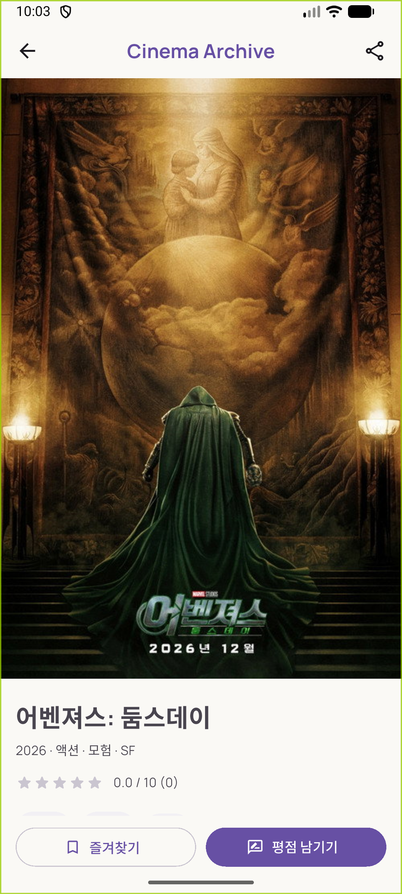

# 5주차 미션 기록 · HoGiSim

작성일: 2026-10-29 (한국 시간)
작업 브랜치: `week05_HoGiSim_fe`

## 목표

4주차 Mock/FutureBuilder 기반 영화 화면을
TMDB API + Dio + Provider/ChangeNotifier 기반 MVVM 구조로 전환한다.
Guided Practice와 Required Mission, Challenge Mission의 기능을 구현한다.

## 구현 과정

1. 워크북 요구사항과 기존 홈·영화 목록·상세·평점 Dialog를 확인했다.
   기존 목록에는 실패 화면 확인을 위한 FakeMovieService 설정이 있었다.
2. 기존 화면의 동작을 보존하기 위해 수정 전 파일을
   `docs/week04-before-tmdb/`에 텍스트로 보관했다.
3. Dio, Provider, flutter_dotenv 의존성을 추가했다.
   `.env` asset 로드가 완료된 뒤 앱을 실행하도록 바꾸고
   실제 토큰 파일을 Git에서 제외했다.
4. 영화/페이지/장르 DTO에 snake_case → camelCase 매핑,
   nullable 문자열, num → int/double 변환을 구현했다.
5. TMDB 전용 Dio Client와 Service를 만들었다.
   자체 API의 인증 설정과 섞지 않도록 TMDB 통신을 별도 경로로 분리했다.
6. 홈·목록·상세별 ViewModel을 만들고 각 Route에서 생성한다.
   Service는 앱 최상단 Provider에서 공유한다.
7. 홈은 Popular results.take(5)를 표시하고,
   목록은 페이지를 순차 조회하며 id 기준 중복을 제거해 최대 30개를 만든다.
8. 장르 이름과 ID는 Genre API 응답을 사용한다.
   단일 Chip/다중 BottomSheet 선택 모두 Discover 재요청으로 연결했다.
   전체는 with_genres를 생략하고 다중 선택은 OR(|)로 전달한다.
9. 로딩 중에는 장르 변경과 중복 새로고침을 막는다.
   dispose 시 CancelToken으로 요청을 취소하고,
   request version으로 오래된 결과의 상태 갱신을 방지한다.
10. 새로고침 중에는 기존 목록을 유지한다.
    실패 시 최근 성공 목록과 재시도/취소 Dialog를 표시하고
    재시도는 같은 장르 조건으로 1페이지부터 시작한다.
11. TmdbPosterImage에서 null·빈 경로·이미지 오류를 placeholder로 처리한다.
    목록 카드의 실제 TMDB id를 상세와 평점 Dialog로 전달한다.
12. 토큰 발급 후 실제 TMDB와 브라우저에서 응답 및 화면을 검증했다.
13. Android 17(API 37) Medium_Phone 에뮬레이터에 앱을 설치하고
    1080×2400 세로 화면으로 실행 화면을 다시 캡처했다.

## 구현 체크

- [x] TMDB Client와 데이터 계층 분리
- [x] .env 로드와 Git 제외
- [x] Popular 최대 5개
- [x] Discover 중복 없는 최대 30개
- [x] Genre API 기반 Chip과 with_genres 재요청
- [x] Loading / Empty / Error / Success 및 재시도
- [x] 포스터 null·로드 오류 처리
- [x] 요청 중 장르 변경 차단
- [x] TMDB id를 상세·평점 Dialog로 전달
- [x] 다중 장르 OR 필터
- [x] Pull to Refresh와 현재 장르 유지
- [x] 실패 시 기존 목록 유지·재시도 Dialog
- [x] 디버그 로그의 인증 정보 마스킹

## 검증 결과

자동 테스트와 실제 API/브라우저 검증을 구분했다.

### 자동 테스트

- `flutter analyze`: No issues found.
- `flutter build web --release`: 빌드 성공.
- Git 추적/공유 대상 파일에서 실제 토큰 원문 미검출, .env Git 제외 확인.
- `flutter test`: 네트워크 대역 기반 22개 테스트 통과.
- DTO의 null/num 매핑, Popular 5개 미만, 페이지 중복·종료 조건을 확인했다.
- 다중 장르 OR 및 전체 파라미터 생략을 확인했다.
- 로딩 중 변경 차단, 새로고침 중 기존 목록 유지,
  실패 후 같은 장르로 재시도, dispose 후 늦은 응답 무시를 확인했다.
- 시작/회원가입/로그인 이동 기능을 유지했다.
- fixture의 TMDB id=550이 상세와 평점 Dialog까지 전달됨을 확인했다.
- null/빈 포스터 placeholder, Empty/Error 화면, 실패 Dialog 취소를 확인했다.
- 일반 테스트에서는 실제 TMDB 테스트를 건너뛰도록 분리했다.

### 실제 TMDB

`docs/evidence/tmdb-live.json`에 토큰을 제외한 결과를 기록했다.

- Popular: 200, ViewModel 인기 영화 5개.
- Genre: 200, 실제 장르 목록 확인.
- Discover 전체: 200, 1·2페이지를 사용해 중복 없는 30개.
- Discover 액션(28): 200, 장르 필터 결과 30개.
- 의도적으로 잘못된 토큰을 넣은 별도 Client: 401.
- 오류 로그에는 요청 URL·오류 종류·상태가 남으며 토큰 원문이 없다.
- 사용자 .env의 실제 토큰은 401 재현 과정에서 변경하지 않았다.

### 실제 브라우저

- 홈에서 실제 인기 영화 제목과 포스터가 표시됨을 확인.
- 탐색 목록의 실제 개수 표기가 30개임을 확인.
- 액션 Chip 선택으로 Discover를 page=1부터 재요청.
- 장르 BottomSheet에서 액션+모험 선택 후
  `with_genres=12|28` 요청 확인.
  URL에서는 | 문자가 %7C로 인코딩된다.
- 선택한 실제 영화의 상세 화면과 평점 Dialog가 열림을 확인.

브라우저 요청 기록: `docs/evidence/browser-network-requests.json`

### Android 에뮬레이터

- Android debug APK 빌드·설치·실행 성공.
- 홈, 인기 영화, Discover 30개, 액션 필터, 다중 장르 선택과 결과 확인.
- 실제 영화의 상세 화면과 평점 Dialog 확인.
- 장르 요청에서 connectionError가 발생한 상황을 확인.
  최근 성공 목록과 실패 Dialog가 유지되었고,
  같은 장르 조건으로 재시도한 뒤 30개 목록으로 복구됨을 확인.
- 이 연결 오류의 원인은 확정하지 않았다.
  기기 네트워크를 직접 끄고 켠 시나리오와는 구분한다.
- 원본 캡처는 1080×2400 PNG로 저장했고 문서에서는 표시 너비만 줄였다.

Android 요청·오류 기록: `docs/evidence/android-network-requests.txt`

## 실행 화면

아래 이미지는 모두 Android 에뮬레이터의 세로 화면 원본이다.

### 홈과 인기 영화

### Discover 30개

### 액션 장르

### 다중 장르 선택과 결과

### 상세 화면과 평점 Dialog

### 요청 실패와 기존 목록 유지

## 학습 내용

View는 상태를 표시하고 입력을 전달하며, ViewModel은 화면별 개수 제한과 장르·로딩 상태를 관리한다.
Service는 HTTP 요청과 DTO 변환만 담당하므로 여러 화면에서 같은 인스턴스를 공유할 수 있다.
API의 total_pages와 빈 results를 종료 조건으로 사용하고 id를 Map의 key로 삼아 페이지 중복을 제거했다.
평점 movieId에는 배열 순서가 아닌 TMDB의 고유 id를 전달해야 한다.
ChangeNotifierProvider는 ViewModel 수명을 관리하고 Consumer는 구독한 영역을 다시 그린다.
.env의 Git 제외는 저장소 노출을 막는 구성이며 Flutter asset의 값을 완전한 비밀로 만드는 것은 아니다.

## 오류와 해결 과정

### 1. 로그 URI의 숫자 query 변환

상황: page 같은 숫자 query를 Uri.replace에 전달하던 로그 코드에서 자료형 오류가 발생했다.
원인: Uri의 queryParameters 값은 문자열 또는 문자열 Iterable이어야 한다.
수정: 로그용 query를 문자열로 변환하고 인증 관련 query key는 마스킹했다.
재검증: 요청 조건과 로그 테스트, 실제 page 1·2 요청이 통과했다.

### 2. 상세 화면 줄거리 확인

상황: 위젯 테스트에서 줄거리 없음 안내 문구를 처음에 찾지 못했다.
원인: 포스터 아래의 내용이 스크롤 밖에 있어 아직 만들어지지 않았다.
수정: 상세 목록을 스크롤한 뒤 안내 문구를 확인했다.
재검증: 상세 이동 및 TMDB id 전달 테스트가 통과했다.

### 3. 이전 주차 장르 저장값

상황: 기존 로컬 설정은 장르 이름 문자열을 저장하고 있었다.
원인: TMDB API는 장르 이름이 아니라 숫자 ID를 사용한다.
수정: 새 저장값은 ID 문자열로 관리하고,
       복원 시 숫자로 해석할 수 없거나 현재 Genre API에 없는 값은 무시했다.
재검증: 이전 이름·알 수 없는 ID를 제외하고 유효한 ID만 필터에 반영했다.

### 4. 에뮬레이터에서 장르 요청 연결 실패

상황: 액션 또는 다중 장르 선택 시 Discover 요청이 connectionError로 실패했다.
실제 로그: `type=connectionError, status=연결 실패`.
원인: 로그만으로 연결 실패의 세부 원인을 확정하지 못했다.
확인: 기존 목록 유지와 실패 Dialog가 동작했다.
재검증: Dialog의 재시도로 같은 with_genres 조건을 1페이지부터 다시 요청해
        30개 목록으로 복구되는 것을 확인했다.

## 남은 수동 확인 및 제출

- [ ] 장르 선택 전/후 화면과 Network query 변화 영상 촬영.
- [ ] 네트워크를 끈 뒤 새로고침 → 실패 Dialog → 네트워크 복구 → 재시도 영상.
- [x] Success 목록 및 기존 목록을 유지하는 요청 실패 Dialog 캡처.
- [ ] Loading/Empty/최초 Error 화면과 포스터 로드 실패 증거 캡처.
      상태 분기는 자동 테스트했지만 모든 상태의 실제 기기 캡처를 완료한 것은 아니다.
- [ ] release 모드에서 로그가 나오지 않는지 실제 기기/브라우저 콘솔로 확인.
      코드에서는 kDebugMode와 Interceptor 등록 조건으로 차단한다.
- [ ] PR 링크, 스터디 인증샷, 개인 학습 후기 추가.
- [ ] 개인 Notion 페이지에 기록/캡처/영상을 첨부하고 UMC에 제출.

## PR 설명 초안

### 구현 내용

- TMDB Popular·Discover·Genre API와 Dio 연결
- Provider/ChangeNotifier 기반 MVVM 및 영화 DTO 구현
- 인기 5개, 중복 없는 탐색 최대 30개, 장르 단일/다중 필터 구현
- 새로고침과 실패 재시도, 포스터 placeholder, 실제 movieId 전달

### 실행 화면

Android 에뮬레이터의 홈·탐색 30개·장르 필터·상세·평점·실패 Dialog 캡처 첨부.
장르 변경 및 네트워크 실패 재시도 영상은 별도 첨부 예정.

### 학습 내용

UI와 데이터 계층 분리, 페이지네이션 중복 제거,
Provider 상태 구독 및 TMDB id 전달 방식을 학습했다.

### 오류와 해결 과정

로그 query 값의 자료형 오류를 문자열 변환으로 해결했고,
이전 주차 장르 이름 저장값을 TMDB 숫자 ID 기반으로 전환했다.

## 참고

- [TMDB Popular](https://developer.themoviedb.org/reference/movie-popular-list)
- [TMDB Discover](https://developer.themoviedb.org/reference/discover-movie)
- [TMDB Genres](https://developer.themoviedb.org/reference/genre-movie-list)
- [TMDB Images](https://developer.themoviedb.org/docs/image-basics)
- [TMDB Authentication](https://developer.themoviedb.org/docs/authentication-application)
